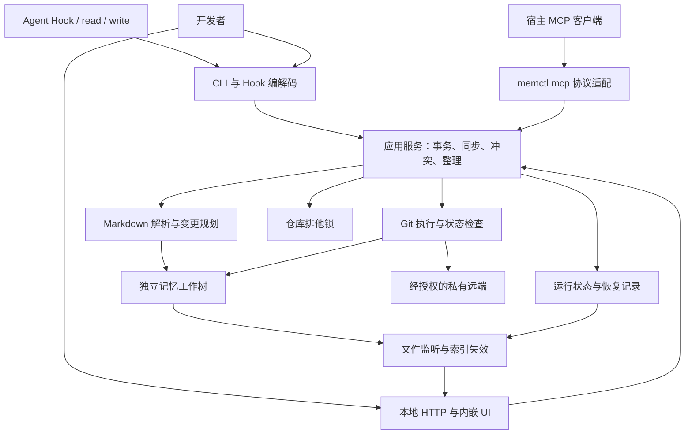

# 01. 架构与模块

## 1. 系统如何工作

`memctl` 以独立 Git 工作树保存记忆，用短生命周期 CLI 处理 Hook、读取、受管写入和同步；`memctl ui` 才启动 HTTP 服务、文件监听和完整图谱索引。宿主沙箱之外的 Agent 还可通过宿主派生的 `memctl mcp` 调用 `memory_read` 与 `memory_write`。UI、CLI 与 MCP 通道调用同一应用服务，不相互依赖进程常驻。

一次受管写入包含版本校验、文件变更和本地 Git 提交。远端同步独立进行，失败不会撤销已经成功的本地提交。Dreaming 生成可审阅提案，只有显式确认后才进入同一写入事务。



## 2. 写入模型

### 2.1 受管写入

受管写入指 CLI `write`、MCP `memory_write`、UI 编辑、重命名、诊断修复、整理应用等通过同一事务入口修改记忆。读取返回文件修订标识；提交时携带读取基线，服务在仓库锁内重新校验。旧基线被拒绝，调用方重新读取并合并后再提交。

锁协调遵守同一协议的 `memctl` 进程，不能拦截编辑器、Agent 文件工具或手动 Git 命令。只有全部并发写入都通过受管入口时，才提供「拒绝覆盖其他已提交更新」的保证。`fsnotify` 是变更通知，不是互斥或事务机制。

应用服务独占获取锁的职责；解析器、Git 引擎和文件写入器不递归获取同一锁。锁内完成状态检查、版本校验、变更规划复核和提交；网络同步也使用该仓库锁，但前台 Hook 不排队等待它。

### 2.2 外部直接编辑

直接编辑文件属于串行维护场景：先停止其他写入者及自动同步，修改后检查差异，再执行 `memctl sync --capture`。该命令仅接收当前仓库的变化，不替用户判断每行是否值得保存。

发现未登记的 staged、unstaged 或 untracked 变化时，普通写入、自动同步和 Dreaming 应用返回 `EXTERNAL_CHANGES`，不自动 `git add -A`、stash 或覆盖文件。正在进行的外部写入无法被可靠检测，因此检测干净工作树并不扩展为对任意外部并发进程的保证。

人工 Git 维护也遵循暂停自动操作的前提；恢复运行时重新读取 Git 状态，不能仅删除状态文件以解除保护。

### 2.3 写入不变量

| 对象 | 不变量 | 不满足时 |
| --- | --- | --- |
| 受管写入 | 所有受影响文件在同一仓库事务内重新校验基线 | 拒绝整个请求，不部分接受 |
| Git 操作 | 没有未合并索引、未知中间态或待恢复事务 | 只允许诊断与对应恢复入口 |
| 暂存范围 | 普通事务只暂存自身变更清单，使用字面路径语义 | 拒绝夹带无关 staged 内容 |
| 多文件变更 | 全部前置条件通过后才开始落盘；中断可识别并恢复 | 标为 `recovery_required`，暂停新写入 |
| 文件内容 | 局部编辑保留未触及文本、开放元数据、换行和文件模式 | 无法无损定位时转为原文编辑或拒绝 |
| 远端失败 | 本地提交保留，远端状态单独报告 | 返回 `pending` 或具体失败原因 |

原子替换单个文件不等于多文件事务。事务持久化与恢复步骤见 [流程文档](./03-workflows-and-dataflows.md)。

## 3. 仓库、路径与信任边界

### 3.1 仓库身份

默认仓库为 `~/memory`，可通过配置选择其他独立仓库；一个进程只绑定一个仓库。入口验证 `git rev-parse --show-toplevel` 的规范化路径等于配置根目录，且存在根 `MEMORY.md`。误指向项目子目录、非空普通目录或当前项目时拒绝初始化。

首版受管仓库使用普通非 bare 工作树；外部 linked worktree、submodule 和嵌套仓库仅诊断，不作为自动写入目标。内部 Dreaming 工作目录不是受管记忆仓库。

`repoId` 是规范化绝对根路径的 SHA-256，用于本机状态分区，不是跨设备身份。路径移动后重新建立本机状态，不自动沿用原会话缓存。仓库互斥锁固定在该仓库实际 Git 目录下的 `memctl.lock`，不受 `AGENT_MEMORY_STATE` 覆盖影响；同一仓库选择不同状态目录不能绕过互斥。

可重建的会话、索引和同步摘要保存在 `$STATE/repos/<repoId>/cache/`；待审阅提案保存在同级 `proposals/`，不作为缓存自动清除。待恢复事务、冲突阶段快照、Git 操作所有权和远端授权记录保存在实际 Git 目录的 `memctl/`，不能因切换状态目录而绕过或丢失。运行目录仅当前用户可读写；Windows 使用等效 ACL。

### 3.2 文件边界

以下规则由统一的仓库文件访问器执行，适用于扫描、读取、写入、移动、冲突结果与提案应用：

- 接收根相对路径，内部使用 `/`；拒绝绝对路径、空路径、`.`、`..`、NUL、反斜杠、Windows 盘符、UNC、设备名和替代数据流路径。
- HTTP 解码只进行一次；不能在检查后再次解码。针对大小写不敏感文件系统、尾随点或空格等别名重新核验实际目标。
- `.git` 及其大小写等价路径、嵌套仓库、submodule 不属于可编辑记忆。Git 内部文件只允许 Git 引擎和恢复存储按固定用途操作。
- 不沿符号链接或 Windows reparse point 读取、遍历或写入；普通文件写入拒绝多硬链接目标，避免修改别名内容。图谱可以标记不支持资产，不将其内容跟随到库外。
- 使用根句柄相对访问或等效防跟随实现；仅做字符串前缀比较、`EvalSymlinks` 后再普通打开，不能作为防路径替换的保证。Go/平台实现未通过路径竞争测试时不开放写入功能。
- 新文件检查已存在的全部父目录；文件移动拒绝覆盖已有目标。大小写重命名需使用事务内中间路径并验证链接更新。
- 读取原文只支持有界 UTF-8 文本；二进制资产可列出元信息并参与 Git 同步，不进入文本编辑器。资源限额见 [接口契约](./02-domain-models-and-contracts.md)。

这不构成对同一用户恶意本机进程的隔离。浏览器访问控制另见 [HTTP 安全](./04-ui-and-cli-specification.md#5-http-安全)。

### 3.3 记忆与执行权限

记忆、Git Diff、元数据和远端内容均为不可信数据，不因来自记忆库就执行其中指令或脚本。诊断模式只报告可疑特征，不能保证不存在提示词注入或敏感信息。

Git 引擎沿用用户已有签名和 hooks 策略，不默认设置 `commit.gpgsign=false` 或关闭 hooks。自动命令使用非交互输入和总 deadline；签名、凭据或 hook 阻塞时返回可诊断错误，不私自改全局配置。已有 Git 配置、过滤器及 hooks 属于用户已信任的执行环境，`memctl` 不把调用 Git 宣称为沙箱。

### 3.4 凭据与信任边界

`memctl` 不存储、不复制、不生成凭据，也不把凭据写入记忆仓库、运行状态、恢复记录、提案、日志或 remote URL。远端同步复用用户已有的 Git 与 SSH 凭据来源：SSH agent（`SSH_AUTH_SOCK`）、`~/.ssh` 中的密钥与 `known_hosts`、Git credential helper、系统密钥链，以及用户配置的 `GIT_ASKPASS` 与 `SSH_ASKPASS`。这些配置、helper 及其脚本属于用户已信任的执行环境；`memctl` 不改写它们，也不把调用 Git 宣称为凭据沙箱。

每次调用 Git 都剔除仓库重定向变量（`GIT_DIR`、`GIT_WORK_TREE`、`GIT_INDEX_FILE`、`GIT_OBJECT_DIRECTORY`、`GIT_ALTERNATE_OBJECT_DIRECTORIES`、`GIT_COMMON_DIR`、`GIT_NAMESPACE`、`GIT_PREFIX`、`GIT_CEILING_DIRECTORIES`），显式绑定目标仓库。凭据与网络环境另按固定白名单传递，白名单内保留 `HOME`、`PATH`、`TMPDIR`、代理变量，凭据相关变量（`SSH_AUTH_SOCK`、`SSH_AGENT_PID`、`GIT_SSH`、`GIT_SSH_COMMAND`、`GIT_SSH_VARIANT`、`GIT_ASKPASS`、`SSH_ASKPASS`、`SSH_ASKPASS_REQUIRE`、`GIT_TERMINAL_PROMPT`）、用户 Git 配置通道（`GIT_CONFIG_GLOBAL`、`GIT_CONFIG_SYSTEM`、`GIT_CONFIG_NOSYSTEM`、`XDG_CONFIG_HOME`、`GIT_CONFIG_COUNT` 及配套 `GIT_CONFIG_KEY_n`/`GIT_CONFIG_VALUE_n`）和身份覆盖变量（`GIT_AUTHOR_NAME`、`GIT_AUTHOR_EMAIL`、`GIT_COMMITTER_NAME`、`GIT_COMMITTER_EMAIL`）。身份变量在白名单内是因为后台重放会创建提交，`memctl` 不能因派生而改变用户已经生效的提交身份。前台与后台的 Git 子进程都只获得这份白名单：前台取自调用方环境，后台派生使用父进程在派生时传入的白名单快照，不读取登录 shell 或宿主初始化文件。该白名单是全项目唯一定义，流程与场景按 [同步流程](./03-workflows-and-dataflows.md#43-凭据环境继承与失败处理) 引用。

信任边界止于用户本机凭据。继承 `SSH_AUTH_SOCK` 只表示复用用户 agent，不表示 `memctl` 校验 agent 归属、socket 对端或密钥用途；socket 无效、过期或不可达时按认证失败处理。远程主机密钥校验沿用用户 `known_hosts`，非交互路径不自动接受未知主机。凭据环境只在本进程及其直接派生的 Git 子进程内传递，不持久化；后台任务能否认证取决于派生时的环境，终端认证成功不保证后台认证成功。

默认不配置远端。首次启用同步需显式确认远端私有性和所有权；该确认是用户声明，不是从 URL 推导的事实。确认绑定 Git URL 重写后实际使用的 fetch/push 目标集合，修改 remote、push URL 或 URL 重写导致目标变化后重新确认。

## 4. 模块职责

| 包 | 输入与输出 | 职责及依赖 |
| --- | --- | --- |
| `internal/cli`、`hookio` | argv、stdin → 请求、stdout、退出码 | 协议转换，不直接写工作树 |
| `internal/mcp` | stdio 上的 JSON-RPC → MCP 响应 | 协议适配，把 `memory_read`/`memory_write` 映射为 app 读写；不新增存储、锁或事务，不读宿主配置 |
| `internal/app` | 类型化请求 → 结果或错误 | 唯一事务入口，调用锁、vault、git、state |
| `internal/vault` | 文件快照 → 条目、图谱、变更计划 | 不执行 Git，不取得应用锁；不持有过期文件内容直接写回 |
| `internal/git` | Git 命令请求 → 状态、结果、错误 | 使用 argv 调用 Git，检查操作状态，不自行决定 abort 或忽略错误 |
| `internal/syncer` | 同步请求 → 本地与远端状态 | 编排 fetch、rebase、push，通过 app 的仓库执行上下文互斥 |
| `internal/state`、`lock` | 仓库身份 → 状态、恢复记录、锁 | 原子状态写入和内核锁；PID 仅供诊断，不能决定锁是否仍有效 |
| `internal/doctor` | vault 快照 → 诊断和修复计划 | 默认只读；修复计划交 app 提交 |
| `internal/dream` | 固定快照、runner → 提案 | 隔离生成与校验；应用交 app，不在 Agent 内直接推送 |
| `internal/adapters` | 探测环境、已知宿主版本与配置 → 安装计划、检测结果及安装后状态 | 按配置路径独立加锁，保留语义定点更新 JSON/JSONC/YAML/TOML，备份并支持中断恢复；不持仓库锁等待配置安装 |
| `internal/server` | HTTP → app 请求、SSE、adapter 探测与安装 | 鉴权、请求限制和响应转换，不重复加锁；安装只把 `expectedConfigRevisions` 转换成配置基线，不重复实现合并与恢复 |
| `internal/update` | 当前版本与平台 → 下载、校验与替换结果 | 只请求固定的 GitHub Releases 地址；校验 SHA-256 后同目录原子替换，不执行下载的二进制，不自动重启 |
| `internal/watcher` | 文件事件 → 索引失效通知 | 不解析业务状态，不承担持久化消息队列职责 |

`app` 组合服务，底层包不反向导入 `app`。不要为这些本地模块引入 RPC、外部数据库或常驻系统服务。

## 5. 目录结构与依赖

下表是项目布局的权威定义。目录在首个实际文件落地时创建，不添加 `.gitkeep` 或占位实现；已经存在的文件以磁盘为准，实施状态见 [开发状态](./STATUS.md)。

```text
memctl/
  README.md                 # 项目介绍与导航
  AGENTS.md                 # Agent 协作入口
  .gitignore
  docs/
    README.md               # 方案索引与上游基线
    01-architecture-and-modules.md
    02-domain-models-and-contracts.md
    03-workflows-and-dataflows.md
    04-ui-and-cli-specification.md
    05-validation-and-delivery.md
    06-development-loop.md   # 开发过程与完成条件
    07-dsh-plugin.md         # dsh 专用插件
    08-pi-plugin.md          # pi 专用插件
    09-mcp-memory-tools.md   # 受沙箱宿主的 MCP 写入通道
    STATUS.md               # 当前任务、证据、阻塞与下一步
    validation/             # 按阶段归档的历史任务验收记录与平台报告
  cmd/memctl/main.go         # 进程入口与依赖装配
  internal/
    cli/          # 子命令和参数到应用请求的映射
    app/          # 事务与入口编排
    config/       # 路径、环境变量、仓库配置
    memerr/       # 契约错误码
    hookio/       # Hook 编解码
    lock/         # 平台文件锁
    state/        # 状态及恢复记录
    git/          # 命令与状态适配
    syncer/       # 同步、spawn_unix.go、spawn_windows.go
    vault/        # 格式解析、图谱、变更计划
    doctor/
    dream/
    adapters/
    server/
    watcher/
    mcp/          # stdio MCP server 与能力探测
    update/       # 自更新下载、校验与替换
    assets/       # embed.go、INSTRUCTIONS.md、adapter 模板
  web/
    embed.go      # 前端内嵌入口
    src/          # 前端源码及组件测试
    scripts/      # 发布辅助：npm 依赖许可证清单生成
    vite.config.js
    package.json
    package-lock.json
    dist/         # 构建产物，不提交
  tests/
    integration/  # CLI、Git、HTTP 和故障恢复集成测试
    testdata/     # 跨模块使用的合成输入和预期输出
  plugins/
    dsh/          # memctl-dsh 源文件；embed.go 用 go:embed 打包运行时文件
      package.json
      cordis.patch.yml
      index.js
      locale/
      icon.svg
      README.md
      LICENSE
      test/       # Node 单元测试，不进入 npm 包
      embed.go
    pi/           # memctl-pi 源文件；npm 包与本地目录共用同一份入口
      package.json
      index.js
      README.md
      LICENSE
      test/       # Node 单元测试，不进入 npm 包
      embed.go
  skills/
    memctl/       # 面向 Agent 的使用 Skill，随仓库分发
      SKILL.md
      references/ # 按需加载：记忆内容规范、错误与恢复
  scripts/        # 按需：已有重复操作的自动化（如 next-round.sh、release.sh），不放业务逻辑
  .github/
    workflows/    # 按需：调用真实构建入口的 CI
  脚本化实现参考/  # 原始参考，不作为源码、fixture 或发布资产
  Makefile        # 实现后统一构建、测试和打包入口
  go.mod
  go.sum
  bin/            # 本机构建产物，不提交
  dist/           # 发布候选产物，不提交
```

文件放置规则：

- `main.go` 只装配进程；业务功能放到已有职责对应的 `internal` 包。没有外部 Go API 需求时不创建 `pkg/`。
- Go 单元测试与被测包放在一起，使用 `*_test.go`；包专用数据放该包 `testdata/`。跨模块集成测试与共享样例放入 `tests/`。
- 平台实现使用平台文件和 build tags，先在实际使用包内拆分，不提前增加一层通用平台框架。
- `web/src/` 保存源码，`web/dist/` 由构建生成；构建步骤在 Go embed 前生成资产，不用空 dist 冒充可用 UI。
- 默认指引和 adapter 模板统一放 `internal/assets/`。从参考目录采纳内容时复制必要内容并标注来源，不让新实现运行时依赖参考目录。
- `plugins/dsh/` 只保存 `memctl-dsh` 的运行时源文件和同目录 `embed.go`；`test/` 不进入 npm 包，运行时 tarball 与目录由 `memctl dsh` 在状态目录生成，不提交生成物。
- `plugins/pi/` 只保存 `memctl-pi` 的运行时源文件和同目录 `embed.go`；`test/` 不进入 npm 包，本地包目录由 `memctl pi plugin-dir` 在状态目录生成，不提交生成物。pi 不把 tarball 当作安装输入，因此该目录没有 tarball 生成逻辑。
- `skills/memctl/` 只保存面向 Agent 的使用说明与按需加载的参考。Skill 描述任务流程与边界，命令、参数和错误码以 `memctl help` 与契约文档为准，不复制实现细节或运行产物。
- 可复用测试数据使用合成内容或可追溯的公开样例；临时仓库、真实凭据、运行日志和调试脚本不放入项目。需要长期保留的验收结论使用简短报告并由 STATUS 链接。

开发循环只在 [06](./06-development-loop.md) 定义；本节不另建任务状态或完成标准。

### 技术依赖

| 领域 | 选型 | 使用边界 |
| --- | --- | --- |
| 运行时 | Go、系统 Git | 使用实施时受支持的 Go 稳定版；路由采用 Go 1.22 引入的语法，安全文件访问按目标工具链验证 |
| 锁 | `golang.org/x/sys`（`unix.Flock` / `windows.LockFileEx`） | Unix/Windows 分别测试；锁文件描述符可被子进程继承，父进程被强杀后锁不早于 Git 子进程释放；不删除并重建正在使用的锁文件 |
| Markdown | `goldmark` 或保留字节区间的行级解析 | 优先无损定点修改，不整体重排文档；链接扩展需独立测试 |
| 监听 | `fsnotify` | macOS 为 kqueue 等平台后端；递归目录监听由应用维护，不假设库自动递归 |
| 前端 | Preact、Vite、Tailwind CSS | 只在构建期需要 Node.js；运行时资产全部内嵌 |
| 图谱与 Diff | Cytoscape.js、Diff2Html | 按需加载，测量实际 bundle；渲染遵循不可信内容处理 |
| 宿主配置 | JSON / JSONC / YAML / TOML 的格式专用解析 | 按宿主版本选择；不能用 `encoding/json` 宣称保留 JSONC 注释 |

依赖在实施时固定版本并记录许可证；不把候选库版本下限视为已验证组合。不承诺未经测量的 150KB 前端或 8MB 二进制体积。

## 6. 平台与进程生命周期

Unix 后台子进程使用平台文件中的独立会话设置；Windows 使用单独的创建标志、句柄继承和 Job Object 处理。通用包不能直接引用 Unix 的 `Setsid` 字段。

后台派生重定向标准输入输出，显式传入规范化仓库与状态路径，仅保留同步所需环境；不把 Hook payload 传给后台。独立会话不保证逃离宿主进程树清理，因此后台同步是尽力执行，已提交内容在下次同步时补推。

父进程释放仓库锁前先结束并回收其 Git 子进程。父进程被强杀、无法自行清理时，平台实现必须保证 Git 子进程不会继续无锁修改仓库：采用锁生命周期继承或受控进程容器，并以强杀测试确认。未满足此条件的平台不能发布自动写入与后台同步。

不为首版安装 launchd、systemd 或 Windows 服务。若宿主不允许可靠脱离后台，只支持显式 `sync --wait`，安装器提示该限制。平台通过编译不等于通过宿主生命周期验收。
