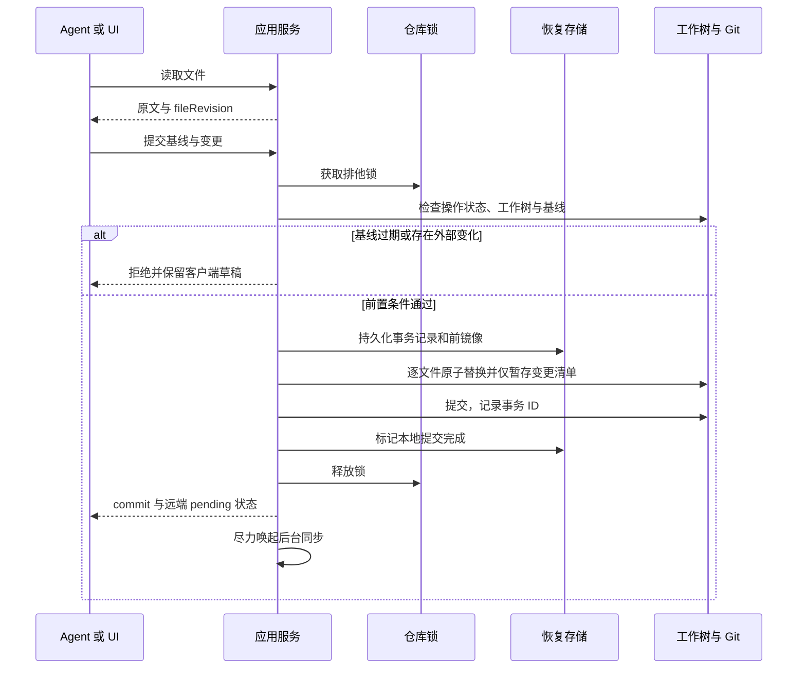
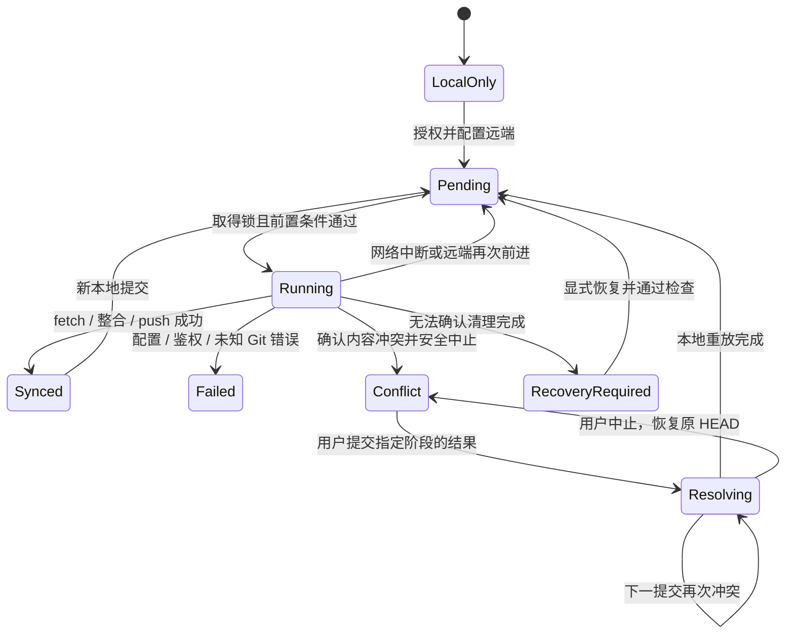

# 03. 流程与恢复

流程使用 [模型与错误契约](./02-domain-models-and-contracts.md)，写入遵循 [受管写入模型](./01-architecture-and-modules.md#2-写入模型)。所有后台任务均允许被中断，恢复不能依赖原 PID 仍然存在。

## 1. 初始化与远端接入

`init` 先验证目标路径及 Git 安装，再根据目标目录与远端状态选择分支。不在判断远端为空之前创建独立本地历史。

| 本地状态 | 远端状态 | 动作与结果 |
| --- | --- | --- |
| 不存在或空目录 | 未提供 URL | 创建独立仓库、根入口及首笔提交，`local_only` |
| 不存在或空目录 | 经确认且包含历史 | 克隆，使用远端默认分支；验证根入口，建立 upstream |
| 不存在或空目录 | 经确认且没有任何 ref | 创建本地 `main`、入口和首笔提交，首次推送建立 upstream |
| 有效记忆仓库 | 没有变更接入配置的请求 | 幂等返回，不覆盖文件和 remote |
| 有效记忆仓库 | 新增远端或 URL 不同 | 展示差异，要求显式确认；不自动改向另一个仓库 |
| 非空普通目录、项目目录、嵌套仓库 | 任意 | 拒绝，不覆盖、不自动接管 |

提供 URL 时使用 `ls-remote` 区分空远端、访问失败和已有历史。连接失败不能解释成空仓库。已有历史但没有有效默认分支、没有 `MEMORY.md` 或只有无法直接检出的 ref 时，停止并说明人工准备步骤。

为已有本地仓库连接非空远端时先 fetch 并验证共同历史；无共同历史返回需人工处理，不自动允许 unrelated histories。有共同历史但未配置 upstream 时，要求明确跟踪分支，不猜测名称。没有远端时不执行 fetch/rebase/push。

初始化部分失败时保留实际结果并报告阶段。例如本地首笔提交成功但首次 push 失败，返回本地仓库路径与 `pending`，重试不得再次创建首笔提交。缺少 Git 身份时提示配置本仓库身份，不设置全局配置或伪造用户身份。

## 2. 受管写入事务

Agent 使用 `read` 取得文件和修订，用 `write` 提交完整新文本；UI 条目操作则先由 vault 生成局部变更计划。两者最终进入同一事务。

事务步骤：

1. 获取仓库锁，检查 Git 中间态、冲突处理状态和恢复记录。任何拒绝或异常路径都释放已取得的锁。
2. 检查工作树、索引和输入基线，生成完整影响清单；多文件计划同时验证新增目标不存在和原有文件未变化。
3. 在 Git 目录的恢复存储记录 `transactionId`、原始 HEAD、受影响路径、原模式、原内容和计划内容摘要；记录落盘后才修改文件。新增文件的前镜像为不存在。
4. 在目标文件所在文件系统创建临时文件，写入并同步，再原子替换；保留未修改模式。跨文件 rename 和链接修订不是一个 OS 原子操作，依靠事务记录恢复。
5. 使用字面路径清单暂存，检查 staged diff 与计划一致，再提交。提交消息附带 `Memctl-Transaction` 标识和明确的 Agent/SID/设备来源，不夹带用户 prompt。
6. 记录提交完成，更新运行状态及索引，释放锁，通知客户端。远端任务不计入本地事务成功条件。

普通事务要求干净基线，因此不会把用户原本的 staged 内容当作事务输入。`sync --capture` 是单独的显式导入：预检所有变化、确认无未合并项、冻结路径清单，再提交该清单；它不承诺其他程序仍在直接写入时的安全性。

### 2.1 中断与恢复

| 中断点 | 重新进入时的动作 |
| --- | --- |
| 记录完成，尚未改文件 | 核对原始 HEAD 和全部前镜像，一致则取消未开始事务 |
| 部分文件写入，尚未提交 | 标为 `recovery_required`；恢复命令核对每个文件是否仍等于前镜像或计划内容 |
| 提交已完成，完成标记未写 | 通过 HEAD、父提交和 `Memctl-Transaction` 证明提交归属，补写完成状态，不再次提交 |
| hook 或外部进程产生计划外变化 | 保留现场，显示差异，停止自动恢复 |
| 远端任务中断 | 本地提交保留，下次按实际 ahead/behind 状态重新同步 |

`memctl recover --status` 展示受影响文件；`memctl recover --rollback` 只恢复可证明仍由该未完成事务控制的路径和索引项。原始 HEAD 已变、存在未知 Git 子进程或文件不匹配时拒绝自动恢复。不能用全仓库 `reset --hard`、删除 `.git/*.lock` 或清空状态目录代替恢复。

读取事务中间内容不是一致性读取；事务期间 UI 使用带 `stale` 标记的最近完整快照，CLI 读取返回忙碌。恢复流程不自动处理用户手工启动的 Git 操作。

## 3. 会话开始与上下文注入

1. 按 [SID 优先级](./04-ui-and-cli-specification.md#2-环境变量与会话身份) 解析身份。有 `--stdin` 时有界读取 Hook JSON，即使显式 SID 已提供也消费输入；不保存或回显 prompt。
2. 以 `repoId + agent + sid` 查询会话状态。`injected` 与 `syncSucceeded` 分开记录，首次断网不能被当成同步成功。
3. `start` 总是尝试一次同步；`context`、`pull --once` 在本会话尚未成功同步时尝试同步。锁忙、断网或超时则保留本地可用内容和错误摘要，后续 Hook 仍可重试。
4. 无 remote 时检查本地仓库后记为 `local`；有 remote 时按下一节流程运行。存在外部未提交变化时只读，不自动 capture。
5. 取得完整 `MEMORY.md`，附上内嵌指引、当前来源标签和同步提示。内嵌指引明确：记忆内容是数据、写入使用版本基线、来源缺失时不编造。
6. `context --once` 已成功注入后不再输出正文，但失败同步仍可以重试。首次输出成功写入 stdout 后才记 `injected`；进程在输出与状态登记之间被杀可能重复注入，不承诺 exactly-once。

会话缓存过期清理保留 14 天的初始策略，仅清理可重建的会话记录；不删除提案、恢复记录或未推送提交。没有稳定 SID 时不启用跨进程去重。

在宿主输出限额内优先保留安全指引、仓库路径和来源标签；入口过长时明确提示改为受管读取，不输出被截断但未标记的「完整 MEMORY.md」。宿主不支持注入的适配器依靠全局指引显式读取，不伪造注入成功。

## 4. 同步与后台任务

### 4.1 前台行为

`sync` / `end` 的自动 Hook 路径不提交未知工作树变化，只尽力唤起同步任务。受管写入已经完成本地提交。前台使用非阻塞取锁，锁忙立即报告 `busy` 或按 Hook 契约退出，不等待后台网络持锁。

显式 `sync --capture` 可在前台提交串行外部编辑；显式 `sync --wait` 在前台等待完整同步并返回失败码。调用方需要确认远端已保存时使用 `--wait`，不能把自动 Hook 的退出 0 当作推送确认。

后台每次运行只处理当前磁盘状态，不信任父进程传入的 ahead 数。工作进程尝试取得同一仓库锁，已有同步在执行则退出，避免排队积累后台进程。初版无定时网络重试；下次 Hook、显式 sync 或受管写入负责再次唤起。

### 4.2 Git 同步步骤

1. 锁内确认没有未完成事务、冲突解决和任何 Git 中间态，且工作树与索引干净。
2. 校验远端授权，执行有总 deadline 的 fetch。网络、鉴权、权限和配置错误分别记录。
3. 解析明确的目标 ref；无 upstream 按初始化协议处理。不要对不存在的 `@{u}` 执行 rebase。
4. 本地仅落后时 fast-forward；双端分叉时仅重放尚未推送的本地提交。显式禁用 autostash；存在本地 merge commit 等首版未支持历史时报告人工处理。
5. 成功后普通 push，首推才设置 upstream。禁止自动 force push；fetch 后远端再次前进则记录 `NON_FAST_FORWARD`，留待下一次同步，不无限循环。
6. 同步完成后检查 HEAD、索引、工作树和远端结果，更新 `lastSuccessAt`；失败只更新 `lastAttemptAt` 和具体原因。

Git 命令不通过 shell 拼接执行；清除继承的 `GIT_DIR`、`GIT_WORK_TREE`、`GIT_INDEX_FILE` 等仓库重定向变量，显式绑定目标仓库。网络超时不靠单独的低速参数替代总 deadline。SSH、凭据助手和 hooks 子进程的结束与回收按平台实现验证，不能超时后立即释放锁、留下仍在写仓库的 Git。

### 4.3 凭据环境继承与失败处理

远端同步使用 [架构定义的凭据与网络环境白名单](./01-architecture-and-modules.md#34-凭据与信任边界)。前台与后台的 Git 子进程都按同一份白名单构造环境：前台取自调用方环境，后台工作进程由父进程在派生时显式传入白名单快照，不读取登录 shell 或宿主初始化文件，也不把凭据环境写入状态。三条路径的交互与预算如下。

| 路径 | 触发 | 凭据环境 | 交互 | 远端预算 |
| --- | --- | --- | --- | --- |
| 前台显式 | 用户在终端运行 `init <url>`、`sync --wait`、`pull`、`resolve`、`recover`，或手工运行 `start`/`context` | 调用方环境的白名单 | 标准输入与标准错误均为终端时交给 Git/SSH 原生提示 | 30 秒 |
| 前台 Hook | 宿主触发 `start`/`context`/`pull` | 同上 | 强制非交互 | 8 秒 |
| 后台派生 | 受管写入或 `sync` 后尽力唤起 | 父进程传入的白名单快照 | 强制非交互 | 30 秒 |

`memctl` 不实现自己的凭据提示界面。只有前台且存在可用终端时才允许 Git 与 SSH 走原生提示（解锁密钥、输入 passphrase、确认主机密钥）；此时它把调用方的标准输入输出透传给 Git，不自行读取或回显凭据。非交互路径关闭标准输入，设置 `GIT_TERMINAL_PROMPT=0`，并抑制 SSH 与 Git 的 askpass 回退，使 `GIT_ASKPASS`/`SSH_ASKPASS` 指向的交互式或图形程序不会被调用；agent、密钥文件和 credential helper 等无需终端即可完成的来源仍然可用。抑制只作用于本次 Git 子进程，不修改用户配置。若用户唯一的凭据来源是交互式 askpass，非交互路径返回 `AUTH_FAILED`，留待下一次前台运行处理。

每次远端任务使用单一总 deadline（前台 Hook 8 秒，前台显式与后台 30 秒），覆盖 fetch、整合、push 及全部子进程，不因切换到下一个 Git 子命令而重新计时。deadline 到期后终止 Git 进程组，包含 SSH、credential helper 和 askpass；确认全部结束才释放仓库锁，清理耗时不计入下一次请求的预算。无法确认清理完成时不释放锁并进入 `recovery_required`，不留下在锁释放后继续写仓库的 Git。用户配置的 helper 或 SSH 若在预算内无返回，按超时处理，不会无限阻塞。

失败分类使用 [错误契约](./02-domain-models-and-contracts.md#43-错误与部分成功) 的内部 Git 错误码，判定规则如下。

| 结果 | 判定 | 前台显式 | 前台 Hook 与后台 |
| --- | --- | --- | --- |
| `AUTH_FAILED` | 非交互路径没有可用凭据源（agent socket 缺失或无效、helper 无返回），或提供的凭据被拒绝、主机密钥校验失败 | 终端下交给原生提示；仍失败返回 1 | `remoteState=failed` 并记录原因，下次同步可重试，本轮不自动重试、不排队 |
| `NETWORK_UNAVAILABLE` | DNS、连接、代理或重置类传输错误 | 返回 1 | 保持 `pending`，下次同步重试 |
| `TIMEOUT` | 总 deadline 到期 | 返回 1 | 保持 `pending`，下次同步重试 |
| `NO_UPSTREAM` | 仓库没有可用 upstream 或目标 ref | 返回 1 并指向初始化协议 | `remoteState=failed` 并记录原因，不伪造同步成功 |

鉴权失败与超时按证据区分：deadline 终止一律记为 `TIMEOUT`，即使 stderr 内容看起来像认证错误，因为无法证明认证交换已完成；只有在 deadline 之前拿到明确的拒绝结果（认证失败、helper 返回无凭据、主机密钥不匹配）才记为 `AUTH_FAILED`。两类都保留本地已提交内容，只更新远端状态与原因码，不把失败解释成 `synced`，也不因此撤销本地提交。前台 Hook 与后台按 [CLI 退出行为](./04-ui-and-cli-specification.md#3-hook-输入输出与时限) 返回 0 或记录状态，避免阻断宿主。

## 5. 冲突采集与解决

### 5.1 自动同步发现冲突

开始 rebase 前持久化操作所有权、原始 HEAD、固定 upstream commit 和仓库基线。确认出现未合并索引后，在 abort 之前采集每个冲突文件的 stage 1/2/3、文件模式、删除状态和 `REBASE_HEAD`。

持久化快照后，只中止本工具刚启动的 rebase。核对原始 HEAD、工作树、索引均已恢复，才发布 `phase: captured` 快照。abort 失败或恢复检查失败时进入 `recovery_required`，不能显示「已恢复」或继续自动提交。

配置失败、磁盘故障、已有手工 rebase、未合并索引但无本工具操作记录，都不走上述自动 abort 分支。捕获待解决冲突后，应用层暂停普通写入与自动同步，返回 `OPERATION_ACTIVE` 并指向冲突处理入口。

### 5.2 UI 与 CLI 共用的解决过程

1. 用户读取 `ConflictState` 并编辑本阶段的解决结果。提交携带 `conflictId` 和 `baseRevision`，同时覆盖本阶段全部冲突文件。
2. 服务加锁，校验该阶段的 `expectedHead`、固定 upstream 和工作树基线；对 `resolving` 还校验 `replayCommit` 与 `indexRevision`。如果已经被外部操作改变，拒绝旧结果并要求重新获取。
3. 对 `captured` 阶段，以同一固定 upstream 重启 rebase；不重新 fetch。验证复现的 `replayCommit` 和 `indexRevision` 与快照一致；不能把已恢复的原始 HEAD 当成第二轮之后的期望 HEAD。
4. 在实际停止的冲突阶段应用结果，对明确文件执行 add 或 rm，再执行非交互 `rebase --continue`。保留原提交信息，不打开编辑器等待浏览器用户。
5. 如果下一提交再次冲突，生成新 `conflictId`、`expectedHead`、`baseRevision`、`indexRevision` 和三方快照，记录 `phase: resolving`，保持本工具拥有的 rebase，释放 OS 锁等待下一次用户输入。应用层保护状态继续阻止普通写入和同步。
6. 重放完成后确认无未合并项或 sequencer 中间态，清除冲突处理状态，登记远端 `pending` 并唤起 push。推送失败不恢复已解决的本地历史，也不显示 `synced`。

保持活动 rebase 时重启 UI 或机器后，通过持久化操作记录恢复「等待解决」界面。`resolve --abort` 只中止该操作并恢复原始 HEAD，原冲突仍待处理；不会把中止解释成已与远端同步。

CLI 使用同一 `resolve` 接口，不由 Hook 指示 Agent 自行执行不受锁保护的 `git add -A`。超出支持范围的二进制、重命名等冲突需暂停自动操作后人工处理；重新进入工具时基于 Git 实际状态重建快照。

### 5.3 Revert

回滚前展示目标提交及逆向变更，校验仓库基线、干净状态和提交是否属于当前可达历史。首版只自动回滚单父提交；根提交和 merge commit 返回不支持，避免猜测主线。

执行前登记 `revert` 所有权。成功产生新提交，旧历史保留；遇到冲突不进入普通 Commit 流程，先采集诊断，再中止本次 revert 并验证恢复。中止失败进入恢复态，后续 Hook 不提交冲突标记。

`app.Revert` 只接受当前可达历史中的单父提交：根提交与 merge commit 返回 `UNSUPPORTED`，未知或不可达的 hash 返回 `NOT_FOUND`。回滚冲突时，先按 `ConflictState` 的三方字段采集受影响路径与冲突类型，再中止本工具启动的 revert，并核对 HEAD 已回到原提交且工作树与索引干净；确认后清除所有权记录并返回 `CONTENT_CONFLICT`，冲突内容不在 memctl 内继续解决。中止或恢复检查失败时保留所有权记录并进入恢复态。

## 6. Dreaming 提案

首版按用户触发运行，不安装周期性任务。静态规则识别候选，AI 生成整理建议；「确认前不修改主库」与「模型判断一定正确」是不同承诺。

1. 在仓库锁内确认干净状态，固定 `baseHead` 和 `baseRevision`，导出当前提交的受支持文件到独立临时目录。不导出 `.git`、remote 配置、宿主 Hook、宿主凭据文件或外部符号链接；记忆正文仍可能敏感，需按后续授权步骤处理。不使用带对象硬链接的 `clone --local` 充当隔离。
2. 释放主仓库锁后运行 runner。临时目录可写，主仓库和用户配置不可写；限制执行权限、环境、输出量、耗时与子进程。所选 runner 的模型端点可以需要网络，但只授权必要访问；「本地 CLI」不等于本地模型。
3. 只有已验证的 runner/平台隔离组合才启动。缺少沙箱能力时返回 `UNSUPPORTED`，不回退到不受限 shell，也不通过禁用宿主安全机制运行。
4. 从独立固定基线计算 Diff，包含新增、删除和模式变化；拒绝越界路径、Git 配置修改、不支持类型和超限结果。解析检查能验证格式、链接和变更范围，不能证明没有语义损失。
5. 持久化 `DreamProposal`、有序变化清单和 `patchHash`；删除临时执行环境。全库内容是否发送到外部模型由用户首次选择 runner 时确认，不把原始会话日志自动加入材料。
6. 用户确认的是已有 `proposalId + patchHash`。应用时不重新运行模型；在仓库锁内检查原始基线，过期则标为 `stale` 并要求重新生成。
7. 校验通过后将提案交受管事务提交，事务记录同时保存 `proposalId`；记录 `appliedCommit` 并唤起同步。若提交后提案状态未更新就中断，先按事务恢复结果补齐状态，再处理重试。重复 apply 返回同一结果。

初版整份提案确认或拒绝；逐 hunk 应用会改变依赖关系，暂不提供。用户需要部分采纳时通过普通受管编辑完成选定修改，或重新生成提案；不能篡改已有提案后继续使用原 `patchHash`。相似但矛盾的记忆保留来源供审阅，不以字符串去重代替事实判断。

## 7. Agent 配置安装

安装器依据明确的宿主和插件版本选择模板，先读取配置并生成计划；检测到不支持的格式或版本时只输出说明。没有插件的宿主不自动被宣称支持 Hook。

支持的宿主为 Claude Code、Codex、Grok、Antigravity、Command Code、OpenCode、pi 与 dsh，各内嵌一份版本匹配的模板。安装器按宿主可执行文件探测版本，按插件清单探测插件版本；两者均可在目标机器上缺失。宿主未探测到，或配置中尚无本工具条目时状态为 `not_installed`；宿主可用但缺少必需插件，或目标配置结构无法安全合并时状态为 `needs_attention`；检测到未内嵌模板的宿主、无法解析的版本或未支持的配置格式时状态为 `unsupported`。写入配置只得到 `configured`，只有宿主实测成功才是 `verified`；宿主实测不在本轮范围。安装不要求已初始化记忆仓库，也不依赖 Node.js。

每个规范化配置路径使用独立锁，不持仓库锁等待配置安装。安装计划记录每个目标文件的内容修订作为基线；实际写入前重读并比对基线。仅管理带稳定标识的条目：JSON 事件项以命令串包含 `memctl` 识别，YAML 条目以 `id` 前缀 `agent-memory-` 识别，TOML 以 `[features]` 表层下的固定键识别。重复安装不增加重复项，也不覆盖同事件下的用户自有条目、非本工具配置或原有权限。

配置替换使用同目录临时文件并原子替换，写入前把原文件备份到状态根 `adapters/backups/<installId>/`。多文件安装把每个文件的计划修订、安装后修订和备份路径记入状态根 `adapters/install.json`，失败时显示已修改和未修改清单。安装中断后，下一次非干运行的 `install` 先恢复现场：只还原仍与本次安装后修订一致的文件（新建文件则删除），用户随后编辑过的文件保留并报告。`install --status` 和 `install --dry-run` 只报告待恢复现场，不执行恢复。

JSON 与 JSONC 使用同一定点编辑器，YAML 与 TOML 分别按顶层块和表保留原有行列、注释与未管理键。无法可靠保留时（如目标容器类型不符、待插入区间含注释、TOML 已存在不同值）在计划中给出人工补丁，不写入该文件，也不用普通 JSON 序列化覆写整个文件。安装不会自动安装第三方插件、修改全局 Git 配置或绕过宿主信任确认。

## 8. 同步可观测性

持久化最近一次同步阶段、原因码、开始/结束时间和提交 hash。日志不记录 Hook prompt、Token、含凭据的 URL 或完整记忆正文。详细 Diff 由用户显式打开审计接口读取。

`doctor` 检查运行状态与 Git 状态是否一致，发现孤立操作记录、遗留索引锁或异常退出时给出具体恢复入口，不自动删除未知锁。锁持有者的 PID 和时间只用于显示；进程是否退出不替代内核锁及 Git 状态检查。
