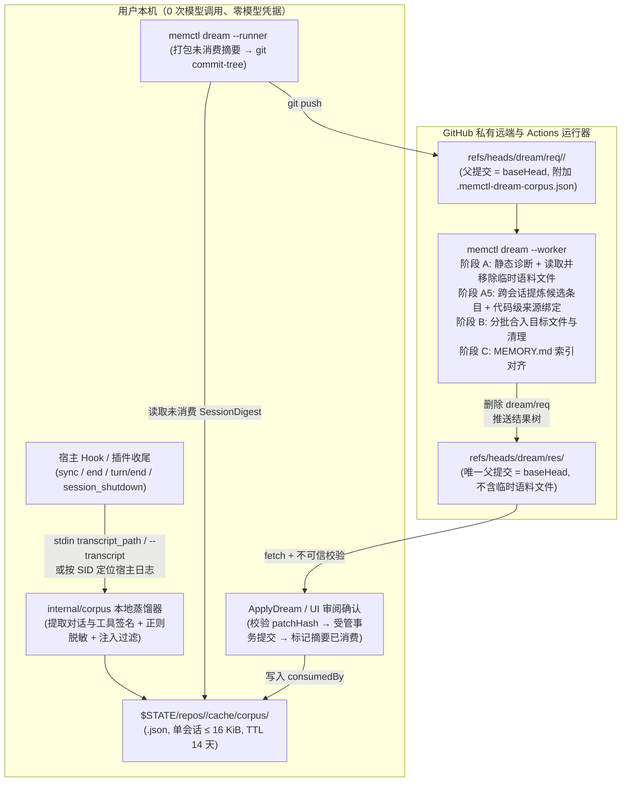

# 12. 跨会话新记忆提炼：本地蒸馏、分支传输与阶段 A5 方案

> 状态：`H-1` 方案与契约已完成（2026-10-20，`T098`），`H-2`–`H-4` 代码尚未实现。本文档定义 Dreaming 跨原始会话日志自动提炼未记录新记忆的完整架构：本地确定性蒸馏与脱敏缓存、`dream/req` 临时树提交传输协议、GitHub Actions worker 的阶段 A5 跨会话提炼、Go 代码级来源绑定守卫与验收矩阵。基础模型、写入事务、生命周期规则与 GitHub Actions 整理主流程分别引用 [02](./02-domain-models-and-contracts.md)、[03](./03-workflows-and-dataflows.md)、[10](./10-memory-lifecycle.md) 与 [11](./11-github-actions-dreaming.md)。

## 1. 结论

- 补齐上游 [Agent Memory Repo](https://cognition.com/agent-memory-repo) 对 Dreaming 定义的第一项职责（跨历史会话发现隐式规律并保存为新条目），与 [11. GitHub Actions Dreaming](./11-github-actions-dreaming.md) 已实现的第二项职责（合并重复、清理到期与核对来源）合流为一次完整的远端整理运行。
- 保持本地零模型凭据：本地只执行 0 次模型调用的确定性蒸馏（解析宿主会话日志、剔除工具大输出、正则脱敏凭据与可疑指令过滤），将单会话上限 `16 KiB` 的结构化摘要 `SessionDigest` 写入 `$STATE/repos/<repoId>/cache/corpus/`。
- 保持主分支不存原始日志：`memctl dream --runner <provider>` 触发时，本地使用 `git commit-tree` 构造一个以 `baseHead` 为唯一父提交的临时提交，仅在 `refs/heads/dream/req/<proposalId>/<provider>` 引用上多携带一个受保护的 `.memctl-dream-corpus.json` 文件（最多 `20` 个未消费会话、总上限 `256 KiB`）；提供 `--no-corpus` 开关在单次运行中跳过会话摘要上传。
- 保持代码控制的有界结构化调用：GitHub Actions 中的 `memctl dream --worker` 在阶段 A（静态诊断）与阶段 B（分批文件改写）之间新增阶段 A5（跨会话新记忆提炼，最多 `2` 次模型调用）。阶段 A5 只提炼三类高价值信号（用户显式纠正与偏好、多轮排障配方与领域映射、架构决策与里程碑事件），对隐式习惯执行跨会话频次门控（至少在 `2` 个独立会话中出现）。
- 强制真实来源绑定（Provenance Guard）：模型在阶段 A5 只输出候选事实文本与引用的输入会话下标 `sessionIndices`，不得自行拼写 `[source: ...]`；由 Go 代码校验下标合法性后确定性拼装 `- <fact> [source: <sourceTag>; added: <date>]`，再作为 `NEW_SESSION_MEMORY` 静态候选汇入阶段 B 合入对应 Markdown 文件。
- 保持确认前不改主库：`.memctl-dream-corpus.json` 列入受保护路径禁区，worker 生成 `dream/res/<proposalId>` 时将其剔除并仍以原始 `baseHead` 为唯一父提交；本地 `ApplyDream` 确认提交后才将本次参与整理的 `SessionDigest` 标记为已消费。

## 2. 系统如何工作

### 2.1 端到端数据流



### 2.2 本地会话采集与确定性蒸馏（`internal/corpus`）

本地采集在 `memctl sync`、`memctl end`（含 `--stdin` Hook 路径以及 `memctl-dsh`、`memctl-pi` 的回合结束与会话卸载路径）中以非阻塞、尽力而为（best-effort）的方式执行。任何日志缺失、格式未知或读取超时均静默跳过，不阻塞宿主，也不影响 Git 同步。

#### 1. 各宿主原始会话日志定位

| 宿主（`--agent`） | 会话日志路径获取方式 | 提取源格式与关键字段 |
| --- | --- | --- |
| `claude-code`、`commandcode`、`grok` | Hook stdin JSON 原生携带 `"transcript_path"` 字段（由 `hookio.ReadInput` 解析），或显式传入 `--transcript <path>` | JSONL：提取用户文本消息、助手最终文本块，以及工具调用的名称、目标路径或命令名与退出状态 |
| `codex` | Hook stdin JSON 原生携带 `"transcript_path"` 与 `"last_assistant_message"` 字段，或显式传入 `--transcript <path>` | JSON / JSONL：提取用户消息、工具调用摘要与 `last_assistant_message` |
| `pi` | `memctl-pi` 在 `agent_settled` 与 `session_shutdown` 中通过 `ctx.sessionManager.getSessionFile()` 取得路径并以 `--transcript <path>` 传给 `memctl` | JSONL：提取用户消息、助手文本回复与 `bash`/`edit` 工具调用签名 |
| `dsh` | `memctl-dsh` 在 `turn/end` 与 `agent/disposed` 中定位当前 profile 下的会话文件并以 `--transcript <path>` 传入，不可得时跳过 | 会话记录：提取用户指令与每轮最终回复 |
| `antigravity` | 优先读取 Hook stdin 的 `"transcript_path"`；缺失时按稳定 `sid`（`conversationId`）定位 `$HOME/.gemini/antigravity/brain/<sid>/.system_generated/logs/transcript.jsonl` | JSONL：提取 `type="USER_INPUT"` 与 `type="PLANNER_RESPONSE"` 的 `content`（跳过 `thinking` 与工具长输出） |
| `opencode` | 显式传入 `--transcript <path>`，或按稳定 `sid` 读取 `$HOME/.local/share/opencode/storage/message/<sid>/` | JSON 消息文件：提取用户与助手文本 |

设置环境变量 `AGENT_MEMORY_CORPUS=0`（或 `false`、`off`、`no`）时，本地完全禁用会话摘要采集，不读写 `$STATE/repos/<repoId>/cache/corpus/`。

#### 2. `SessionDigest` 数据结构与限额

每个存在稳定 `sid` 的会话在 `$STATE/repos/<repoId>/cache/corpus/<sha256(agent + "\x00" + sid)>.json` 下对应唯一一份摘要文件，采用同目录临时文件加 rename 原子更新：

```json
{
  "schemaVersion": 1,
  "agent": "claude-code",
  "sessionId": "6ae43eec-0f2e-4de4-995b-4e113785a4c1",
  "sourceTag": "agent://MacBookPro.local/claude-code/6ae43eec-0f2e-4de4-995b-4e113785a4c1",
  "date": "2026-10-20",
  "updatedAt": "2026-10-20T05:30:00Z",
  "cwdBase": "memctl",
  "wroteMemoryInSession": false,
  "consumedBy": "",
  "turns": [
    {
      "user": "发布新版 release，注意不要在本地跑 make release 上传",
      "tools": [
        "bash: git tag -a v0.9.1 (exit 0)",
        "bash: git push origin v0.9.1 (exit 0)"
      ],
      "assistant": "已推送标签 v0.9.1 触发流水线发布。"
    }
  ]
}
```

字段与限额规则：

| 常量或字段 | 取值与规则 |
| --- | --- |
| `MaxTurnsPerSession` | `20`；超出时优先保留含用户纠正信号（如「不要」「改为」「记住」「不对」「以后」等及对应英文词）的回合与最近回合 |
| `MaxTurnTextBytes` | 单回合 `user` 或 `assistant` 文本上限 `1024` 字节（按 UTF-8 字符边界截断并标记 `…`） |
| `MaxToolsPerTurn` | 单回合最多 `5` 条工具签名，每条上限 `160` 字节；只记录工具名、首行命令或根相对路径及退出码，丢弃工具 stdout/stderr 与文件内容 |
| `MaxSessionDigestBytes` | 单个 `SessionDigest` 序列化后上限 `16 KiB`；超限时从最早的非纠正回合开始裁剪 |
| `CorpusStateTTL` | `14` 天（与 `SessionStateTTL` 一致）；每次采集与 `dream` 启动时自动清理过期文件 |
| `cwdBase` | 仅保留工作目录的 basename（如 `memctl`），不上传宿主机完整绝对路径结构 |
| `wroteMemoryInSession` | 若该会话已在记忆仓库产生包含 `Session: <sid>` trailer 的提交，记为 `true`，供阶段 A5 降低重复提取权重 |

#### 3. 本地确定性清洗与脱敏规则

写入 `SessionDigest` 前，`internal/corpus` 依次执行三道确定性过滤：

1. **系统与注入块剥离**：剔除 `<system-reminder>...</system-reminder>`、`<MEMCTL_INSTRUCTIONS>...</MEMCTL_INSTRUCTIONS>`、`[agent-memory] ...` 注入横幅、代码块中的大段文件内容，以及模型内部 `thinking` / `reasoning` 字段。
2. **凭据与密钥正则脱敏**：将匹配以下模式的子串替换为 `[REDACTED]`：
   - 常见 API Key 与令牌前缀：`sk-[A-Za-z0-9_-]{16,}`、`gh[pousr]_[A-Za-z0-9]{20,}`、`github_pat_[A-Za-z0-9_]{20,}`、`xox[baprs]-[A-Za-z0-9-]{10,}`、`AKIA[0-9A-Z]{16}`、`AIza[0-9A-Za-z_-]{35}`；
   - JWT 与长 Bearer 串：`eyJ[A-Za-z0-9_-]{10,}\.[A-Za-z0-9_-]{10,}\.[A-Za-z0-9_-]{10,}`、`(?i)bearer\s+[A-Za-z0-9._~+/=-]{16,}`；
   - 键值赋值中的敏感值：`(?i)(api[_-]?key|secret|password|passwd|access[_-]?token|refresh[_-]?token|private[_-]?key|authorization)\s*[:=]\s*["']?[^\s"',;]+`；
   - PEM 私钥块：`-----BEGIN [A-Z0-9 ]*PRIVATE KEY-----[\s\S]*?-----END [A-Z0-9 ]*PRIVATE KEY-----`；
   - URL 内嵌凭据：`https?://[^/\s:@]+:[^/\s:@]+@`。
3. **可疑指令回合过滤**：复用 `doctor` 的可疑提示词注入检测模式（如要求忽略系统规则、外发数据或修改安全配置）；命中可疑模式的单个回合直接丢弃，不进入 `turns`。

### 2.3 `dream/req` 临时树提交传输协议

本方案复用 [11. GitHub Actions Dreaming §2.2](./11-github-actions-dreaming.md#22-git-分支与提交元数据协议) 的 Git 引用通道，不调用 GitHub REST API，也不修改本地工作树或 `main` 分支：

1. **选择待上传摘要**：`dream.Service.Begin` 在固定 `baseHead` 后（且未指定 `--no-corpus` 时），扫描 `$STATE/repos/<repoId>/cache/corpus/`，筛选 `consumedBy == ""` 且 `turns` 非空的摘要，按 `updatedAt` 倒序取最多 `MaxCorpusSessions = 20` 个，累计字节上限 `MaxCorpusBytes = 256 KiB`，组装为 `DreamCorpusPayload`：

   ```json
   {
     "schemaVersion": 1,
     "proposalId": "dp-0123456789abcdef0123456789abcdef",
     "baseHead": "e4b8...",
     "sessions": [ /* SessionDigest[] */ ]
   }
   ```

2. **无痕构造请求提交**：
   - 当 `sessions` 为空（或传入 `--no-corpus`）时：`refs/heads/dream/req/<proposalId>/<provider>` 直接指向 `baseHead`（与无语料模式完全相同）。
   - 当 `sessions` 非空时：使用 `git hash-object -w --stdin` 将 `DreamCorpusPayload` 写入本地 Git 对象库得到 `<blobHash>`，读取 `baseHead^{tree}` 并追加一条根目录树项 `100644 blob <blobHash>\t.memctl-dream-corpus.json`，通过 `git mktree` 与 `git commit-tree <treeHash> -p <baseHead> -m "dream-req(<proposalId>)"` 生成临时提交 `<reqCommit>`，推送 `<reqCommit>:refs/heads/dream/req/<proposalId>/<provider>`。本地 `HEAD`、索引与工作树保持原样不变。
3. **远端检出与基线还原**：
   - GitHub Actions 工作流检出 `dream/req/<proposalId>/<provider>` 后立即删除该远端分支。
   - 工作流向 `memctl dream --worker` 传入 `--ref "${GITHUB_REF_NAME}" --base-head "${GITHUB_SHA}"`。
   - `--worker` 启动时检查当前提交：若当前提交包含 `.memctl-dream-corpus.json` 且其唯一父提交包含 `MEMORY.md`，则读取 `.memctl-dream-corpus.json` 中的 `DreamCorpusPayload`，并将对比与结果提交的真实基线还原为 `DreamCorpusPayload.baseHead`（同时校验该值等于当前提交的唯一父提交哈希）；若当前提交不含 `.memctl-dream-corpus.json`，则直接以 `--base-head` 为基线（保持向后兼容，无需用户重写旧工作流 YAML）。
   - 结果提交 `refs/heads/dream/res/<proposalId>` 的唯一父提交始终是记忆仓库的真实 `baseHead`，且文件树中绝不包含 `.memctl-dream-corpus.json`。

### 2.4 Worker 阶段 A5：跨会话新记忆提炼

在 [11. GitHub Actions Dreaming §2.3](./11-github-actions-dreaming.md#23-代码控制的多步结构化调用流程) 的三阶段流程中，当 `DreamCorpusPayload.sessions` 非空时，在阶段 A 与阶段 B 之间执行阶段 A5（最多 `MaxExtractBatches = 2` 次模型调用，计入总调用上限 `MaxTotalCalls = 12`）。

#### 1. 阶段 A5 的输入载荷（`extractRequest`）

```json
{
  "today": "2026-10-20",
  "phase": "extract",
  "entryFile": "# Memory\n\n## Index\n...",
  "existingFiles": [
    { "path": "notes/memctl-release-process.md", "title": "发布流程", "headings": ["规则"] }
  ],
  "existingFacts": [
    "- 发布唯一入口是推标签 [source: agent://...; added: 2026-10-18]"
  ],
  "sessions": [
    {
      "sessionIndex": 0,
      "agent": "claude-code",
      "sourceTag": "agent://MacBookPro.local/claude-code/6ae43eec-...",
      "date": "2026-10-20",
      "cwdBase": "memctl",
      "wroteMemoryInSession": false,
      "turns": [ /* ... */ ]
    }
  ],
  "correction": ""
}
```

#### 2. 阶段 A5 的系统提示词契约（提取与门控规则）

1. **三类可提取目标**：
   - **显式纠正与持久偏好（`state`）**：用户在对话中纠正 Agent 的错误假设、命名习惯、工具选择或输出风格（如「不要运行本地 `make release`，发布只推标签」）。
   - **多轮排障结论与领域映射（`state` 或 `event`）**：经过排查才定位的非显而易见事实、模块映射关系或环境约束（如「`ghost_text` 事件对应自动补全指标」「DSH 的 MCP 客户端随应用内置无需在 profile 安装」）。
   - **架构决策与有时效约束（`event` 或 `time_limited`）**：明确的技术选型理由、迁移结论，或带明确截止日期的临时约束（换算为 `until: YYYY-MM-DD`）。
2. **跨会话频次门控（防噪音扩散）**：
   - 用户明确发出的全局规则、明确纠正或已验证的排障根因：允许从单个会话（`len(sessionIndices) >= 1`）提炼。
   - 隐式行为偏好（用户未说「记住/以后都这样」，仅在交互中表现出某种倾向）：必须在至少 `2` 个不同会话（`len(sessionIndices) >= 2`）中重复出现一致信号才允许提炼；只出现 1 次的隐式倾向必须忽略。
   - 禁止提炼：单次具体编码任务的待办状态、可由 `git log` 或代码搜索直接得出的普通函数名/行号、临时报错日志、与 `existingFacts` 语义重复的事实。
3. **相对时间换算**：会话文本中的「今天」「明天」「下周」必须以该会话的 `date` 字段为基准换算为 `YYYY-MM-DD`。

#### 3. 阶段 A5 的输出 Schema（`DreamExtractOutput`）

模型不得在 `fact` 中手写 `[source: ...]` 或前导 `- `，必须输出符合以下 JSON Schema 的结构：

```json
{
  "type": "object",
  "required": ["candidates", "warnings"],
  "additionalProperties": false,
  "properties": {
    "candidates": {
      "type": "array",
      "items": {
        "type": "object",
        "required": ["kind", "targetPath", "fact", "sessionIndices", "rationale"],
        "additionalProperties": false,
        "properties": {
          "kind": { "type": "string", "enum": ["state", "event", "time_limited"] },
          "targetPath": { "type": "string" },
          "fact": { "type": "string" },
          "until": { "type": "string" },
          "sessionIndices": {
            "type": "array",
            "items": { "type": "integer" }
          },
          "rationale": { "type": "string" }
        }
      }
    },
    "warnings": {
      "type": "array",
      "items": { "type": "string" }
    }
  }
}
```

#### 4. 代码级来源绑定守卫（Provenance Step Guard）

每次收到 `DreamExtractOutput` 后，worker 执行确定性校验（失败时最多纠正重试 `MaxStepRetries = 1` 次）：

1. **下标与来源真实性校验**：`candidates` 最多 `MaxExtractedCandidates = 30` 条；每条的 `sessionIndices` 必须非空，且每个整数 $i$ 必须满足 $0 \le i < \text{len(sessions)}$。越界或为空立即拒绝并触发纠正重试。
2. **正文与元数据净化**：`fact` 必须为单行非空文本（不含换行符），不得包含模型自行拼写的 `[source:` 或 `[added:` 尾注，且必须再次通过 §2.2 的凭据脱敏与可疑指令检查；若 `kind == "time_limited"`，`until` 必须是合法的 `YYYY-MM-DD` 且不早于对应会话的 `date`。
3. **目标路径校验**：`targetPath` 必须通过 `vault.ValidateRelPath`、以 `.md` 结尾且不命中 `protectedPath`。
4. **Go 代码确定性拼装标准条目**：
   - 按 `sessionIndices` 首次出现的顺序去重，提取对应的真实 `sessions[i].sourceTag`，取所引用会话中最新的 `date` 作为 `added` 日期。
   - 由 Go 代码生成标准条目文本：
     `- <fact> [source: <tag1>; source: <tag2>; added: <latestDate>]`（若含 `until`，追加 `; until: <YYYY-MM-DD>`）。
   - 若 `normalizeFact(fact)` 与当前记忆库中已有条目的归一化文本完全相同，静默跳过该候选，避免重复入库。
5. **汇入阶段 B 批次规划**：
   - 每条通过校验的候选转化为一条静态诊断信号：`staticFinding{Code: "NEW_SESSION_MEMORY", Path: targetPath, Message: formattedBullet + " (rationale: " + rationale + ")"}`。
   - 若 `targetPath` 是尚不存在的新主题文件，将其加入阶段 B 的批次目标列表（允许阶段 B 对该路径执行 `create`），随后阶段 B 将这些带有真实 `source` 的条目写入对应文件，阶段 C 自动更新 `MEMORY.md` 的 `## Index` 链接。

### 2.5 运行元数据扩展与消费状态更新

`DreamWorkerMeta`（见 [11. GitHub Actions Dreaming §2.2](./11-github-actions-dreaming.md#22-git-分支与提交元数据协议)）新增两个可选整数字段：

```json
{
  "schemaVersion": 1,
  "proposalId": "dp-0123456789abcdef0123456789abcdef",
  "baseHead": "e4b8...",
  "provider": "deepseek",
  "model": "deepseek-chat",
  "status": "ready",
  "steps": 3,
  "sessionsScanned": 4,
  "newMemoriesExtracted": 2,
  "warnings": [],
  "error": ""
}
```

本地消费状态流转规则：

1. `dream.Service.Begin` 在持久化提案内部记录 `record` 时，同时记录本次打包进 `.memctl-dream-corpus.json` 的会话摘要文件名列表 `corpusDigests: string[]`。
2. 提案处于 `generating`、`ready`、`failed` 或 `stale` 期间，对应的 `SessionDigest` 文件保持 `consumedBy: ""`；若提案失败或过期作废，下次运行 `memctl dream` 仍会纳入这些会话。
3. 当且仅当用户执行 `ApplyDream`（`memctl dream --apply` 或 `POST /api/v1/dream:apply`）且受管写入事务成功提交后，服务遍历该提案记录的 `corpusDigests`，将对应 `SessionDigest` 文件的 `consumedBy` 更新为该 `proposalId`。

## 3. 安全、治理与禁止项

### 3.1 信任边界

| 边界 | 机制与保障 |
| --- | --- |
| 原始会话日志不出本机 | 本地只提取高度裁剪（单回合 $\le 1024$ 字节、单会话 $\le 16\text{ KiB}$、无工具长输出）且经正则脱敏的 `SessionDigest`；完整 `.jsonl` 永不上传 |
| 临时语料不进主分支与结果分支 | `.memctl-dream-corpus.json` 仅存在于短暂存活的 `dream/req` 分支，且被列入 `protectedPath`；`dream/res` 与 `main` 绝不包含该文件 |
| 杜绝伪造来源 URI | 模型只输出整数下标 `sessionIndices`，`[source: agent://...; added: YYYY-MM-DD]` 完全由 Go 代码根据本地采集的权威身份生成 |
| 隐私可控与单次跳过 | 支持环境变量 `AGENT_MEMORY_CORPUS=0` 全局关闭采集，以及 `memctl dream --runner <provider> --no-corpus`（和 HTTP `noCorpus: true`）单次跳过上传会话摘要 |

### 3.2 禁止项

1. **禁止在本地采集路径调用模型或阻塞宿主退出**：`internal/corpus` `MUST` 仅使用确定性解析与正则处理，单次提取耗时预算不超过 `200 ms`；读取失败或超时必须静默放弃，不得令 `sync` 或 `end` 返回非零退出码。
2. **禁止信任模型手写的 `source` 元数据**：阶段 A5 的 Step Guard `MUST` 拒绝任何在 `fact` 中内嵌 `[source:` 的模型输出，或越界引用不存在的 `sessionIndices`；否则模型可通过幻觉伪造审计来源。
3. **禁止将 `.memctl-dream-corpus.json` 视为受管记忆文件**：`vault` 与 `dream` 的 `protectedPath` `MUST` 拦截 `.memctl-dream-corpus.json`（含大小写变体）；若远端返回的 `dream/res` 结果树仍残留该文件，本地 `scanWorkTree` 必须拒绝该提案并标为 `failed`（`D03`）。
4. **禁止在提案未应用前将会话摘要标为已消费**：只有 `ApplyDream` 完成本地 Git 提交后才允许写入 `consumedBy`；预览生成（`Preview`）本身不得消耗摘要，否则用户拒绝或过期重跑提案时会丢失尚未入库的会话线索。

## 4. 调研依据：为什么采用「本地确定性蒸馏 + 远端阶段 A5」

| 对照维度 | Cognition Devin（上游） | Claude Code / OpenClaw | Letta / Mem0 | 本方案（`memctl`） |
| --- | --- | --- | --- | --- |
| 会话材料获取 | 云端 VM 直接读取同机完整会话日志 | 本地 daemon 扫描 `~/.claude/projects/*.jsonl` 或 `.dreams/session-corpus/` | 服务端接收对话 `messages[]` | 复用 Hook stdin 的 `transcript_path` 与插件 `--transcript`，在本地生成 ≤ 16 KiB 脱敏摘要并通过 `dream/req` 分支传给 Actions |
| 噪音与一次性状态过滤 | 后台 Agent 对比多次会话中的用户纠正与工具成败 | Light → REM → Deep 三阶段：先切片去重，再按频次门控（如跨会话出现）晋升长期记忆 | 提取与全库整理分离，避免单次调用同时做提取与删除 | 本地蒸馏剔除工具大输出（Light）→ 远端阶段 A5 独立提炼并执行隐式偏好 $\ge 2$ 次会话门控（REM）→ 阶段 B/C 合入文件树并对齐索引（Deep） |
| 来源可追溯（Provenance） | 每条记忆附带 `[source: <session_url>; added: YYYY-MM-DD]` | 转换相对日期为绝对 ISO 日期，不强制每行绑定 session URI | 数据库字段记录 `episode_id` 与时间戳 | 模型只返回 `sessionIndices`，由 Go 代码强制拼装权威 `agent://<device>/<agent>/<sid>` 与日期 |
| 落盘确认方式 | 后台自动提交到记忆仓库 | 后台自动改写 `MEMORY.md` 并写 `DREAMS.md` 日记 | 自动覆写 Memory Block | 全部新提炼条目进入 `DreamProposal` 的固定 Diff（绑定 `patchHash`），经用户显式确认后才提交 `main` |

## 5. 契约改动映射

| 文档 | 章节 | 修订内容 |
| --- | --- | --- |
| [01. 架构与模块](./01-architecture-and-modules.md) | 3.1、3.2、4、5 | `$STATE/repos/<repoId>/cache/corpus/` 纳入可重建缓存；`.memctl-dream-corpus.json` 纳入受保护非记忆路径；新增 `internal/corpus` 模块职责与目录规划 |
| [02. 模型与契约](./02-domain-models-and-contracts.md) | 2.3、4.2 | `DreamProposal` 新增可选 `sessionsScanned?` 与 `newMemoriesExtracted?` 统计字段；`POST /api/v1/dream:preview` 请求体支持可选 `noCorpus?` 布尔字段 |
| [03. 流程与恢复](./03-workflows-and-dataflows.md) | 4.1、6 | 说明 `sync`/`end` 顺带更新本地脱敏会话摘要缓存；第 6 节 Dreaming 提案流程补入 `dream/req` 临时语料提交、阶段 A5 提炼与 `ApplyDream` 消费标记 |
| [04. CLI、UI 与分发](./04-ui-and-cli-specification.md) | 1、2、3 | `sync`/`end` 支持可选 `--transcript PATH`；`dream --runner` 支持可选 `--no-corpus`；环境变量表新增 `AGENT_MEMORY_CORPUS`；`hookio` 解析 `transcript_path` 与 `last_assistant_message` |
| [05. 验收与交付](./05-validation-and-delivery.md) | 1、2 | 新增阶段 H（跨会话新记忆提炼）实施顺序及 `D06`、`D07` 验收场景 |
| [11. GitHub Actions Dreaming](./11-github-actions-dreaming.md) | 2.1–2.3 | 在端到端数据流、分支协议与 worker 阶段中关联本文档定义的阶段 A5 与 `.memctl-dream-corpus.json` 规则 |

## 6. 验收矩阵与实施计划

### 6.1 新增验收场景（`D06`、`D07`）

| ID | 输入或故障场景 | 可验证结果 |
| --- | --- | --- |
| `D06` | Hook stdin 含 `transcript_path` / `last_assistant_message` 或传入 `--transcript`；日志含超长工具输出、各类 API Key/Token/密码、`<system-reminder>`、可疑提示词注入回合，或设置了 `AGENT_MEMORY_CORPUS=0` | 生成的 `SessionDigest` 大小 $\le 16\text{ KiB}$，所有凭据模式被替换为 `[REDACTED]`，系统块与可疑回合被剔除；`AGENT_MEMORY_CORPUS=0` 或日志文件缺失时不写缓存且命令退出码为 `0` |
| `D07` | 存在未消费 `SessionDigest` 时运行 `dream`：构造 `dream/req` 临时提交 → `--worker` 执行阶段 A5 提炼并校验 `sessionIndices` → 汇入阶段 B/C 生成 `dream/res` → 本地校验并 `ApplyDream`；以及模型返回越界 `sessionIndices`、伪造 `[source:]`、残留 `.memctl-dream-corpus.json` 或传入 `--no-corpus` | 正常路径产出的新条目精确携带对应会话的 `source` 与 `added` 日期，`dream/res` 父提交仍等于原始 `baseHead` 且不含 `.memctl-dream-corpus.json`，`apply` 成功后摘要标记 `consumedBy`；越界下标或伪造 `source` 被阶段 A5 Step Guard 拦截纠正；结果树若残留 `.memctl-dream-corpus.json` 被本地 `D03` 拒绝；`--no-corpus` 不上传语料 |

### 6.2 阶段 H 实施顺序

| 步骤 | 前置依赖 | 本轮交付边界 | 对应验收 |
| --- | --- | --- | --- |
| `H-1`：方案与契约修订（`T098`，本轮） | `G-4` | 新增 `docs/12-session-corpus-dreaming.md`，同步修订 `docs/01`–`05`、`docs/11`、`docs/README.md` 与 `docs/STATUS.md` | 文档链接、锚点与跨文档契约一致性检查 |
| `H-2`：本地会话蒸馏器与 Hook/插件接线 | `H-1` | 实现 `internal/corpus`（各宿主 JSONL 解析、回合裁剪、正则脱敏、可疑指令过滤、14 天 TTL 缓存）；扩展 `hookio.ReadInput` 解析 `transcript_path` 与 `last_assistant_message`；`sync`/`end` 支持 `--transcript` 与 `AGENT_MEMORY_CORPUS`；更新 `memctl-pi` 与 `memctl-dsh` 传递会话文件路径 | `D06` 单元测试与 CLI 集成测试 |
| `H-3`：`dream/req` 语料打包与 Worker 阶段 A5 | `H-2` | `internal/dream` 将 `.memctl-dream-corpus.json` 纳入 `protectedPath`；实现 `git commit-tree` 临时语料提交与 `--no-corpus`（含 HTTP `noCorpus`）；`worker.go` 实现阶段 A5（`DreamExtractOutput` Schema、Provenance Step Guard、`NEW_SESSION_MEMORY` 汇入阶段 B）与父提交基线还原；`ApplyDream` 成功后更新 `consumedBy` | `D07`、`D03` 单元测试与本地受控 Git 远端 + 模拟模型端点集成测试 |
| `H-4`：CLI 帮助、UI 摘要统计展示与端到端验收 | `H-3` | 更新中英与 JSON 帮助（`--transcript`、`--no-corpus`、`AGENT_MEMORY_CORPUS`）；UI「整理」视图展示 `sessionsScanned` 与 `newMemoriesExtracted`；完成合成与真实仓库端到端验收 | `D06`、`D07`、`R06`、前端单测与端到端回归 |
