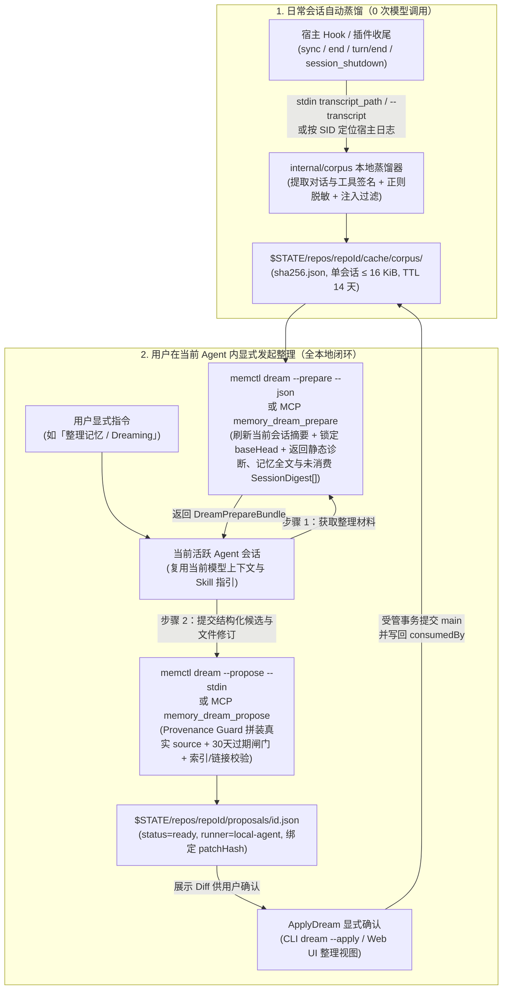

# 12. 跨会话新记忆提炼：本地当前 Agent 交互式整理方案

> 状态：`H-1` 方案与契约已修订（2026-10-20，`T098`、`T099`）；`H-2a` 本地会话蒸馏器已实现并验收（2026-10-20，`T100`）；`H-2b` 存量多会话补扫与 `antigravity` 接入已实现并验收（2026-10-20，`T101`）；`H-3` 本地 `prepare`/`propose`、项目筛选与两个 MCP 工具已实现并验收（2026-10-20，`T102`）；`H-4` 的配套 Skill、中英与 JSON 帮助、UI「整理」视图的本地提案列表与宿主会话内端到端验收已完成（2026-10-20，`T103`）。本文档定义在本地当前 Agent 会话内由用户显式发起的跨会话新记忆提炼与交互式整理架构：本地确定性会话蒸馏与脱敏缓存、`dream --prepare`/`--propose`（及对应 MCP 工具）两阶段本地协议、Go 代码级来源绑定守卫与验收矩阵。已实现的 GitHub Actions 远端整理（[11. GitHub Actions Dreaming](./11-github-actions-dreaming.md)）保持原样不变，不参与会话日志传输与提炼。基础模型、写入事务、MCP 通道与生命周期规则分别引用 [02](./02-domain-models-and-contracts.md)、[03](./03-workflows-and-dataflows.md)、[09](./09-mcp-memory-tools.md) 与 [10](./10-memory-lifecycle.md)。

## 1. 结论

- 职责正交切分：已实现的 [11. GitHub Actions Dreaming](./11-github-actions-dreaming.md)（`--runner <provider>` 与 `--worker`）保持不动，仅负责远端对已有记忆库执行去重、到期清理与索引整理；跨原始会话日志提炼未记录新记忆则**仅在本地当前活跃 Agent 会话内由用户显式发起并完成**，完全放弃将本地会话语料上传至远端分支或 GitHub Actions 处理。
- 零额外模型凭据、零子进程派生：由用户正在使用的当前 Agent 会话自身充当整理推理大脑，直接通过 CLI（`memctl dream --prepare` / `memctl dream --propose --stdin`）或 MCP 工具（`memory_dream_prepare` / `memory_dream_propose`）与本机 `memctl` 交互；既不要求本地配置 API Key，也不由 `memctl` 反向派生无头 Agent CLI 子进程。
- 本地整理路径不依赖远端：`prepare`/`propose`/`apply` 不要求已确认的 GitHub 远端，也不要求仓库内存在 `.github/workflows/memctl-dream.yml`。这两项仍是远端整理路径（`--runner`）的前置条件，不受本文档影响。
- 会话数据出本机的唯一出口是当前 Agent 的上下文：`SessionDigest` 不上传 Git 分支、不发往 GitHub Actions，但 `prepare` 会把摘要注入当前 Agent 会话，而该会话由宿主所称的云端模型处理。这是本方案明确接受并需要用户知晓的边界，见 §3.1。
- 本地确定性会话蒸馏与存量多会话补扫（`internal/corpus`）：一方面，`sync` 与 `end` 在日常会话中执行 0 次模型调用的确定性提取（解析各宿主会话日志、剥离工具大输出、正则脱敏凭据与过滤可疑提示词注入回合），将单会话上限 `16 KiB` 的结构化摘要 `SessionDigest` 缓存在 `$STATE/repos/<repoId>/cache/corpus/`；另一方面，`dream --prepare`（及 `memory_dream_prepare`）启动时调用补扫入口，对本机已知宿主的会话存储目录执行**存量历史会话补扫（Backfill Scan）**，把最近 14 天内尚未入池的当前项目会话补入缓存，再由 `H-3` 按**当前项目优先**策略一次打包最多 `12` 个未消费会话、累计不超过 `96 KiB`。
- 强制真实来源绑定（Provenance Guard）与单步确定性守卫：当前 Agent 在提交整理提案时，针对新提炼记忆只输出候选事实文本 `fact` 与引用的输入会话下标 `sessionIndices`，不得自行手写 `[source: ...]`；由本地 `memctl` 的 Go 代码校验下标合法性后确定性拼装 `- <fact> [source: <sourceTag>; added: <date>]`，并统一执行 30 天到期删除闸门（`DELETION_DEFERRED`）、受保护路径拦截与双向链接校验。
- 保持确认前不改主库：本地 `--propose` / `memory_dream_propose` 校验通过后，将结果直接持久化为本地 `status: "ready"`、`runner: "local-agent"` 的标准 `DreamProposal`（绑定 `baseHead` 与 `patchHash`）。用户可在当前会话指示 Agent 执行 `memctl dream --apply`（或在本机终端运行同一命令），也可在 `memctl ui` 的「整理」视图审阅 Diff 后点击确认；「整理」视图通过 `GET /api/v1/dream` 列出已持久化提案（含 `local-agent` 的扫描会话数与新提炼条目数），该列表不依赖远端就绪状态。MCP 通道不提供 `memory_dream_apply`，见 §3.2。仅当 `ApplyDream` 提交成功且 `consumedBy` 写回完成后，本次参与整理的 `SessionDigest` 才标记为已消费。

## 2. 系统如何工作

### 2.1 端到端数据流



### 2.2 本地会话采集与确定性蒸馏（`internal/corpus`）

本地采集在 `memctl sync`、`memctl end`（含 `--stdin` Hook 路径以及 `memctl-dsh`、`memctl-pi` 的回合结束与会话卸载路径）以及 `dream --prepare` / `memory_dream_prepare` 中以非阻塞、尽力而为（best-effort）的方式执行。任何日志缺失、格式未知或读取超时均静默跳过，不阻塞宿主，也不影响 Git 同步。

#### 1. 各宿主原始会话日志定位与存量目录补扫

`internal/corpus` 同时支持**单次实时采集**（由 Hook / 插件在 `sync`、`end` 时传入当前会话路径）与**存量多会话补扫**（由 `dream --prepare` / `memory_dream_prepare` 扫描本机宿主历史目录）。下表把「已在本机核对过格式」与「仅按约定探测」分开记录，避免把未验证的解析写成已支持能力：

| 宿主（`--agent`） | 实时采集路径获取（`sync`/`end`） | 存量多会话补扫目录（`dream --prepare`） | 提取源格式与关键字段 | 格式核对状态 |
| --- | --- | --- | --- | --- |
| `claude-code` | Hook stdin `"transcript_path"` 或 `--transcript <path>`（`H-2a` 已实现，未接宿主 Hook 样例） | `$HOME/.claude/projects/*/*.jsonl`（项目目录名是 cwd 的路径转义，反向还原为 `cwdBase`；文件名即 `sid`） | JSONL：提取用户文本消息、助手最终文本块，以及工具调用的名称、目标路径或命令名与退出状态 | 已核对 |
| `codex` | Hook stdin `"transcript_path"` 与 `"last_assistant_message"` 或 `--transcript <path>` | `$HOME/.codex/sessions/**/*.jsonl`（首行 `type: "session_meta"` 的 `payload.id` 与 `payload.cwd`） | JSON / JSONL：提取用户消息、工具调用摘要与 `last_assistant_message` | 已核对 |
| `pi` | `memctl-pi` 通过 `ctx.sessionManager.getSessionFile()` 取得会话文件路径并传 `--transcript <path>`；宿主未提供该方法时不传路径 | `$HOME/.pi/agent/sessions/**/*.jsonl`（首行 `type: "session"` 的 `id` 与 `cwd`） | JSONL：提取用户消息、助手文本回复与 `bash`/`edit` 工具调用签名 | 已核对 |
| `dsh` | `memctl-dsh` 在会话根下定位 `session-<sid>/` 目录并取最高版本记录传给 `--transcript <path>`；会话根依次取 `DSH_SESSIONS_DIR`、`$DSH_HOME/sessions`、`~/.dsh/sessions`，都不可用时插件不传路径 | `$HOME/.dsh/sessions/<cwd 转义目录>/session-<sid>/session.v4.jsonl.zstd`（同目录可能有 `session.v3.jsonl.zstd` 与未分片的 `session.jsonl.zstd`，取版本号最高者） | JSONL（zstd 压缩）：首行 `type: "session"` 的 `id` 与 `cwd`；对话从 `user/message`（`data.content[].text`）、`assistant/message`（`data.message.content[]` 中 `type: "text"`）、`tool/call`（`data.name` 与 `data.arguments`）与 `tool/result`（`data.message.isError`）提取；`type: "reasoning"` 内容块丢弃 | 已核对，**zstd 压缩** |
| `antigravity` | Hook stdin `"transcript_path"`，缺失时按 `sid` 定位（未接宿主 Hook 样例） | `$HOME/.gemini/antigravity/brain/<sid>/.system_generated/logs/transcript.jsonl`（目录名为 `sid`） | JSONL：`type="USER_INPUT"` 且 `source="USER_EXPLICIT"` 的记录取 `<USER_REQUEST>` 正文（剥离同记录内的 `<ADDITIONAL_METADATA>`、`<USER_SETTINGS_CHANGE>`）；`type="PLANNER_RESPONSE"` 取 `content` 文本与 `tool_calls[].args` 的命令/路径签名，丢弃同层 `thinking`；其余记录类型（`CONVERSATION_HISTORY`、`CHECKPOINT`、`RUN_COMMAND` 等）是工具输出或系统块，不进入摘要。会话没有元数据行，工作目录只出现在 `run_command` 的 `args.Cwd` | 已核对（本机 169 份 transcript 的事件类型与字段层级） |
| `opencode` | `--transcript <path>` 或按 `sid` 读取 | 无 `.jsonl` 会话日志；状态在 `$HOME/.local/share/opencode/opencode.db`（SQLite） | 不解析：读取 SQLite 会引入新依赖与写入风险，本阶段只接受显式 `--transcript` | 未支持，静默跳过 |
| `commandcode`、`grok` | Hook stdin `"transcript_path"` 或 `--transcript <path>` | 不扫描：`$HOME/.commandcode/projects`、`$HOME/.grok/projects` 等目录存在，但字段结构未核对 | 不解析：`H-2b` 只实现「探测失败静默跳过」，不打开这些目录，也不猜测字段 | 未核对格式，静默跳过 |

`dsh` 的会话记录是 zstd 压缩流，标准库不提供 zstd 解码。`H-2a` 因此引入 `github.com/klauspost/compress/zstd`（v1.20.3，纯 Go、无 cgo，BSD-3-Clause），由 `internal/corpus` 直接解码，不由 `memctl-dsh` 插件代劳：会话文件存在 `v3`、`v4` 与未分片三种形态，选择高版本、定位目录与判断可读性都要读取首行元数据，这些逻辑放在 Go 侧只有一处实现；放进插件则要在 Node 侧再实现一遍同样的版本选择，并让插件为每次 `sync` 多传一份明文副本。

接入约束：

- 用 `zstd.NewReader(file, zstd.WithDecoderConcurrency(1))` 流式解码，把解码器固定在单协程，避免默认按 `GOMAXPROCS` 分配解码缓冲；逐行扫描的 buffer 上限设为 `MaxBackfillFileBytes`。
- **大小上限按解压后字节数计算**：zstd 流不能像明文 JSONL 那样「只读文件尾部」，压缩文件超限时也不能跳过尾部解码。因此 `MaxBackfillFileBytes` 约束的是解码产出的字节数，达到上限即停止解码并标记 `truncated: true`。
- 解码失败（文件正在写入、流被截断）按「读取失败静默跳过」处理，不重试、不阻塞宿主。
- 该依赖进入 `go.mod` 的 `require` 列表，并经由 `scripts/release.sh` 的 `go list -m all` 自动收录进 `THIRD_PARTY_LICENSES.txt`；`CGO_ENABLED=0` 的交叉编译不受影响。

#### 2. 存量补扫的选择顺序与预算

补扫的目标是让当前项目的历史会话进入候选池，而不是把整台机器最近读写过的文件都解析一遍。因此顺序是「先按项目收窄，再按时间排序」：

1. **目录级预过滤**：目录名能还原 `cwd` 的宿主（`claude-code`、`dsh`、`pi`）只保留当前项目对应的目录；`codex` 按 `session_meta` 行、`antigravity` 按 `run_command` 的 `args.Cwd` 判定，不匹配即关闭文件、不进入候选集。判定失败的日志同样丢弃。这两种宿主按目录名收窄不了的会话在候选集之外就被排除，所以无关项目的会话不会占用后面的文件配额。
2. **按 `mtime` 倒序**：在过滤后的候选集合内按文件修改时间倒序处理。
3. **有界读取**：单文件解码产出上限 `MaxBackfillFileBytes = 8 MiB`；明文 JSONL 超过上限时只保留尾部（会话结束部分），zstd 流则从头部顺序解码并在达到上限时停止，两者都标记 `truncated: true`。累计解析文件数上限 `MaxBackfillFilesPerRun = 50`。这个配额统计的是**蒸馏成摘要**的日志数；`codex` 与 `antigravity` 判定项目时只做有界元数据嗅探，受时间预算约束而不占用该配额，否则按日期分区的 `codex` 存储会用 300 余条其他项目日志耗尽上限，一个会话也补不进来。
4. **时间预算**：单次补扫的墙钟预算 `BackfillBudget = 5 s`。超预算时停止解析并保留已完成的摘要，不视为失败。

补扫只处理文件 `mtime` 在 `CorpusStateTTL` 之内的日志；候选按 `mtime` 倒序，所以时间序上第一个过期项就结束整轮，不再扫描更早的归档。`SessionDigest.updatedAt` 仍是缓存单元的 TTL 依据，两者不混用：`mtime` 决定补扫要不要读这份日志，`updatedAt` 决定已入池的摘要是否过期。已入池的会话按 `(agent, sid)` 跳过：已消费摘要不会被覆盖，重复补扫也不产生新记录。

按文件数截断与按墙钟预算截断是两种停止条件，结果不同：达到 `MaxBackfillFilesPerRun` 时返回结果的 `TimedOut` 为 `false`，达到 `BackfillBudget` 时为 `true`。两者都不返回错误，调用方据 `TimedOut` 区分「还有更多候选」与「本轮只做了一部分」。被预算切断的日志**不写入缓存**，否则一份不完整的摘要会被下一轮当作已入池而永久跳过。

`MaxBackfillFilesPerRun` 与 `BackfillBudget` 都只约束补扫；实时采集的单次预算是 `200 ms`（§3.2 第 1 条）。两者是不同的调用路径，不能互相替代。

设置环境变量 `AGENT_MEMORY_CORPUS=0`（或 `false`、`off`、`no`）时，本地完全禁用实时采集与存量补扫，不读写 `$STATE/repos/<repoId>/cache/corpus/`。补扫以库函数形式提供（`internal/corpus` 的 `Backfill`），由 `H-3` 的 `prepare` 调用；`H-2b` 不新增 CLI 子命令。

#### 3. `SessionDigest` 数据结构与限额

每个存在稳定 `sid` 的会话在 `$STATE/repos/<repoId>/cache/corpus/<sha256(agent + "\x00" + sid)>.json` 下对应唯一一份摘要文件，采用同目录临时文件加 rename 原子更新：

```json
{
  "schemaVersion": 1,
  "agent": "claude-code",
  "sessionId": "6ae43eec-0f2e-4de4-995b-4e113785a4c1",
  "sourceTag": "agent://MacBookPro.local/claude-code/6ae43eec-0f2e-4de4-995b-4e113785a4c1",
  "date": "2026-10-20",
  "updatedAt": "2026-10-20T05:30:00Z",
  "cwdBase": "memctl",
  "cwdKey": "sha256:3f1c...",
  "truncated": false,
  "wroteMemoryInSession": false,
  "consumedBy": "",
  "consumedRevision": "",
  "turns": [
    {
      "user": "发布新版 release，注意不要在本地跑 make release 上传",
      "tools": [
        "bash: git tag -a v0.9.1 (exit 0)",
        "bash: git push origin v0.9.1 (exit 0)"
      ],
      "assistant": "已推送标签 v0.9.1 触发流水线发布。"
    }
  ]
}
```

字段与限额规则：

| 常量或字段 | 取值与规则 |
| --- | --- |
| `MaxTurnsPerSession` | `20`；解析阶段保留回合的上限，超出时优先保留含用户纠正信号（如「不要」「改为」「记住」「不对」「以后」等及对应英文词）的回合与最近回合 |
| `MaxTurnTextBytes` | 单回合 `user` 或 `assistant` 文本上限 `1024` 字节（按 UTF-8 字符边界截断并标记 `…`） |
| `MaxToolsPerTurn` | 单回合最多 `5` 条工具签名，每条上限 `160` 字节；只记录工具名、首行命令或根相对路径及退出码，丢弃工具 stdout/stderr 与文件内容 |
| `MaxSessionDigestBytes` | 单个 `SessionDigest` 序列化后上限 `16 KiB`；超限时从最早的非纠正回合开始裁剪。`MaxTurnsPerSession` 是解析上限，`16 KiB` 是产出上限，两者同时生效：实际保留回合数等于先触发的那一个 |
| `MaxCorpusSessions` / `MaxCorpusBytes` | 单次 `prepare` 最多 `12` 个会话、累计 `96 KiB`；先到者截断。被截断的会话计入 `remainingUnconsumed` |
| `CorpusStateTTL` | `14` 天，从 `updatedAt` 起算；每次采集与 `dream --prepare` 启动时自动清理过期文件 |
| `cwdBase` | 仅保留工作目录的 basename（如 `memctl`），不记录宿主机完整绝对路径结构 |
| `cwdKey` | `sha256(规范化绝对 cwd)` 的十六进制；用于过滤与去重，不还原为路径 |
| `truncated` | 该摘要来自被大小上限截断的日志尾部，提醒当前 Agent 不宜据此断言会话早期内容 |
| `wroteMemoryInSession` | 若该会话已产生包含 `Session: <sid>` trailer 的提交，记为 `true`，供当前 Agent 降低重复提取权重 |
| `consumedBy` / `consumedRevision` | 消费该摘要的提案 ID 与消费时摘要内容哈希；两者只在 `ApplyDream` 成功后同时写入 |

`--project` 的过滤键是 `cwdKey` 而非 `cwdBase`：同一 basename 的两个克隆必须被区分。`cwdBase` 只用于展示与「当前项目优先」的默认排序提示。

#### 4. 本地确定性清洗与脱敏规则

写入 `SessionDigest` 前，`internal/corpus` 依次执行三道确定性过滤：

1. **系统与注入块剥离**：剔除 `<system-reminder>...</system-reminder>`、`<MEMCTL_INSTRUCTIONS>...</MEMCTL_INSTRUCTIONS>`、`[agent-memory] ...` 注入横幅、代码块中的大段文件内容，以及模型内部 `thinking` / `reasoning` 字段。
2. **凭据与密钥正则脱敏**：将匹配以下模式的子串替换为 `[REDACTED]`：
   - 常见 API Key 与令牌前缀：`sk-[A-Za-z0-9_-]{16,}`、`gh[pousr]_[A-Za-z0-9]{20,}`、`github_pat_[A-Za-z0-9_]{20,}`、`xox[baprs]-[A-Za-z0-9-]{10,}`、`AKIA[0-9A-Z]{16}`、`AIza[0-9A-Za-z_-]{35}`；
   - JWT 与长 Bearer 串：`eyJ[A-Za-z0-9_-]{10,}\.[A-Za-z0-9_-]{10,}\.[A-Za-z0-9_-]{10,}`、`(?i)bearer\s+[A-Za-z0-9._~+/=-]{16,}`；
   - 键值赋值中的敏感值：`(?i)(api[_-]?key|secret|password|passwd|access[_-]?token|refresh[_-]?token|private[_-]?key|authorization)\s*[:=]\s*["']?[^\s"',;]+`；
   - PEM 私钥块：`-----BEGIN [A-Z0-9 ]*PRIVATE KEY-----[\s\S]*?-----END [A-Z0-9 ]*PRIVATE KEY-----`；
   - URL 内嵌凭据：`https?://[^/\s:@]+:[^/\s:@]+@`。
3. **可疑指令回合过滤**：复用 `doctor` 的 `SUSPICIOUS_INSTRUCTION` 检测模式（如要求忽略系统规则、外发数据或修改安全配置）；命中可疑模式的单个回合直接丢弃，不进入 `turns`。

脱敏是确定性的模式匹配，不能保证穷尽所有凭据形态。`prepare` 因此在返回摘要的同时返回 `redactionNotice`，提示当前 Agent 与用户：摘要中仍可能存在未被模式覆盖的敏感文本。

#### 5. 按实测补充的采集规则

以下四条在 `H-2a` 实现时按本机会话样本补充，不改变 §2.2.1 的字段契约：

- **回合按用户消息切分**：一个回合从一个用户消息开始，到下一条用户消息或日志结束为止。连续的用户消息（粘贴的文件、真正的问题、宿主的补充说明）合并进同一回合，避免产生只有工具调用、`user` 为空的回合。
- **宿主的注入消息不算用户发言**：`dsh` 的 `user/message` 带 `data.source.kind`，只有 `user` 是用户键入的内容；`agent-instructions`、`runtime-context`、`skill-catalog`、`time-context`、`user-approval` 等由宿主注入，直接跳过。`codex` 与 `pi` 的同名消息按内容前缀识别（`# AGENTS.md instructions`、`Current runtime context.`、以 snake_case 标签开头的宿主事件等）。
- **没有打开的回合时不记录**：在任何用户消息之前出现的助手文本与工具调用属于宿主初始化，无法归属到某个回合，直接丢弃。
- **截断标记落在限额之内**：`MaxTurnTextBytes` 与 `MaxToolTextBytes` 把 `…` 计入上限，截断后的字段不超过限值本身。若一份摘要的全部回合都带纠正信号且仍超过 `MaxSessionDigestBytes`，采集按失败处理并静默跳过该会话，不写出超过限额的文件。

### 2.3 本地当前 Agent 交互式整理协议（`prepare` → `propose` → `apply`）

用户在当前 Agent 会话中显式发起整理时，Agent 按配套 Skill（`skills/memctl/SKILL.md` §6）指引执行两步结构化交互；受沙箱限制的宿主（如 `workspace-write` 下的 Codex 与 DSH）直接调用同名 MCP 工具，无需放宽工作区沙箱。

Skill 只描述流程与判定规则，不复述参数表：检索与阅读时机、三类可提炼信号与频次门控、`files[]` 的逐字写法、失败码处置都写在该 Skill，命令、选项、输入输出与退出码以 `memctl help dream` 为准。两处边界由 Skill 明确承担，因为它们都属于「Agent 必须在提交前知道」的规则：

- 目标文件所在的父目录必须已存在。`memctl` 不在持锁期间创建目录结构（见 [架构与模块](./01-architecture-and-modules.md#32-文件边界)），缺失时 `apply` 返回 `NOT_FOUND`。
- MCP 不提供 `memory_dream_apply`。提案生成后由 Skill 展示摘要与 Diff，应用只能来自用户的 CLI 或 UI 操作。

#### 步骤 1：准备整理上下文（`memctl dream --prepare [--project KEY] [--max-bytes N] --json` / MCP `memory_dream_prepare`）

1. **刷新当前会话与存量多会话补扫**：若当前调用带有稳定 `agent` 与 `sid`，先增量刷新当前会话摘要；随后对本机已知宿主的会话目录执行存量补扫（§2.2.2），将最近 14 天内尚未入池的多个历史会话蒸馏写入 `cache/corpus/`。
2. **锁定基线与静态扫描**：确认工作树干净、无未完成事务或冲突，记录 `baseHead` 与 `baseRevision`；运行与 `doctor` 相同的静态扫描（识别膨胀索引、孤立文件、断链、重复候选，以及区分「仍在 30 天隐藏期」与「隐藏期已满可删除」的到期 `until` 条目）。

   该步骤使用**本地基线固定路径**，不调用远端整理的就绪检查：它只要求仓库可读、工作树干净、无未完成事务或冲突，**不要求已确认私有的 GitHub 远端，也不要求 `.github/workflows/memctl-dream.yml` 存在**。`--runner` 远端整理路径的前置条件保持不变。
3. **当前项目优先的多会话筛选与分批**：
   - 扫描 `$STATE/repos/<repoId>/cache/corpus/`，筛选 `consumedBy == ""` 且 `turns` 非空的全部未消费 `SessionDigest`。
   - **项目过滤与优先级**：
     - 过滤键是 `cwdKey`。`--project`（或 MCP 参数 `project`）接受 `cwdBase` 名称或完整 `cwdKey`；传入名称时只在该名称唯一对应一个 `cwdKey` 时生效，存在同名歧义则返回 `INVALID_ARGUMENT` 并列出候选 `cwdKey`。
     - 未显式指定 `project` 时，默认以当前工作目录的 `cwdKey` 作为优先项目：先排与当前 `cwdKey` 匹配的会话（按 `updatedAt` 倒序），有剩余配额时再排其他项目的未消费会话（按 `updatedAt` 倒序）。
   - 单次最多取 `MaxCorpusSessions = 12` 个会话（累计上限 `MaxCorpusBytes = 96 KiB`，默认值可由 `--max-bytes` 在本机上限内调整），按顺序赋予整数下标 `sessionIndex: 0..N-1`；超出本次配额的其余未消费会话计入返回字段 `remainingUnconsumed`，供用户在当前提案 `apply` 后继续发起下一批整理。
   - 字节预算只用于分批，不能产生空批次：单份摘要不超过 `MaxSessionDigestBytes = 16 KiB`，低于 `MaxCorpusBytes`，因此预算耗尽只影响后续会话，第一份摘要总会进入本批。
   - `prepare` 把本次会话列表与每份摘要的内容哈希写入 `$STATE/repos/<repoId>/cache/dream/prepare.json`。`propose` 按该快照解析下标，不从当前目录重新推导列表：下标只有在与 Agent 看到的那份列表一一对应时才有意义，重新推导会在选择顺序变化时把引用指到别的会话上。快照只含会话元数据与摘要修订，不含记忆全文，位于可重建缓存下，新一次 `prepare` 覆盖旧快照。
4. **返回 `DreamPrepareBundle`**：

```json
{
  "today": "2026-10-20",
  "baseHead": "e4b8...",
  "baseRevision": "sha256:...",
  "projectFilter": { "cwdBase": "memctl", "cwdKey": "sha256:3f1c..." },
  "remainingUnconsumed": 5,
  "redactionNotice": "摘要经过确定性正则脱敏，仍可能存在未覆盖的敏感文本",
  "rules": {
    "entryPointHintLines": 100,
    "deletionGraceDays": 30,
    "implicitPreferenceMinSessions": 2
  },
  "findings": [
    {
      "code": "EXPIRED_ELIGIBLE",
      "path": "notes/sprint.md",
      "message": "- 临时冻结发布 [source: ...; added: 2026-08-01; until: 2026-09-01] (expired >= 30d, eligible for deletion)"
    }
  ],
  "files": [
    {
      "path": "MEMORY.md",
      "revision": "sha256:...",
      "content": "# Memory\n\n## Index\n..."
    }
  ],
  "sessions": [
    {
      "sessionIndex": 0,
      "agent": "claude-code",
      "sourceTag": "agent://MacBookPro.local/claude-code/6ae43eec-...",
      "date": "2026-10-20",
      "cwdBase": "memctl",
      "truncated": false,
      "wroteMemoryInSession": false,
      "turns": [ /* ... */ ]
    },
    {
      "sessionIndex": 1,
      "agent": "codex",
      "sourceTag": "agent://MacBookPro.local/codex/0199f2a0-...",
      "date": "2026-10-19",
      "cwdBase": "memctl",
      "truncated": false,
      "wroteMemoryInSession": false,
      "turns": [ /* ... */ ]
    }
  ]
}
```

#### 步骤 2：Agent 提炼规则与提交提案（`memctl dream --propose --stdin` / MCP `memory_dream_propose`）

当前 Agent 根据 `DreamPrepareBundle` 在会话上下文内完成推理：

1. **三类可提取新记忆信号**：
   - **显式纠正与持久偏好（`state`）**：用户在对话中纠正 Agent 的错误假设、命名习惯、工具选择或输出风格（如「不要运行本地 `make release`，发布只推标签」）。
   - **多轮排障结论与领域映射（`state` 或 `event`）**：经过排查才定位的非显而易见事实、模块映射关系或环境约束（如「DSH 的 MCP 客户端随应用内置无需在 profile 安装」）。
   - **架构决策与有时效约束（`event` 或 `time_limited`）**：明确的技术选型理由、迁移结论，或带明确截止日期的临时约束（以对应会话的 `date` 为基准换算为 `until: YYYY-MM-DD`）。
2. **跨会话频次门控（防噪音扩散）**：
   - 用户明确发出的全局规则、显式纠正或已验证的排障根因：允许从单个会话（`len(sessionIndices) >= 1`）提炼。
   - 隐式行为偏好（用户未说「记住/以后都这样」，仅在交互中表现出某种倾向）：必须在至少 `2` 个不同会话（`len(sessionIndices) >= 2`，且 `sessionIndices` 必须指向不同 `sessionId`）中重复出现一致信号才允许提炼；只出现 1 次的隐式倾向必须忽略。
   - 禁止提炼：单次具体编码任务的待办状态、可由 `git log` 或代码搜索直接得出的普通函数名/行号、临时报错日志、与已有文件条目语义重复的事实。
3. **单一写入通道（`files[]` 为唯一权威）**：
   提案的最终文件内容只由 `files[]` 给出，`newMemories[]` 是**来源绑定声明**，不参与文件拼装。Go 侧按下列规则处理后做一致性校验：

   - 每条 `newMemories[].fact` 拼装出的条目行（`- <fact> [source: ...; added: ...]`，含可选的 `; until: ...`）必须**逐字出现在** `files[]` 中 `targetPath` 的目标内容里（目标文件不存在时，视为该文件必须由 `files[]` 创建）。未出现即返回 `INVALID_ARGUMENT`，提示补齐 `files[]`。
   - Go 不向 `files[]` 注入条目、不自动创建文件、不自动补 `[[targetPath]]` 索引链接。索引是否齐全由 §2.3 步骤 3 的断链与孤立文件校验判定，缺失时返回 `INVALID_LINK` 或 `ORPHAN_FILE` 结构错误，由当前 Agent 修正后重试。
   - 由此保证 `patchHash` 只取决于 `files[]`：同一份 `files[]` 无论 `newMemories[]` 顺序如何，产出的提案内容与哈希完全一致。
4. **结构化输入（`DreamProposeInput`）**：
   Agent 在 `files[]` 中的新条目行必须严格照抄 Go 会拼出的形式：`- <fact> [source: <sourceTag>; added: <date>]`，其中 `sourceTag` 只能取 `prepare` 返回的 `sessions[].sourceTag`，`date` 只能取所引用会话中最新 `date`（`time_limited` 另加 `; until: <YYYY-MM-DD>`）。Agent 不得编造 `agent://`、`https://` 或其他来源，也不得省略 `added`；`newMemories[].fact` 不带前导 `- `。Go 按同样规则重新拼装后逐字比对，不一致即拒绝。

```json
{
  "baseHead": "e4b8...",
  "baseRevision": "sha256:...",
  "newMemories": [
    {
      "kind": "state",
      "targetPath": "notes/release.md",
      "fact": "发布唯一入口是推送 v* 标签，禁止在本地运行 make release 上传产物",
      "sessionIndices": [0],
      "rationale": "用户在会话 0 明确纠正发布流程"
    }
  ],
  "files": [
    {
      "path": "MEMORY.md",
      "action": "update",
      "content": "# Memory\n\n## Index\n- [[notes/release]] — 发布规则\n"
    },
    {
      "path": "notes/release.md",
      "action": "create",
      "content": "# Release\n\n## 规则\n- 发布唯一入口是推送 v* 标签，禁止在本地运行 make release 上传产物 [source: agent://MacBookPro.local/claude-code/6ae43eec-...; added: 2026-10-20]\n"
    }
  ],
  "warnings": []
}
```

#### 步骤 3：Go 代码级来源绑定与确定性守卫（Provenance & Step Guard）

`memctl` 收到 `DreamProposeInput` 后，在本地内存中基于 `baseHead` 快照依次执行确定性守卫（任一校验失败立即返回结构化错误原因与修正提示，供当前 Agent 在同一轮修正重试，不写盘）：

1. **下标与来源真实性校验（Provenance Guard）**：
   - `newMemories` 最多 `MaxExtractedCandidates = 30` 条；每条的 `sessionIndices` 必须非空，且每个整数 $i$ 必须满足 $0 \le i < \text{len(sessions)}$（对应 `baseHead` 准备阶段读取的未消费会话列表）。越界或为空立即返回 `INVALID_ARGUMENT`。
   - `fact` 必须为单行非空文本（不含换行符），不得包含模型自行拼写的 `[source:` 或 `[added:` 尾注，且必须再次通过 §2.2 的凭据脱敏与可疑指令检查；若 `kind == "time_limited"`，`until` 必须是合法的 `YYYY-MM-DD` 且不早于对应会话的 `date`。
   - 若 `normalizeFact(fact)` 与当前记忆库已有条目的归一化文本完全相同，自动跳过该条候选，避免重复入库；跳过的候选同时从 `files[]` 一致性校验中豁免。
2. **Go 代码确定性拼装与比对**：
   - 按 `sessionIndices` 首次出现的顺序去重，提取对应的真实 `sessions[i].sourceTag`，取所引用会话中最新的 `date` 作为 `added` 日期。
   - 由 Go 代码生成标准条目行：`- <fact> [source: <tag1>; source: <tag2>; added: <latestDate>]`（含 `until` 时追加 `; until: <YYYY-MM-DD>`），并按 §2.3 步骤 2 第 3 条与 `files[]` 逐字比对。
3. **文件修订与生命周期守卫**：
   - 对完整的 `files[]` 结果树，复用远端整理路径既有的不可信输入校验：拒绝 `.git`/`.github` 等 `protectedPath`、拒绝删除 `MEMORY.md`、校验未满 30 天隐藏期的 `until` 条目未被删除（违者返回 `DELETION_DEFERRED`）、校验不存在新的断链或孤立文件。
   - **事件型条目的保护不在 Go 侧校验**：解析器没有条目类型字段，`worker` 的 Step Guard 同样只校验路径、格式与链接。本方案沿用这一现状，把「事件型只增不改」作为当前 Agent 的提炼规则（§2.3 步骤 2）与 `warnings` 提示，而不是宣称已有确定性守卫。若要把它升级为硬约束，需先为 `MemoryEntry` 引入可判定的类型元数据并单独立任务。
   - `MEMORY.md` 行数不设新的硬限。沿用既有提示阈值 `EntryBloatLines = 100`：超过时进入 `findings` 并写入提案 `warnings`，不阻断生成。
4. **生成本地提案**：
   - 校验全部通过后，计算从 `baseHead` 到目标文件树的有序 `changes`、`diff` 与 `patchHash`，在 `$STATE/repos/<repoId>/proposals/<proposalId>.json` 持久化 `status: "ready"`、`runner: "local-agent"`、`sessionsScanned: len(sessions)`、`newMemoriesExtracted: len(acceptedNewMemories)` 的 `DreamProposal`。提案内部另存本次涉及的 `corpusDigests`：每项为 `{file, revision}`，`revision` 是准备阶段该摘要文件的内容哈希。只记录被 `newMemories[].sessionIndices` 实际引用的摘要：批次携带最多 12 份摘要供 Agent 选择，把未被引用的会话标为已消费会让它在下一批里永久消失。
   - 向调用方返回 `{proposalId, status: "ready", patchHash, sessionsScanned, newMemoriesExtracted, changes, diff, warnings}`。

#### 步骤 4：显式确认与消费标记（`ApplyDream`）

1. Agent 将生成的提案摘要与 Diff 展示给用户；用户确认后，可通过以下入口应用提案：
   - 用户在终端运行 `memctl dream --apply <proposalId> --patch-hash <patchHash>`；
   - 用户在 `memctl ui` 的「整理」视图审阅 Diff 后点击「应用提案」。
   MCP 通道不提供 `memory_dream_apply`：MCP 场景下无法区分「用户已审阅」与「Agent 自行决定」，把 apply 留给用户可直接操作的入口（§3.2 第 5 条）。
2. `ApplyDream` 持仓库锁校验 `baseRevision` 与 `patchHash`，通过受管写入事务提交到主分支（提交说明沿用现有 `memctl dream apply`、`Memctl-Transaction:` 与 `Agent/Session/Device` trailer，`proposalId` 记录在事务记录与提案文件中，不新增提交 trailer）。
3. 提交成功后，按提案记录的顺序执行消费写回：
   - 逐项重算 `corpusDigests` 中每个摘要文件的内容哈希，与提案记录的 `revision` 比对；
   - 一致时将 `consumedBy` 设为 `<proposalId>`、`consumedRevision` 设为当前哈希；
   - 不一致或文件已消失（被 TTL 清理或被重新蒸馏）时跳过该项，不覆盖新内容，并在返回结果的 `warnings` 与提案 `warnings` 中列出跳过的会话。返回结果是 `MutationResult`，其 `warnings` 只描述提交之后尽力而为的工作，不表示提交失败。
4. 消费写回是**尽力而为且可重入**的：提交已发生但写回中断时，提案仍为 `applied`；重新执行 `--apply` 命中幂等路径后再执行一次写回，已消费的项保持不变，跳过项按当前内容重新判定。
5. 提案在被 `ApplyDream` 成功提交前，所有 `SessionDigest` 的 `consumedBy` 保持为空字符串 `""`；若提案被丢弃或因基线变化转为 `stale`，下次整理仍会纳入这些会话摘要。已消费摘要不因 TTL 清理而丢失「已提炼过」的结论——`consumedBy` 非空的文件在 TTL 清理时保留，仅当其对应提案记录已不存在时才清理。

## 3. 安全、治理与禁止项

### 3.1 信任边界

| 边界 | 机制与保障 |
| --- | --- |
| 会话语料不进入 Git 与 CI | `SessionDigest` 仅保存在本机 `$STATE/repos/<repoId>/cache/corpus/`，不上传 Git 分支，不发往 GitHub Actions |
| 会话语料会进入当前 Agent 的模型上下文 | `prepare` 把最多 `96 KiB` 的摘要返回给当前 Agent，该会话由宿主配置的模型端点处理。用户在当前会话发起整理即表示接受这一传输；本方案不声称「数据不出任何远端模型」 |
| 历史日志脱敏与防撑爆 | 本地蒸馏器剥离工具长输出与系统块，单回合 $\le 1024$ 字节、单会话 $\le 16\text{ KiB}$，并对 API Key/Token/密码执行正则脱敏、过滤可疑提示词注入回合；脱敏是模式匹配，返回 `redactionNotice` 提示残余风险 |
| 杜绝伪造来源 URI | Agent 只输出整数下标 `sessionIndices`，`[source: agent://...; added: YYYY-MM-DD]` 完全由本机 Go 代码根据权威会话身份拼装，并与 Agent 提供的 `files[]` 逐字比对 |
| 确认前不改主库 | `dream --propose` 与 `memory_dream_propose` 只写 `$STATE/repos/<repoId>/proposals/` 下的待审阅提案，不修改 `~/memory` 工作树与 Git 历史 |
| apply 只能由用户入口触发 | MCP 不暴露 apply；CLI 与 UI 是仅有的两个应用入口 |

### 3.2 禁止项

1. **禁止在本地采集路径调用模型或阻塞宿主退出**：`internal/corpus` `MUST` 仅使用确定性解析与正则处理，实时采集单次预算不超过 `200 ms`；读取失败或超时必须静默放弃，不得令 `sync` 或 `end` 返回非零退出码。
2. **禁止信任 Agent 手写的 `source` 元数据**：`dream --propose` 与 `memory_dream_propose` 的 Provenance Guard `MUST` 拒绝任何在 `newMemories[].fact` 中内嵌 `[source:` 的输入、越界引用不存在的 `sessionIndices`，以及 `files[]` 中与 Go 拼装结果不一致的新条目行。
3. **禁止绕过提案直接落盘批量整理结果**：跨会话整理与全库去重/清理 `MUST` 先通过 `propose` 生成绑定 `patchHash` 的 `DreamProposal`，再经 `ApplyDream` 校验基线并提交；不得在 `propose` 阶段直接改动主分支。
4. **禁止在提案未应用前将会话摘要标为已消费**：只有 `ApplyDream` 完成本地 Git 提交后才允许写入 `consumedBy`；仅执行 `prepare` 或 `propose` 不得消耗摘要。
5. **禁止通过 MCP 应用提案**：`memctl mcp` `MUST NOT` 注册 `memory_dream_apply` 或任何等价的应用工具；应用必须来自 CLI 或 Web UI 的用户操作。
6. **禁止把未核对格式的宿主日志当作已支持能力**：`internal/corpus` 对格式未知或读取失败的宿主 `MUST` 静默跳过，不得猜测字段结构；新增宿主支持必须先在本机核对样本并在本文档更新「格式核对状态」列。

## 4. 调研依据：为什么采用「本地蒸馏缓存 + 当前 Agent 交互式整理」

| 对照维度 | Cognition Devin（上游） | Claude Code / OpenClaw | 远端 Actions 方案（已放弃用于会话提炼） | 本方案（本地当前 Agent 交互式） |
| --- | --- | --- | --- | --- |
| 执行环境与凭据 | 云端 VM 直接读取同机日志并调用云端模型 | 本地后台进程读取 `~/.claude/projects/*.jsonl` | 需将脱敏语料推上 GitHub 分支并配置 Actions API Key Secret | 直接复用用户当前活跃 Agent 会话与模型通道，零额外凭据 |
| 沙箱与进程兼容 | 同机特权进程 | 宿主内置逻辑 | 无本地沙箱问题，但有 30–90 秒 CI 排队延迟 | 通过既有 `memctl mcp` 与 CLI 原语交互，天然兼容 `workspace-write` 沙箱，10 秒级完成 |
| 噪音与频次门控 | 对比多次会话中的用户纠正与工具成败 | Light → REM → Deep 三阶段，跨会话频次门控 | 远端多步调用 | 本地确定性蒸馏（Light）→ 当前 Agent 按频次门控提炼（REM）→ 本地 Go 守卫拼装来源并生成提案（Deep） |
| 来源可追溯（Provenance） | `[source: <session_url>; added: YYYY-MM-DD]` | 转换相对日期为 ISO 日期 | 远端 worker 拼装 | Agent 只传 `sessionIndices`，本机 Go 代码强制拼装权威 `agent://<device>/<agent>/<sid>` 与日期，并与 `files[]` 逐字比对 |

## 5. 契约改动映射

| 文档 | 章节 | 修订内容 |
| --- | --- | --- |
| [01. 架构与模块](./01-architecture-and-modules.md) | 3.1、4、5 | `$STATE/repos/<repoId>/cache/corpus/` 纳入可重建缓存；新增 `internal/corpus` 模块职责与目录规划；`internal/dream` 支持本地 Agent 交互式 `prepare`/`propose` |
| [02. 模型与契约](./02-domain-models-and-contracts.md) | 2.3、4.2 | `DreamProposal.runner` 增加 `"local-agent"`；新增可选 `sessionsScanned?` 与 `newMemoriesExtracted?`；新增 `GET /api/v1/dream` 提案列举路由 |
| [03. 流程与恢复](./03-workflows-and-dataflows.md) | 4.1、6 | 说明 `sync`/`end` 顺带更新本地脱敏会话摘要缓存；第 6 节并列说明「GitHub Actions 远端整理（既有不动）」与「本地当前 Agent 交互式整理（`prepare` → `propose` → `apply`）」共用同一 `DreamProposal` 与 `ApplyDream` 闭环 |
| [04. CLI、UI 与分发](./04-ui-and-cli-specification.md) | 1、2、3、4 | `sync`/`end` 支持可选 `--transcript PATH`；`dream` 新增 `--prepare`、`--propose --stdin` 与 `--list`；环境变量表新增 `AGENT_MEMORY_CORPUS`；`hookio` 解析 `transcript_path` 与 `last_assistant_message`；UI「整理」视图支持列出并展示 `local-agent` 提案及扫描会话数/新提炼条目数 |
| [05. 验收与交付](./05-validation-and-delivery.md) | 1、2 | 更新阶段 H 实施顺序（`H-2` 拆分为 `H-2a`/`H-2b`）及 `D06`、`D07`、`D08` 验收场景 |
| [09. MCP 记忆工具](./09-mcp-memory-tools.md) | 1、4.4、6.1 | `memctl mcp` 新增 `memory_dream_prepare` 与 `memory_dream_propose` 两个工具；不提供 `memory_dream_apply` |

## 6. 验收矩阵与实施计划

### 6.1 新增验收场景（`D06`、`D07`、`D08`）

| ID | 输入或故障场景 | 可验证结果 |
| --- | --- | --- |
| `D06` | Hook stdin 含 `transcript_path` / `last_assistant_message`、传入 `--transcript`，或 `dream --prepare` 扫描存量宿主历史目录；日志含超长工具输出、各类 API Key/Token/密码、`<system-reminder>`、可疑提示词注入回合，或设置了 `AGENT_MEMORY_CORPUS=0`；补扫目录中混入超过 `8 MiB` 的日志与最近的无关项目会话 | 实时采集与存量补扫生成的每个 `SessionDigest` 大小均 $\le 16\text{ KiB}$，所有凭据模式被替换为 `[REDACTED]`，系统块与可疑回合被剔除；超限日志只读取尾部并标记 `truncated: true`；当前项目的会话优先进入候选，无关项目不挤占配额；`AGENT_MEMORY_CORPUS=0` 或日志文件缺失时不写缓存且命令退出码为 `0` |
| `D07` | 存在同一项目或跨项目的多个未消费 `SessionDigest` 时，通过 CLI（`dream --prepare [--project KEY]` → `dream --propose --stdin` → `dream --apply`）或 MCP（`memory_dream_prepare` → `memory_dream_propose`）执行本地交互式整理；含跨多会话引用 `sessionIndices: [0, 1]`、超出 12 个会话返回 `remainingUnconsumed`、传入越界 `sessionIndices`、伪造 `[source:]`、`files[]` 缺少拼装后的条目行、同一 basename 的两个克隆、删除未满 30 天的过期条目 | 仓库无远端、无 `.github/workflows/memctl-dream.yml` 时 `--prepare` 仍成功；`--prepare` 默认优先返回当前 `cwdKey` 项目的多个会话（指定 `project` 时仅返回该项目会话，同名歧义返回 `INVALID_ARGUMENT`）；`--propose` 正常路径生成 `runner: "local-agent"`、`status: "ready"` 的 `DreamProposal`，多会话提炼的新条目精确携带全部引用会话的 `source` 与最新 `added` 日期；`files[]` 缺少拼装行时拒绝且不生成提案；`apply` 成功后提交主分支并将本次涉及的多个会话摘要统一标记 `consumedBy` 与 `consumedRevision`；越界下标、伪造 `source` 或触发 `DELETION_DEFERRED` 时被本地守卫拒绝且不生成提案 |
| `D08` | 提案生成后、apply 前对参与整理的会话摘要重新蒸馏（`updatedAt` 与 `turns` 变化），以及 apply 提交成功后写回 `consumedBy` 前中断进程 | 摘要变化时 apply 仍可完成提交，但对应项不被标记消费并在结果与 `warnings` 中列出；写回中断后重新 apply 命中幂等路径并完成写回，已消费项保持不变；任何情况下都不以新摘要内容覆盖已记录的 `consumedRevision` |

### 6.2 阶段 H 实施顺序

| 步骤 | 前置依赖 | 本轮交付边界 | 对应验收 |
| --- | --- | --- | --- |
| `H-1`：方案与契约修订（`T098`，本轮） | `G-4` | 新增 `docs/12-session-corpus-dreaming.md`，同步修订 `docs/01`–`05`、`docs/09`、`docs/README.md` 与 `docs/STATUS.md`；不改动已实现的 GitHub Actions Dreaming 功能 | 文档链接、锚点与跨文档契约一致性检查 |
| `H-2a`：本地会话蒸馏器（已核对宿主） | `H-1` | 引入 `github.com/klauspost/compress/zstd` 并在 `go.mod` 固定版本；实现 `internal/corpus` 框架与四个已核对格式（`claude-code`、`codex`、`pi`、`dsh` 含 zstd 解码与解压产出上限）、回合裁剪、正则脱敏、可疑指令过滤、14 天 TTL 缓存与消费保留规则；扩展 `hookio.ReadInput` 解析 `transcript_path` 与 `last_assistant_message`；`sync`/`end` 支持 `--transcript` 与 `AGENT_MEMORY_CORPUS`；`memctl-pi`、`memctl-dsh` 传递会话文件路径 | `D06` 中四个已核对宿主的单元测试与 CLI 集成测试 |
| `H-2b`：存量多会话补扫与其余宿主探测 | `H-2a` | 实现按项目预过滤的补扫（`MaxBackfillFilesPerRun`、`MaxBackfillFileBytes`、`BackfillBudget`）；接入 `antigravity`；`commandcode`、`grok`、`opencode` 只做「探测失败静默跳过」，并在本文档记录格式核对状态 | `D06` 其余场景（超限日志、无关项目不挤占配额） |
| `H-3`：本地交互式 `prepare`/`propose`、项目筛选与 MCP 工具 | `H-2a`、`H-2b` | `internal/dream` 实现本地基线固定路径（不依赖远端就绪检查）、`PrepareLocal`（补扫触发、`cwdKey` 优先排序、`--project` 过滤与 `remainingUnconsumed` 计数）与 `ProposeLocal`（Provenance Guard、`files[]` 逐字比对、30 天删除闸门、链接校验、`runner: "local-agent"` 提案持久化）、`ApplyDream` 的幂等消费写回与 `Store.List`；CLI 新增 `dream --prepare`、`dream --propose --stdin`、`dream --list`；`internal/mcp` 新增 `memory_dream_prepare`、`memory_dream_propose`；`internal/server` 新增 `GET /api/v1/dream` | `D07`、`D08` 单元测试、MCP 协议测试与 CLI 集成测试 |
| `H-4`：配套 Skill、CLI 帮助、UI 展示与端到端验收（`T103`，已完成） | `H-3` | 更新 `skills/memctl/SKILL.md` 纳入本地交互式 Dreaming 指引；更新中英与 JSON 帮助；UI「整理」视图通过 `GET /api/v1/dream` 列出提案并展示 `local-agent` 的 `sessionsScanned`/`newMemoriesExtracted`；完成宿主会话内端到端验收 | `D06`、`D07`、`D08`、`R06`、前端单测与真实宿主会话回归 |
