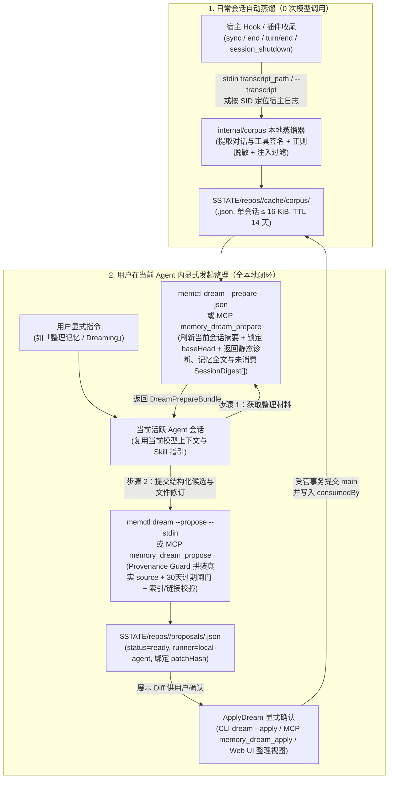

# 12. 跨会话新记忆提炼：本地当前 Agent 交互式整理方案

> 状态：`H-1` 方案与契约已修订（2026-10-20，`T098`），`H-2`–`H-4` 代码尚未实现。本文档定义在本地当前 Agent 会话内由用户显式发起的跨会话新记忆提炼与交互式整理架构：本地确定性会话蒸馏与脱敏缓存、`dream --prepare`/`--propose`（及对应 MCP 工具）两阶段本地协议、Go 代码级来源绑定守卫与验收矩阵。已实现的 GitHub Actions 远端整理（[11. GitHub Actions Dreaming](./11-github-actions-dreaming.md)）保持原样不变，不参与会话日志传输与提炼。基础模型、写入事务、MCP 通道与生命周期规则分别引用 [02](./02-domain-models-and-contracts.md)、[03](./03-workflows-and-dataflows.md)、[09](./09-mcp-memory-tools.md) 与 [10](./10-memory-lifecycle.md)。

## 1. 结论

- 职责正交切分：已实现的 [11. GitHub Actions Dreaming](./11-github-actions-dreaming.md)（`--runner <provider>` 与 `--worker`）保持不动，仅负责远端对已有记忆库执行去重、到期清理与索引整理；跨原始会话日志提炼未记录新记忆则**仅在本地当前活跃 Agent 会话内由用户显式发起并完成**，完全放弃将本地会话语料上传至远端分支或 GitHub Actions 处理。
- 零额外模型凭据、零子进程派生、数据不出本机：由用户正在使用的当前 Agent 会话自身充当整理推理大脑，直接通过 CLI（`memctl dream --prepare` / `memctl dream --propose --stdin`）或 MCP 工具（`memory_dream_prepare` / `memory_dream_propose`）与本机 `memctl` 交互；既不要求本地配置 API Key，也不由 `memctl` 反向派生无头 Agent CLI 子进程。
- 本地确定性会话蒸馏（`internal/corpus`）：`sync` 与 `end` 在本地执行 0 次模型调用的确定性提取（解析各宿主会话日志、剥离工具大输出、正则脱敏凭据与过滤可疑提示词注入回合），将单会话上限 `16 KiB` 的结构化摘要 `SessionDigest` 缓存在 `$STATE/repos/<repoId>/cache/corpus/`，防止当前 Agent 直接读取几十 MB 的原始 `.jsonl` 撑爆上下文窗口。
- 强制真实来源绑定（Provenance Guard）与单步确定性守卫：当前 Agent 在提交整理提案时，针对新提炼记忆只输出候选事实文本 `fact` 与引用的输入会话下标 `sessionIndices`，不得自行手写 `[source: ...]`；由本地 `memctl` 的 Go 代码校验下标合法性后确定性拼装 `- <fact> [source: <sourceTag>; added: <date>]`，并统一执行 30 天到期删除闸门（`DELETION_DEFERRED`）、受保护路径拦截、`MEMORY.md` 200 行限额与双向链接校验。
- 保持确认前不改主库：本地 `--propose` / `memory_dream_propose` 校验通过后，将结果直接持久化为本地 `status: "ready"`、`runner: "local-agent"` 的标准 `DreamProposal`（绑定 `baseHead` 与 `patchHash`）。用户可在当前会话指示 Agent 执行 `memctl dream --apply`（或 `memory_dream_apply`），也可在 `memctl ui` 的「整理」视图审阅 Diff 后点击确认；仅当 `ApplyDream` 提交成功后，才将本次参与整理的 `SessionDigest` 标记为已消费（`consumedBy`）。

## 2. 系统如何工作

### 2.1 端到端数据流



### 2.2 本地会话采集与确定性蒸馏（`internal/corpus`）

本地采集在 `memctl sync`、`memctl end`（含 `--stdin` Hook 路径以及 `memctl-dsh`、`memctl-pi` 的回合结束与会话卸载路径）以及 `dream --prepare` / `memory_dream_prepare` 中以非阻塞、尽力而为（best-effort）的方式执行。任何日志缺失、格式未知或读取超时均静默跳过，不阻塞宿主，也不影响 Git 同步。

#### 1. 各宿主原始会话日志定位

| 宿主（`--agent`） | 会话日志路径获取方式 | 提取源格式与关键字段 |
| --- | --- | --- |
| `claude-code`、`commandcode`、`grok` | Hook stdin JSON 原生携带 `"transcript_path"` 字段（由 `hookio.ReadInput` 解析），或显式传入 `--transcript <path>` | JSONL：提取用户文本消息、助手最终文本块，以及工具调用的名称、目标路径或命令名与退出状态 |
| `codex` | Hook stdin JSON 原生携带 `"transcript_path"` 与 `"last_assistant_message"` 字段，或显式传入 `--transcript <path>` | JSON / JSONL：提取用户消息、工具调用摘要与 `last_assistant_message` |
| `pi` | `memctl-pi` 在 `agent_settled` 与 `session_shutdown` 中通过 `ctx.sessionManager.getSessionFile()` 取得路径并以 `--transcript <path>` 传给 `memctl` | JSONL：提取用户消息、助手文本回复与 `bash`/`edit` 工具调用签名 |
| `dsh` | `memctl-dsh` 在 `turn/end` 与 `agent/disposed` 中定位当前 profile 下的会话文件并以 `--transcript <path>` 传入，不可得时跳过 | 会话记录：提取用户指令与每轮最终回复 |
| `antigravity` | 优先读取 Hook stdin 的 `"transcript_path"`；缺失时按稳定 `sid`（`conversationId`）定位 `$HOME/.gemini/antigravity/brain/<sid>/.system_generated/logs/transcript.jsonl` | JSONL：提取 `type="USER_INPUT"` 与 `type="PLANNER_RESPONSE"` 的 `content`（跳过 `thinking` 与工具长输出） |
| `opencode` | 显式传入 `--transcript <path>`，或按稳定 `sid` 读取 `$HOME/.local/share/opencode/storage/message/<sid>/` | JSON 消息文件：提取用户与助手文本 |

设置环境变量 `AGENT_MEMORY_CORPUS=0`（或 `false`、`off`、`no`）时，本地完全禁用会话摘要采集，不读写 `$STATE/repos/<repoId>/cache/corpus/`。

#### 2. `SessionDigest` 数据结构与限额

每个存在稳定 `sid` 的会话在 `$STATE/repos/<repoId>/cache/corpus/<sha256(agent + "\x00" + sid)>.json` 下对应唯一一份摘要文件，采用同目录临时文件加 rename 原子更新：

```json
{
  "schemaVersion": 1,
  "agent": "claude-code",
  "sessionId": "6ae43eec-0f2e-4de4-995b-4e113785a4c1",
  "sourceTag": "agent://MacBookPro.local/claude-code/6ae43eec-0f2e-4de4-995b-4e113785a4c1",
  "date": "2026-10-20",
  "updatedAt": "2026-10-20T05:30:00Z",
  "cwdBase": "memctl",
  "wroteMemoryInSession": false,
  "consumedBy": "",
  "turns": [
    {
      "user": "发布新版 release，注意不要在本地跑 make release 上传",
      "tools": [
        "bash: git tag -a v0.9.1 (exit 0)",
        "bash: git push origin v0.9.1 (exit 0)"
      ],
      "assistant": "已推送标签 v0.9.1 触发流水线发布。"
    }
  ]
}
```

字段与限额规则：

| 常量或字段 | 取值与规则 |
| --- | --- |
| `MaxTurnsPerSession` | `20`；超出时优先保留含用户纠正信号（如「不要」「改为」「记住」「不对」「以后」等及对应英文词）的回合与最近回合 |
| `MaxTurnTextBytes` | 单回合 `user` 或 `assistant` 文本上限 `1024` 字节（按 UTF-8 字符边界截断并标记 `…`） |
| `MaxToolsPerTurn` | 单回合最多 `5` 条工具签名，每条上限 `160` 字节；只记录工具名、首行命令或根相对路径及退出码，丢弃工具 stdout/stderr 与文件内容 |
| `MaxSessionDigestBytes` | 单个 `SessionDigest` 序列化后上限 `16 KiB`；超限时从最早的非纠正回合开始裁剪 |
| `CorpusStateTTL` | `14` 天（与 `SessionStateTTL` 一致）；每次采集与 `dream --prepare` 启动时自动清理过期文件 |
| `cwdBase` | 仅保留工作目录的 basename（如 `memctl`），不记录宿主机完整绝对路径结构 |
| `wroteMemoryInSession` | 若该会话已在记忆仓库产生包含 `Session: <sid>` trailer 的提交，记为 `true`，供当前 Agent 降低重复提取权重 |

#### 3. 本地确定性清洗与脱敏规则

写入 `SessionDigest` 前，`internal/corpus` 依次执行三道确定性过滤：

1. **系统与注入块剥离**：剔除 `<system-reminder>...</system-reminder>`、`<MEMCTL_INSTRUCTIONS>...</MEMCTL_INSTRUCTIONS>`、`[agent-memory] ...` 注入横幅、代码块中的大段文件内容，以及模型内部 `thinking` / `reasoning` 字段。
2. **凭据与密钥正则脱敏**：将匹配以下模式的子串替换为 `[REDACTED]`：
   - 常见 API Key 与令牌前缀：`sk-[A-Za-z0-9_-]{16,}`、`gh[pousr]_[A-Za-z0-9]{20,}`、`github_pat_[A-Za-z0-9_]{20,}`、`xox[baprs]-[A-Za-z0-9-]{10,}`、`AKIA[0-9A-Z]{16}`、`AIza[0-9A-Za-z_-]{35}`；
   - JWT 与长 Bearer 串：`eyJ[A-Za-z0-9_-]{10,}\.[A-Za-z0-9_-]{10,}\.[A-Za-z0-9_-]{10,}`、`(?i)bearer\s+[A-Za-z0-9._~+/=-]{16,}`；
   - 键值赋值中的敏感值：`(?i)(api[_-]?key|secret|password|passwd|access[_-]?token|refresh[_-]?token|private[_-]?key|authorization)\s*[:=]\s*["']?[^\s"',;]+`；
   - PEM 私钥块：`-----BEGIN [A-Z0-9 ]*PRIVATE KEY-----[\s\S]*?-----END [A-Z0-9 ]*PRIVATE KEY-----`；
   - URL 内嵌凭据：`https?://[^/\s:@]+:[^/\s:@]+@`。
3. **可疑指令回合过滤**：复用 `doctor` 的可疑提示词注入检测模式（如要求忽略系统规则、外发数据或修改安全配置）；命中可疑模式的单个回合直接丢弃，不进入 `turns`。

### 2.3 本地当前 Agent 交互式整理协议（`prepare` → `propose` → `apply`）

用户在当前 Agent 会话中显式发起整理时，Agent 按配套 Skill（`skills/memctl/SKILL.md`）指引执行两步结构化交互；受沙箱限制的宿主（如 `workspace-write` 下的 Codex 与 DSH）直接调用同名 MCP 工具，无需放宽工作区沙箱。

#### 步骤 1：准备整理上下文（`memctl dream --prepare --json` / MCP `memory_dream_prepare`）

1. **刷新当前会话摘要**：若当前调用带有稳定 `agent` 与 `sid`（或能按 `sid` 定位当前会话日志），先尽力触发一次当前会话的增量蒸馏，确保当前会话的最新对话已写入 `cache/corpus/`。
2. **锁定基线与静态扫描**：在仓库锁内确认工作树干净、无未完成事务或冲突，记录 `baseHead` 与 `baseRevision`；运行与 `doctor` 相同的静态扫描（识别膨胀索引、孤立文件、断链、重复候选，以及区分「仍在 30 天隐藏期」与「隐藏期已满可删除」的到期 `until` 条目）。
3. **读取未消费会话摘要**：扫描 `$STATE/repos/<repoId>/cache/corpus/`，筛选 `consumedBy == ""` 且 `turns` 非空的 `SessionDigest`，按 `updatedAt` 倒序取最多 `MaxCorpusSessions = 20` 个（累计上限 `MaxCorpusBytes = 256 KiB`），并按顺序赋予整数下标 `sessionIndex: 0..N-1`。
4. **返回 `DreamPrepareBundle`**：

```json
{
  "today": "2026-10-20",
  "baseHead": "e4b8...",
  "baseRevision": "rev-...",
  "rules": {
    "entryMaxLines": 200,
    "deletionGraceDays": 30,
    "implicitPreferenceMinSessions": 2
  },
  "findings": [
    {
      "code": "EXPIRED_ELIGIBLE",
      "path": "notes/sprint.md",
      "message": "- 临时冻结发布 [source: ...; added: 2026-08-01; until: 2026-09-01] (expired >= 30d, eligible for deletion)"
    }
  ],
  "files": [
    {
      "path": "MEMORY.md",
      "revision": "sha256:...",
      "content": "# Memory\n\n## Index\n..."
    }
  ],
  "sessions": [
    {
      "sessionIndex": 0,
      "agent": "claude-code",
      "sourceTag": "agent://MacBookPro.local/claude-code/6ae43eec-...",
      "date": "2026-10-20",
      "cwdBase": "memctl",
      "wroteMemoryInSession": false,
      "turns": [ /* ... */ ]
    }
  ]
}
```

#### 步骤 2：Agent 提炼规则与提交提案（`memctl dream --propose --stdin` / MCP `memory_dream_propose`）

当前 Agent 根据 `DreamPrepareBundle` 在会话上下文内完成推理：

1. **三类可提取新记忆信号**：
   - **显式纠正与持久偏好（`state`）**：用户在对话中纠正 Agent 的错误假设、命名习惯、工具选择或输出风格（如「不要运行本地 `make release`，发布只推标签」）。
   - **多轮排障结论与领域映射（`state` 或 `event`）**：经过排查才定位的非显而易见事实、模块映射关系或环境约束（如「DSH 的 MCP 客户端随应用内置无需在 profile 安装」）。
   - **架构决策与有时效约束（`event` 或 `time_limited`）**：明确的技术选型理由、迁移结论，或带明确截止日期的临时约束（以对应会话的 `date` 为基准换算为 `until: YYYY-MM-DD`）。
2. **跨会话频次门控（防噪音扩散）**：
   - 用户明确发出的全局规则、显式纠正或已验证的排障根因：允许从单个会话（`len(sessionIndices) >= 1`）提炼。
   - 隐式行为偏好（用户未说「记住/以后都这样」，仅在交互中表现出某种倾向）：必须在至少 `2` 个不同会话（`len(sessionIndices) >= 2`）中重复出现一致信号才允许提炼；只出现 1 次的隐式倾向必须忽略。
   - 禁止提炼：单次具体编码任务的待办状态、可由 `git log` 或代码搜索直接得出的普通函数名/行号、临时报错日志、与已有文件条目语义重复的事实。
3. **结构化输入（`DreamProposeInput`）**：
   Agent 不得在 `newMemories[].fact` 中手写 `[source: ...]` 或前导 `- `，而是通过 `--stdin` 或 `memory_dream_propose` 提交如下结构化对象：

```json
{
  "baseHead": "e4b8...",
  "baseRevision": "rev-...",
  "newMemories": [
    {
      "kind": "state",
      "targetPath": "notes/release.md",
      "section": "## 规则",
      "fact": "发布唯一入口是推送 v* 标签，禁止在本地运行 make release 上传产物",
      "sessionIndices": [0],
      "rationale": "用户在会话 0 明确纠正发布流程"
    }
  ],
  "files": [
    {
      "path": "MEMORY.md",
      "action": "update",
      "content": "# Memory\n\n## Index\n- [[notes/release]] — 发布规则\n"
    }
  ],
  "warnings": []
}
```

#### 步骤 3：Go 代码级来源绑定与确定性守卫（Provenance & Step Guard）

`memctl` 收到 `DreamProposeInput` 后，在本地内存中基于 `baseHead` 快照依次执行确定性守卫（任一校验失败立即返回结构化错误原因与修正提示，供当前 Agent 在同一轮修正重试，不写盘）：

1. **下标与来源真实性校验（Provenance Guard）**：
   - `newMemories` 最多 `MaxExtractedCandidates = 30` 条；每条的 `sessionIndices` 必须非空，且每个整数 $i$ 必须满足 $0 \le i < \text{len(sessions)}$（对应 `baseHead` 准备阶段读取的未消费会话列表）。越界或为空立即返回 `INVALID_INPUT`。
   - `fact` 必须为单行非空文本（不含换行符），不得包含模型自行拼写的 `[source:` 或 `[added:` 尾注，且必须再次通过 §2.2 的凭据脱敏与可疑指令检查；若 `kind == "time_limited"`，`until` 必须是合法的 `YYYY-MM-DD` 且不早于对应会话的 `date`。
   - 若 `normalizeFact(fact)` 与当前记忆库已有条目的归一化文本完全相同，自动跳过该条候选，避免重复入库。
2. **Go 代码确定性拼装与注入**：
   - 按 `sessionIndices` 首次出现的顺序去重，提取对应的真实 `sessions[i].sourceTag`，取所引用会话中最新的 `date` 作为 `added` 日期。
   - 由 Go 代码生成标准条目行：`- <fact> [source: <tag1>; source: <tag2>; added: <latestDate>]`（含 `until` 时追加 `; until: <YYYY-MM-DD>`），并按 `targetPath` 与可选 `section` 标题确定性合入目标 Markdown 文件（目标文件尚不存在且未在 `files` 中提供时，自动创建带一级标题与该条目的新文件；若 `MEMORY.md` 的 `## Index` 尚未包含 `[[targetPath]]`，自动补齐索引链接）。
3. **文件修订与生命周期守卫**：
   - 对合入新记忆及 `files[]` 修订后的完整结果树，复用 `dream` 既有的全套不可信输入校验：拒绝 `.git`/`.github` 等 `protectedPath`、校验事件型条目未被删除、校验未满 30 天隐藏期的 `until` 条目未被删除（违者返回 `DELETION_DEFERRED`）、校验 `MEMORY.md` 不超过 200 行且不存在新的断链或孤立文件。
4. **生成本地提案**：
   - 校验全部通过后，计算从 `baseHead` 到目标文件树的有序 `changes`、`diff` 与 `patchHash`，在 `$STATE/repos/<repoId>/proposals/<proposalId>.json` 持久化 `status: "ready"`、`runner: "local-agent"`、`sessionsScanned: len(sessions)`、`newMemoriesExtracted: len(acceptedNewMemories)` 的 `DreamProposal`（同时在提案内部记录本次涉及的 `corpusDigests` 文件名列表）。
   - 向调用方返回 `{proposalId, status: "ready", patchHash, sessionsScanned, newMemoriesExtracted, changes, diff, warnings}`。

#### 步骤 4：显式确认与消费标记（`ApplyDream`）

1. Agent 将生成的提案摘要与 Diff 展示给用户；用户确认后，可通过以下任一入口应用提案：
   - 当前 Agent 调用 `memctl dream --apply <proposalId> --patch-hash <patchHash>` 或 MCP `memory_dream_apply`；
   - 用户在终端手工运行上述命令，或在 `memctl ui` 的「整理」视图审阅 Diff 后点击「应用提案」。
2. `ApplyDream` 持仓库锁校验 `baseRevision` 与 `patchHash`，通过受管写入事务提交到主分支（提交说明带 `Proposal: <proposalId>` trailer），并将该提案关联的 `corpusDigests` 中各 `SessionDigest` 文件的 `consumedBy` 更新为 `<proposalId>`。
3. 提案在被 `ApplyDream` 成功提交前，所有 `SessionDigest` 的 `consumedBy` 保持为空字符串 `""`；若提案被丢弃或因基线变化转为 `stale`，下次整理仍会纳入这些会话摘要。

## 3. 安全、治理与禁止项

### 3.1 信任边界

| 边界 | 机制与保障 |
| --- | --- |
| 会话数据完全不出本机 | `SessionDigest` 仅保存在本机 `$STATE/repos/<repoId>/cache/corpus/`，仅由本机当前 Agent 通过本地 CLI/MCP 读取；不上传 Git 分支，不发往 GitHub Actions |
| 历史日志脱敏与防撑爆 | 本地蒸馏器剥离工具长输出与系统块，单回合 $\le 1024$ 字节、单会话 $\le 16\text{ KiB}$，并对 API Key/Token/密码执行正则脱敏、过滤可疑提示词注入回合 |
| 杜绝伪造来源 URI | Agent 只输出整数下标 `sessionIndices`，`[source: agent://...; added: YYYY-MM-DD]` 完全由本机 Go 代码根据权威会话身份拼装 |
| 确认前不改主库 | `dream --propose` 与 `memory_dream_propose` 只写 `$STATE/repos/<repoId>/proposals/` 下的待审阅提案，不修改 `~/memory` 工作树与 Git 历史 |

### 3.2 禁止项

1. **禁止在本地采集路径调用模型或阻塞宿主退出**：`internal/corpus` `MUST` 仅使用确定性解析与正则处理，单次提取耗时预算不超过 `200 ms`；读取失败或超时必须静默放弃，不得令 `sync` 或 `end` 返回非零退出码。
2. **禁止信任 Agent 手写的 `source` 元数据**：`dream --propose` 与 `memory_dream_propose` 的 Provenance Guard `MUST` 拒绝任何在 `newMemories[].fact` 中内嵌 `[source:` 的输入，或越界引用不存在的 `sessionIndices`。
3. **禁止绕过提案直接落盘批量整理结果**：跨会话整理与全库去重/清理 `MUST` 先通过 `propose` 生成绑定 `patchHash` 的 `DreamProposal`，再经 `ApplyDream` 校验基线并提交；不得在 `propose` 阶段直接改动主分支。
4. **禁止在提案未应用前将会话摘要标为已消费**：只有 `ApplyDream` 完成本地 Git 提交后才允许写入 `consumedBy`；仅执行 `prepare` 或 `propose` 不得消耗摘要。

## 4. 调研依据：为什么采用「本地蒸馏缓存 + 当前 Agent 交互式整理」

| 对照维度 | Cognition Devin（上游） | Claude Code / OpenClaw | 远端 Actions 方案（已放弃用于会话提炼） | 本方案（本地当前 Agent 交互式） |
| --- | --- | --- | --- | --- |
| 执行环境与凭据 | 云端 VM 直接读取同机日志并调用云端模型 | 本地后台进程读取 `~/.claude/projects/*.jsonl` | 需将脱敏语料推上 GitHub 分支并配置 Actions API Key Secret | 直接复用用户当前活跃 Agent 会话与模型通道，零额外凭据、会话语料不出本机 |
| 沙箱与进程兼容 | 同机特权进程 | 宿主内置逻辑 | 无本地沙箱问题，但有 30–90 秒 CI 排队延迟 | 通过既有 `memctl mcp` 与 CLI 原语交互，天然兼容 `workspace-write` 沙箱，10 秒级完成 |
| 噪音与频次门控 | 对比多次会话中的用户纠正与工具成败 | Light → REM → Deep 三阶段，跨会话频次门控 | 远端多步调用 | 本地确定性蒸馏（Light）→ 当前 Agent 按频次门控提炼（REM）→ 本地 Go 守卫拼装来源并生成提案（Deep） |
| 来源可追溯（Provenance） | `[source: <session_url>; added: YYYY-MM-DD]` | 转换相对日期为 ISO 日期 | 远端 worker 拼装 | Agent 只传 `sessionIndices`，本机 Go 代码强制拼装权威 `agent://<device>/<agent>/<sid>` 与日期 |

## 5. 契约改动映射

| 文档 | 章节 | 修订内容 |
| --- | --- | --- |
| [01. 架构与模块](./01-architecture-and-modules.md) | 3.1、4、5 | `$STATE/repos/<repoId>/cache/corpus/` 纳入可重建缓存；新增 `internal/corpus` 模块职责与目录规划；`internal/dream` 支持本地 Agent 交互式 `prepare`/`propose` |
| [02. 模型与契约](./02-domain-models-and-contracts.md) | 2.3 | `DreamProposal` 的 `runner` 支持 `"local-agent"`，新增可选 `sessionsScanned?` 与 `newMemoriesExtracted?` 统计字段 |
| [03. 流程与恢复](./03-workflows-and-dataflows.md) | 4.1、6 | 说明 `sync`/`end` 顺带更新本地脱敏会话摘要缓存；第 6 节并列说明「GitHub Actions 远端整理（既有不动）」与「本地当前 Agent 交互式整理（`prepare` → `propose` → `apply`）」共用同一 `DreamProposal` 与 `ApplyDream` 闭环 |
| [04. CLI、UI 与分发](./04-ui-and-cli-specification.md) | 1、2、3、4 | `sync`/`end` 支持可选 `--transcript PATH`；`dream` 新增 `--prepare [--json]` 与 `--propose --stdin`；环境变量表新增 `AGENT_MEMORY_CORPUS`；`hookio` 解析 `transcript_path` 与 `last_assistant_message`；UI「整理」视图支持展示 `local-agent` 提案及扫描会话数/新提炼条目数 |
| [05. 验收与交付](./05-validation-and-delivery.md) | 1、2 | 更新阶段 H（本地当前 Agent 交互式跨会话整理）实施顺序及 `D06`、`D07` 验收场景 |
| [09. MCP 记忆工具](./09-mcp-memory-tools.md) | 1、4.4、6.1 | `memctl mcp` 新增 `memory_dream_prepare`、`memory_dream_propose`、`memory_dream_apply` 三个工具，供受沙箱宿主在会话内完成交互式整理 |

## 6. 验收矩阵与实施计划

### 6.1 新增验收场景（`D06`、`D07`）

| ID | 输入或故障场景 | 可验证结果 |
| --- | --- | --- |
| `D06` | Hook stdin 含 `transcript_path` / `last_assistant_message` 或传入 `--transcript`；日志含超长工具输出、各类 API Key/Token/密码、`<system-reminder>`、可疑提示词注入回合，或设置了 `AGENT_MEMORY_CORPUS=0` | 生成的 `SessionDigest` 大小 $\le 16\text{ KiB}$，所有凭据模式被替换为 `[REDACTED]`，系统块与可疑回合被剔除；`AGENT_MEMORY_CORPUS=0` 或日志文件缺失时不写缓存且命令退出码为 `0` |
| `D07` | 存在未消费 `SessionDigest` 时通过 CLI（`dream --prepare` → `dream --propose --stdin` → `dream --apply`）或 MCP（`memory_dream_prepare` → `memory_dream_propose` → `memory_dream_apply`）执行本地交互式整理；以及传入越界 `sessionIndices`、伪造 `[source:]`、删除事件型条目或删除未满 30 天的过期条目 | 正常路径生成 `runner: "local-agent"`、`status: "ready"` 的 `DreamProposal`，新条目精确携带由 Go 代码拼装的真实会话 `source` 与 `added` 日期，不发起任何远端分支推送；`apply` 成功后提交主分支并将摘要标记 `consumedBy`；越界下标、伪造 `source`、删除事件型条目或触发 `DELETION_DEFERRED` 时被本地守卫拒绝且不生成提案 |

### 6.2 阶段 H 实施顺序

| 步骤 | 前置依赖 | 本轮交付边界 | 对应验收 |
| --- | --- | --- | --- |
| `H-1`：方案与契约修订（`T098`，本轮） | `G-4` | 新增 `docs/12-session-corpus-dreaming.md`，同步修订 `docs/01`–`05`、`docs/09`、`docs/README.md` 与 `docs/STATUS.md`；不改动已实现的 GitHub Actions Dreaming 功能 | 文档链接、锚点与跨文档契约一致性检查 |
| `H-2`：本地会话蒸馏器与 Hook/插件接线 | `H-1` | 实现 `internal/corpus`（各宿主 JSONL 解析、回合裁剪、正则脱敏、可疑指令过滤、14 天 TTL 缓存）；扩展 `hookio.ReadInput` 解析 `transcript_path` 与 `last_assistant_message`；`sync`/`end` 支持 `--transcript` 与 `AGENT_MEMORY_CORPUS`；更新 `memctl-pi` 与 `memctl-dsh` 传递会话文件路径 | `D06` 单元测试与 CLI 集成测试 |
| `H-3`：本地交互式 `prepare`/`propose` 与 MCP 工具 | `H-2` | `internal/dream` 实现 `PrepareLocal` 与 `ProposeLocal`（含 Provenance Guard 来源拼装、文件合入、30 天删除闸门与索引校验）及 `ApplyDream` 后的 `consumedBy` 更新；CLI 新增 `dream --prepare`、`dream --propose --stdin`；`internal/mcp` 新增 `memory_dream_prepare`、`memory_dream_propose`、`memory_dream_apply` | `D07` 单元测试、MCP 协议测试与 CLI 集成测试 |
| `H-4`：配套 Skill、CLI 帮助、UI 展示与端到端验收 | `H-3` | 更新 `skills/memctl/SKILL.md` 纳入本地交互式 Dreaming 指引；更新中英与 JSON 帮助；UI「整理」视图兼容展示 `local-agent` 提案及 `sessionsScanned`/`newMemoriesExtracted`；完成宿主会话内端到端验收 | `D06`、`D07`、`R06`、前端单测与真实宿主会话回归 |
