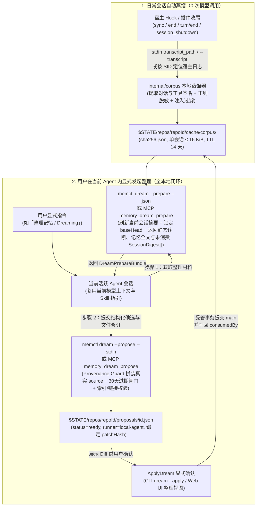

# 12. 跨会话新记忆提炼：本地当前 Agent 交互式整理方案

> 状态：`H-1` 方案与契约已修订（2026-10-20，`T098`、`T099`）；`H-2a` 本地会话蒸馏器已实现并验收（2026-10-20，`T100`）；`H-2b` 存量多会话补扫与 `antigravity` 接入已实现并验收（2026-10-20，`T101`）；`H-3` 本地 `prepare`/`propose`、项目筛选与两个 MCP 工具已实现并验收（2026-10-20，`T102`）；`H-4` 的配套 Skill、中英与 JSON 帮助、UI「整理」视图的本地提案列表与宿主会话内端到端验收已完成（2026-10-20，`T103`）；`H-2c` 的 CodeBuddy 与 WorkBuddy 会话格式接入已完成（2026-10-21，`T115`）；阶段 I 的 `I-1b`（2026-11-11，`T139`）已补齐 `antigravity-cli/brain` 会话扫描与定位、通用 Git 顶层/worktree/软链接项目根归一化、可疑指令过滤器显式注入、已消费会话增量回合水位 `consumedTurns`、`files[]` 新增行差集守卫、`prepare-<bundleId>.json` 快照隔离与凭据脱敏规则扩展；阶段 I 的 `I-3b`（2026-11-11，`T143`）已将远端 GitHub Actions 轨道标记为维护冻结并确立本地方案为首选轨道，升级 `SessionDigest` 头尾保留截断（前 `384 B` + 后 `619 B`）、有界工具输出摘要 `toolOutcomes`（每回合最多 `4` 条，单条 `<= 256 B`）与超 `8 MiB` 明文日志首行保留（`MaxFirstLineBytes = 64 KiB`），在 `prepare` 中新增 `relatedExistingEntries`（最多 `20` 条）与 `rules.tasks` 双向纠错指引，并在 `propose` 中支持结构化 `operations[]`（`append_entry`、`replace_entry`、`delete_entry`）无损组装。本文档定义在本地当前 Agent 会话内由用户显式发起的跨会话新记忆提炼与交互式整理架构：本地确定性会话蒸馏与脱敏缓存、`dream --prepare`/`--propose`（及对应 MCP 工具）两阶段本地协议、Go 代码级来源绑定守卫与验收矩阵。已实现的 GitHub Actions 远端整理（[11. GitHub Actions Dreaming](./11-github-actions-dreaming.md)）处于维护冻结状态，保留既有兼容，不参与会话日志传输与提炼。基础模型、写入事务、MCP 通道与生命周期规则分别引用 [02](./02-domain-models-and-contracts.md)、[03](./03-workflows-and-dataflows.md)、[09](./09-mcp-memory-tools.md) 与 [10](./10-memory-lifecycle.md)。

## 1. 结论

- 职责切分与单轨主推：已实现的 [11. GitHub Actions Dreaming](./11-github-actions-dreaming.md)（`--runner <provider>` 与 `--worker`）自 `I-3b`（`T143`）起进入维护冻结状态，保留现有兼容，仅用于远端对已有记忆库做静态整理；跨原始会话日志提炼未记录新记忆以及对照会话轨迹与工具输出证伪修正错误旧条目，**统一以本地当前活跃 Agent 会话内的交互式整理（`--prepare` / `--propose`）作为首选主轨道**，完全放弃将本地会话语料上传至远端分支或 GitHub Actions 处理。
- 零额外模型凭据、零子进程派生：由用户正在使用的当前 Agent 会话自身充当整理推理大脑，直接通过 CLI（`memctl dream --prepare` / `memctl dream --propose --stdin`）或 MCP 工具（`memory_dream_prepare` / `memory_dream_propose`）与本机 `memctl` 交互；既不要求本地配置 API Key，也不由 `memctl` 反向派生无头 Agent CLI 子进程。
- 本地整理路径不依赖远端：`prepare`/`propose`/`apply` 不要求已确认的 GitHub 远端，也不要求仓库内存在 `.github/workflows/memctl-dream.yml`。这两项仍是远端整理路径（`--runner`）的前置条件，不受本文档影响。
- 会话数据出本机的唯一出口是当前 Agent 的上下文：`SessionDigest` 不上传 Git 分支、不发往 GitHub Actions，但 `prepare` 会把摘要注入当前 Agent 会话，而该会话由宿主所称的云端模型处理。这是本方案明确接受并需要用户知晓的边界，见 §3.1。
- 本地确定性会话蒸馏与存量多会话补扫（`internal/corpus`）：一方面，`sync` 与 `end` 在日常会话中执行 0 次模型调用的确定性提取（解析各宿主会话日志、头尾保留截断超长对话文本、提取失败或最后一步验证命令的有界输出摘要 `toolOutcomes`、正则脱敏凭据与过滤可疑提示词注入回合），将单会话上限 `16 KiB` 的结构化摘要 `SessionDigest` 缓存在 `$STATE/repos/<repoId>/cache/corpus/`；另一方面，`dream --prepare`（及 `memory_dream_prepare`）启动时调用补扫入口，对本机已知宿主的会话存储目录执行**存量历史会话补扫（Backfill Scan）**，把最近 14 天内尚未入池的当前项目会话补入缓存，再由 `H-3` 按**当前项目优先**策略一次打包最多 `12` 个未消费会话、累计不超过 `96 KiB`，同时调用纯 Go 分词 BM25 检索器召回最多 `20` 条关联已有条目 `relatedExistingEntries` 供对照轨迹核验。
- 强制真实来源绑定（Provenance Guard）、结构化 `operations[]` 无损组装与单步确定性守卫：当前 Agent 在提交整理提案时，优先提交结构化动作列表 `operations[]`（支持 `append_entry`、`replace_entry`、`delete_entry`，同时保留 `files[]` + `newMemories[]` 整文件通道供全文件重排），针对新提炼或替换的记忆只输出候选事实文本 `fact` 与引用的输入会话下标 `sessionIndices`，不得自行手写 `[source: ...]`；由本地 `memctl` 的 Go 代码校验下标合法性后确定性拼装 `- <fact> [source: <sourceTag>; added: <date>]`、在内存中无损编辑基线文件并同事务幂等补齐 `MEMORY.md` 的 `## Index` 链接，统一执行 30 天到期删除闸门（`DELETION_DEFERRED`）、受保护路径拦截与双向链接校验。
- 保持确认前不改主库：本地 `--propose` / `memory_dream_propose` 校验通过后，将结果直接持久化为本地 `status: "ready"`、`runner: "local-agent"` 的标准 `DreamProposal`（绑定 `baseHead` 与 `patchHash`）。用户可在当前会话指示 Agent 执行 `memctl dream --apply`（或在本机终端运行同一命令），也可在 `memctl ui` 的「整理」视图审阅 Diff 后点击确认；「整理」视图通过 `GET /api/v1/dream` 列出已持久化提案（含 `local-agent` 的扫描会话数与新提炼条目数），该列表不依赖远端就绪状态。MCP 通道不提供 `memory_dream_apply`，见 §3.2。仅当 `ApplyDream` 提交成功且 `consumedBy` 写回完成后，本次参与整理的 `SessionDigest` 才标记为已消费。

## 2. 系统如何工作

### 2.1 端到端数据流



### 2.2 本地会话采集与确定性蒸馏（`internal/corpus`）

本地采集在 `memctl sync`、`memctl end`（含 `--stdin` Hook 路径以及 `memctl-dsh`、`memctl-pi` 的回合结束与会话卸载路径；`memctl-pi` 同时服务 pi 与 OMP）以及 `dream --prepare` / `memory_dream_prepare` 中以非阻塞、尽力而为（best-effort）的方式执行。任何日志缺失、格式未知或读取超时均静默跳过，不阻塞宿主，也不影响 Git 同步。

#### 1. 各宿主原始会话日志定位与存量目录补扫

`internal/corpus` 同时支持**单次实时采集**（由 Hook / 插件在 `sync`、`end` 时传入当前会话路径）与**存量多会话补扫**（由 `dream --prepare` / `memory_dream_prepare` 扫描本机宿主历史目录）。下表把「已在本机核对过格式」与「仅按约定探测」分开记录，避免把未验证的解析写成已支持能力：

| 宿主（`--agent`） | 实时采集路径获取（`sync`/`end`） | 存量多会话补扫目录（`dream --prepare`） | 提取源格式与关键字段 | 格式核对状态 |
| --- | --- | --- | --- | --- |
| `claude-code` | Hook stdin `"transcript_path"` 或 `--transcript <path>`（`H-2a` 已实现，未接宿主 Hook 样例） | `$HOME/.claude/projects/*/*.jsonl`（项目目录名是 cwd 的路径转义，反向还原为 `cwdBase`；文件名即 `sid`） | JSONL：提取用户文本消息、助手最终文本块，以及工具调用的名称、目标路径或命令名与退出状态 | 已核对 |
| `codex` | Hook stdin `"transcript_path"` 与 `"last_assistant_message"` 或 `--transcript <path>` | `$HOME/.codex/sessions/**/*.jsonl`（首行 `type: "session_meta"` 的 `payload.id` 与 `payload.cwd`） | JSON / JSONL：提取用户消息、工具调用摘要与 `last_assistant_message` | 已核对 |
| `pi` | `memctl-pi` 通过 `ctx.sessionManager.getSessionFile()` 取得会话文件路径并传 `--transcript <path>`；宿主未提供该方法时不传路径 | `$HOME/.pi/agent/sessions/**/*.jsonl`（首行 `type: "session"` 的 `id` 与 `cwd`） | JSONL：提取用户消息、助手文本回复与 `bash`/`edit` 工具调用签名 | 已核对 |
| `omp` | `memctl-pi` 通过 `ctx.sessionManager.getSessionFile()` 取得 OMP 转录路径并传 `--transcript <path>`；宿主未提供该方法时不传路径 | `$HOME/.omp/agent/sessions/**/*.jsonl`（目录与文件名规则与 pi 相同；转录在 `type: "session"` 记录前可能有一行 `type: "title"`） | 与 `pi` 共用解析器：按记录类型查找 `session` 元数据，提取用户消息、助手文本与工具调用签名 | 已核对（OMP 18.17.0 真机转录与 `sync --transcript` 蒸馏） |
| `dsh` | `memctl-dsh` 在会话根下定位 `session-<sid>/` 目录并取最高版本记录传给 `--transcript <path>`；会话根依次取 `DSH_SESSIONS_DIR`、`$DSH_HOME/sessions`、`~/.dsh/sessions`，都不可用时插件不传路径 | `$HOME/.dsh/sessions/<cwd 转义目录>/session-<sid>/session.v4.jsonl.zstd`（同目录可能有 `session.v3.jsonl.zstd` 与未分片的 `session.jsonl.zstd`，取版本号最高者） | JSONL（zstd 压缩）：首行 `type: "session"` 的 `id` 与 `cwd`；对话从 `user/message`（`data.content[].text`）、`assistant/message`（`data.message.content[]` 中 `type: "text"`）、`tool/call`（`data.name` 与 `data.arguments`）与 `tool/result`（`data.message.isError`）提取；`type: "reasoning"` 内容块丢弃 | 已核对，**zstd 压缩** |
| `antigravity` | Hook stdin `"transcript_path"`，缺失时按 `sid` 定位（Hook payload 携带有效非配置目录 `cwd` 时经 `ResolveProjectRoot` 归一化后优先覆盖） | `$HOME/.gemini/antigravity/brain/<sid>/.system_generated/logs/transcript.jsonl` 与 `$HOME/.gemini/antigravity-cli/brain/<sid>/.system_generated/logs/transcript.jsonl`（目录名为 `sid`，`LocateSession` 与 `Backfill` 同时扫描两处） | JSONL：`type="USER_INPUT"` 且 `source="USER_EXPLICIT"` 的记录取 `<USER_REQUEST>` 正文（剥离同记录内的 `<ADDITIONAL_METADATA>`、`<USER_SETTINGS_CHANGE>`）；`type="PLANNER_RESPONSE"` 取 `content` 文本与 `tool_calls[].args` 的命令/路径签名，丢弃同层 `thinking`；其余记录类型（`CONVERSATION_HISTORY`、`CHECKPOINT`、`RUN_COMMAND` 等）是工具输出或系统块，不进入摘要。工作目录从 `run_command` 的 `args.Cwd` 或 `<user_information>` 的 `Command Working Directory:` 提取，并忽略 `~/.gemini/config` 等宿主配置目录 | 已核对（IDE 与 CLI transcript 事件类型与字段层级） |
| `codebuddy` | Hook stdin 的 `"transcript_path"`（headless 会话已验证 `SessionStart`/`Stop` 采集） | `$HOME/.codebuddy/projects/*/*.jsonl`（项目目录名是 `cwd` 的路径转义，只把分隔符替换为 `-`；文件名即 `sid`） | JSONL：每行带 `sessionId`、`cwd` 与毫秒时间戳；`type="message"` 的 `input_text`/`output_text` 取对话，`function_call` 取工具名与 `arguments` 中的命令或路径；`reasoning`、`function_call_result.output` 与宿主回显（`providerData.skipRun`、`<local-command-*>`、`<command-name>`、`<command-args>`、`<task-notification>`）丢弃；`type="summary"` 标记上下文已压缩 | 已核对（本机 CodeBuddy 日志与真实 Hook 会话） |
| `workbuddy` | Hook stdin 的 `"transcript_path"`（headless sidecar 已验证 `SessionStart`/`Stop` 采集） | `$HOME/.workbuddy/projects/*/*.jsonl`（目录转义与 `codebuddy` 相同） | 与 `codebuddy` 共用格式；新会话首行可能是 `type="session-meta"`，只提供 `sessionId`、不含 `cwd`，不作为对话内容 | 已核对（本机 WorkBuddy 日志与 sidecar 会话） |
| `opencode` | `--transcript <path>` 或按 `sid` 读取 | 无 `.jsonl` 会话日志；状态在 `$HOME/.local/share/opencode/opencode.db`（SQLite） | 不解析：读取 SQLite 会引入新依赖与写入风险，本阶段只接受显式 `--transcript` | 未支持，静默跳过 |
| `commandcode`、`grok` | Hook stdin `"transcript_path"` 或 `--transcript <path>` | 不扫描：`$HOME/.commandcode/projects`、`$HOME/.grok/projects` 等目录存在，但字段结构未核对 | 不解析：`H-2b` 只实现「探测失败静默跳过」，不打开这些目录，也不猜测字段 | 未核对格式，静默跳过 |
| `delta` | 无 Hook；`DELTA_CURRENT_THREAD_ID` 只能提供会话 ID，不提供日志路径 | 不扫描：`delta thread list`/`thread show` 不暴露工作目录，`thread search --edited-path` 的路径是仓库根相对、不含仓库标识，无法先按项目收窄 | 采集入口为 `delta thread watch <id> --json`（结构化 JSONL，`agent_message` 与 `agent_thought` 分属不同事件），项目归属由进程 cwd 经 `ResolveProjectRoot` 归一化到项目根；只采当前线程，且只在 `dream --prepare` 触发，详见 [15. Delta 会话蒸馏适配](./15-delta-corpus-adaptation.md#4-采集器契约) | 已核对（Delta 0.23.0 真机采集当前线程） |

`dsh` 的会话记录是 zstd 压缩流，标准库不提供 zstd 解码。`H-2a` 因此引入 `github.com/klauspost/compress/zstd`（v1.20.3，纯 Go、无 cgo，BSD-3-Clause），由 `internal/corpus` 直接解码，不由 `memctl-dsh` 插件代劳：会话文件存在 `v3`、`v4` 与未分片三种形态，选择高版本、定位目录与判断可读性都要读取首行元数据，这些逻辑放在 Go 侧只有一处实现；放进插件则要在 Node 侧再实现一遍同样的版本选择，并让插件为每次 `sync` 多传一份明文副本。

接入约束：

- 用 `zstd.NewReader(file, zstd.WithDecoderConcurrency(1))` 流式解码，把解码器固定在单协程，避免默认按 `GOMAXPROCS` 分配解码缓冲；逐行扫描的 buffer 上限设为 `MaxBackfillFileBytes`。
- **大小上限按解压后字节数计算**：zstd 流不能像明文 JSONL 那样「只读文件尾部」，压缩文件超限时也不能跳过尾部解码。因此 `MaxBackfillFileBytes` 约束的是解码产出的字节数，达到上限即停止解码并标记 `truncated: true`。
- 解码失败（文件正在写入、流被截断）按「读取失败静默跳过」处理，不重试、不阻塞宿主。
- 该依赖进入 `go.mod` 的 `require` 列表，并经由 `scripts/release.sh` 的 `go list -m all` 自动收录进 `THIRD_PARTY_LICENSES.txt`；`CGO_ENABLED=0` 的交叉编译不受影响。

#### 2. 存量补扫的选择顺序与预算

补扫的目标是让当前项目的历史会话进入候选池，而不是把整台机器最近读写过的文件都解析一遍。因此顺序是「先按项目收窄，再按时间排序」：

1. **目录级预过滤**：目录名能还原 `cwd` 的宿主（`claude-code`、`dsh`、`pi`、`codebuddy`、`workbuddy`）只保留当前项目对应的目录；`codex` 按 `session_meta` 行、`antigravity` 按 `run_command` 的 `args.Cwd` 判定，不匹配即关闭文件、不进入候选集。判定失败的日志同样丢弃。`codex` 与 `antigravity` 这两类按记录判定的宿主无法用目录名收窄，其无关会话在候选集之外就被排除，所以不会占用后面的文件配额。
2. **按 `mtime` 倒序**：在过滤后的候选集合内按文件修改时间倒序处理。
3. **有界读取**：单文件解码产出上限 `MaxBackfillFileBytes = 8 MiB`；明文 JSONL 超过上限时，[`openSessionStream`](../internal/corpus/source.go) 先通过 `readFirstLine`（上限 `MaxFirstLineBytes = 64 KiB`）预先读取文件首行，只要首行在截尾窗口起点之前结束，就将首行拼接在尾部流之前（确保位于首行的 Codex `session_meta` 等会话级元数据与 `cwd` 在超 `8 MiB` 会话补扫时不丢失），zstd 流则从头部顺序解码并在达到上限时停止，两者都标记 `truncated: true`。累计解析文件数上限 `MaxBackfillFilesPerRun = 50`。这个配额统计的是**蒸馏成摘要**的日志数；`codex` 与 `antigravity` 判定项目时只做有界元数据嗅探，受时间预算约束而不占用该配额，否则按日期分区的 `codex` 存储会用 300 余条其他项目日志耗尽上限，一个会话也补不进来。
4. **时间预算**：单次补扫的墙钟预算 `BackfillBudget = 5 s`。超预算时停止解析并保留已完成的摘要，不视为失败。

补扫只处理文件 `mtime` 在 `CorpusStateTTL` 之内的日志；候选按 `mtime` 倒序，所以时间序上第一个过期项就结束整轮，不再扫描更早的归档。`SessionDigest.updatedAt` 仍是缓存单元的 TTL 依据，两者不混用：`mtime` 决定补扫要不要读这份日志，`updatedAt` 决定已入池的摘要是否过期。已入池的会话按 `(agent, sid)` 跳过：已消费摘要不会被覆盖，重复补扫也不产生新记录。

按文件数截断与按墙钟预算截断是两种停止条件，结果不同：达到 `MaxBackfillFilesPerRun` 时返回结果的 `TimedOut` 为 `false`，达到 `BackfillBudget` 时为 `true`。两者都不返回错误，调用方据 `TimedOut` 区分「还有更多候选」与「本轮只做了一部分」。被预算切断的日志**不写入缓存**，否则一份不完整的摘要会被下一轮当作已入池而永久跳过。

`MaxBackfillFilesPerRun` 与 `BackfillBudget` 都只约束补扫；实时采集的单次预算是 `200 ms`（§3.2 第 1 条）。两者是不同的调用路径，不能互相替代。

设置环境变量 `AGENT_MEMORY_CORPUS=0`（或 `false`、`off`、`no`）时，本地完全禁用实时采集与存量补扫，不读写 `$STATE/repos/<repoId>/cache/corpus/`。补扫以库函数形式提供（`internal/corpus` 的 `Backfill`），由 `H-3` 的 `prepare` 调用；`H-2b` 不新增 CLI 子命令。

#### 3. `SessionDigest` 数据结构与限额

每个存在稳定 `sid` 的会话在 `$STATE/repos/<repoId>/cache/corpus/<sha256(agent + "\x00" + sid)>.json` 下对应唯一一份摘要文件，采用同目录临时文件加 rename 原子更新：

```json
{
  "schemaVersion": 1,
  "agent": "claude-code",
  "sessionId": "6ae43eec-0f2e-4de4-995b-4e113785a4c1",
  "sourceTag": "agent://MacBookPro.local/claude-code/6ae43eec-0f2e-4de4-995b-4e113785a4c1",
  "date": "2026-10-20",
  "updatedAt": "2026-10-20T05:30:00Z",
  "cwdBase": "memctl",
  "cwdKey": "sha256:3f1c...",
  "truncated": false,
  "wroteMemoryInSession": false,
  "consumedBy": "",
  "consumedRevision": "",
  "turns": [
    {
      "user": "发布新版 release，注意不要在本地跑 make release 上传",
      "tools": [
        "bash: git tag -a v0.9.1 (exit 0)",
        "bash: git push origin v0.9.1 (exit 0)"
      ],
      "toolOutcomes": [
        "bash: go test ./... -> ok: ok github.com/gray0128/memctl/internal/dream 1.2s"
      ],
      "assistant": "已推送标签 v0.9.1 触发流水线发布。"
    }
  ]
}
```

字段与限额规则：

| 常量或字段 | 取值与规则 |
| --- | --- |
| `MaxTurnsPerSession` | `20`；解析阶段保留回合的上限，超出时优先保留含用户纠正信号（如「不要」「改为」「记住」「不对」「以后」等及对应英文词）的回合与最近回合 |
| `MaxTurnTextBytes` | 单回合 `user` 或 `assistant` 文本上限 `1024` 字节；超限时由 `truncateTurnText` 按 UTF-8 字符边界执行头尾保留截断：保留前 `384 B` + `" ... [truncated] ... "`（`21 B`）+ 尾部最多 `619 B`（总长 $\le 1024$ 字节），确保回合末尾的排障根因、验证结论与最终决策被保留 |
| `MaxToolsPerTurn` | 单回合最多 `5` 条工具签名，每条上限 `160` 字节（超出按 UTF-8 字符边界截断并标记 `…`）；记录工具名、首行命令或根相对路径及退出码 |
| `MaxToolOutcomesPerTurn` / `MaxToolOutcomeBytes` | `Turn.toolOutcomes`（可选）：单回合最多保留最新 `4` 条工具结果摘要，每条上限 `256` 字节，格式为 `<工具签名> -> failed\|ok: <关键行>`（最多提取 `3` 行含错误标记的末尾行或输出尾部）；当工具执行失败（`claude-code` 的 `tool_result.is_error`、`codex` 的 `function_call_output`/`custom_tool_call_output` 非零 `exit_code`、`pi`/`omp` 的 `toolResult.isError`、`dsh` 的 `tool/result isError`、`delta` 的 `tool_call status=failed\|error`）或属于回合内最后一条验证命令（`go test`/`go vet`/`go build`/`gofmt -l`/`make test`/`make check`/`make lint`/`npm test`/`pnpm test`/`yarn test`/`vitest`/`jest`/`pytest`/`cargo test`/`tsc`/`eslint`/`ruff`/`mypy` 等）时保留，经 `Clean` + `Redact` 脱敏并在截断前后双向执行可疑指令检查（命中则整条丢弃） |
| `MaxSessionDigestBytes` | 单个 `SessionDigest` 序列化后上限 `16 KiB`；超限时先从最早的非纠正回合开始裁剪，若仅剩纠正回合仍超限，则按时间从早到晚依次清空各回合的 `toolOutcomes`；`MaxTurnsPerSession` 是解析上限，`16 KiB` 是产出上限，两者同时生效 |
| `MaxCorpusSessions` / `MaxCorpusBytes` | 单次 `prepare` 最多 `12` 个会话、累计 `96 KiB`；先到者截断。被截断的会话计入 `remainingUnconsumed` |
| `CorpusStateTTL` | `14` 天，从 `updatedAt` 起算；每次采集与 `dream --prepare` 启动时自动清理过期文件 |
| `cwdBase` | 仅保留工作目录的 basename（如 `memctl`），不记录宿主机完整绝对路径结构 |
| `cwdKey` | `sha256(经 ResolveProjectRoot 与软链接解析归一化后的绝对 cwd)` 的十六进制；同一仓库的子目录、普通 `git worktree`、Delta worktree 与软链接路径计算得到同一 `cwdKey`，用于过滤与去重，不还原为路径 |
| `truncated` | 该摘要来自被大小上限截断的日志尾部，提醒当前 Agent 不宜据此断言会话早期内容 |
| `wroteMemoryInSession` | 若该会话已产生包含 `Session: <sid>` trailer 的提交，记为 `true`，供当前 Agent 降低重复提取权重 |
| `consumedBy` / `consumedRevision` / `consumedTurns` | 消费该摘要的提案 ID、消费时摘要内容哈希与已消费回合水位；`ApplyDream` 成功后写入 `consumedBy` 与 `consumedRevision`。若已消费会话在实时采集或 `CollectDelta` 重刷时未产生新回合，幂等保留消费元数据；若追加了新回合，保留 `consumedBy`/`consumedRevision` 并记录 `consumedTurns`，仅将未消费增量回合暴露给后续 `prepare` |

`--project` 的过滤键是 `cwdKey` 而非 `cwdBase`：同一 basename 的两个克隆必须被区分。`cwdBase` 只用于展示与「当前项目优先」的默认排序提示。

#### 4. 本地确定性清洗与脱敏规则

写入 `SessionDigest` 前，`internal/corpus` 依次执行三道确定性过滤：

1. **系统与注入块剥离**：剔除 `<system-reminder ...>...</system-reminder>`（含带 `data-role` 等属性的形式）、`<MEMCTL_INSTRUCTIONS>...</MEMCTL_INSTRUCTIONS>`、`[agent-memory] ...` 注入横幅、代码块中的大段文件内容，以及模型内部 `thinking` / `reasoning` 字段。
2. **凭据与密钥正则脱敏**：将匹配以下模式的子串替换为 `[REDACTED]`：
   - 常见 API Key 与令牌前缀：`sk-[A-Za-z0-9_-]{16,}`、`gh[pousr]_[A-Za-z0-9]{20,}`、`github_pat_[A-Za-z0-9_]{20,}`、`glpat-[A-Za-z0-9_-]{20,}`、`hf_[A-Za-z0-9]{20,}`、`npm_[A-Za-z0-9]{20,}`、`xox[baprs]-[A-Za-z0-9-]{10,}`、`AKIA[0-9A-Z]{16}`、`AKID[0-9A-Za-z]{16,}`、`LTAI[0-9A-Za-z]{12,}`、`AIza[0-9A-Za-z_-]{35}`；
   - JWT 与 Bearer / Basic 认证串：`eyJ[A-Za-z0-9_-]{10,}\.[A-Za-z0-9_-]{10,}\.[A-Za-z0-9_-]{10,}`、`(?i)bearer\s+[A-Za-z0-9._~+/=-]{16,}`、`(?i)authorization\s*[:=]\s*["']?basic\s+[A-Za-z0-9+/=_-]{8,}`；
   - 键值赋值中的敏感值：覆盖 JSON 双引号键名（如 `"api_key": "..."`）、通用 `\w*(token|secret|key|passw(or)?d|pwd)\w*` 复合键名、中文键名（如 `密码`、`密钥`）及带空格的引号包裹口令；
   - PEM 私钥块：`-----BEGIN [A-Z0-9 ]*PRIVATE KEY-----[\s\S]*?-----END [A-Z0-9 ]*PRIVATE KEY-----`；
   - URL 内嵌凭据：`[A-Za-z][A-Za-z0-9+.-]*://[^/\s:@]+:[^/\s:@]+@`。
3. **可疑指令过滤**：所有采集入口（`sync`/`end`、`prepare`、`Backfill`、`LocateSession` 刷新、`CollectDelta` 与 MCP `memory_dream_prepare`）均通过配置结构体的 `SuspiciousMatcher` 字段显式注入 `doctor.ContainsSuspiciousInstruction`；匹配前执行零宽字符剥离、全角 ASCII 折叠与连续空白折叠，匹配范围覆盖 `user`、`assistant` 文本与 `tools` 命令签名，命中可疑模式时丢弃对应回合或工具签名。

脱敏是确定性的模式匹配，不能保证穷尽所有凭据形态。`prepare` 因此在返回摘要的同时返回 `redactionNotice`，提示当前 Agent 与用户：摘要中仍可能存在未被模式覆盖的敏感文本。

#### 5. 按实测补充的采集规则

以下四条在 `H-2a` 实现时按本机会话样本补充，不改变 §2.2.1 的字段契约：

- **回合按用户消息切分**：一个回合从一个用户消息开始，到下一条用户消息或日志结束为止。连续的用户消息（粘贴的文件、真正的问题、宿主的补充说明）合并进同一回合，避免产生只有工具调用、`user` 为空的回合。
- **宿主的注入消息不算用户发言**：`dsh` 的 `user/message` 带 `data.source.kind`，只有 `user` 是用户键入的内容；`agent-instructions`、`runtime-context`、`skill-catalog`、`time-context`、`user-approval` 等由宿主注入，直接跳过。`codex` 与 `pi` 的同名消息按内容前缀识别（`# AGENTS.md instructions`、`Current runtime context.`、以 snake_case 标签开头的宿主事件等）。`codebuddy` 与 `workbuddy` 另外跳过 `providerData.skipRun` 标记的命令回显，以及以 `<local-command-stdout>`、`<command-name>`、`<command-args>`、`<task-notification>` 开头的宿主消息；用户消息先剥离注入块，再取 `<user_query>` 正文，WorkBuddy 把当轮上下文与真实请求写在同一条消息里时不会整条丢弃；`startsNewUserRequest: false` 与 `__codebuddyLocal` 仍是用户输入，不跳过。
- **没有打开的回合时不记录**：在任何用户消息之前出现的助手文本与工具调用属于宿主初始化，无法归属到某个回合，直接丢弃。
- **截断标记落在限额之内**：`MaxTurnTextBytes`（头 `384 B` + `" ... [truncated] ... "` `21 B` + 尾 `619 B`）与 `MaxToolTextBytes`、`MaxToolOutcomeBytes`（尾附 `…`）均将截断标记计入上限，截断后的字段不超过限值本身。若一份摘要的全部回合都带纠正信号、清空全部 `toolOutcomes` 后仍超过 `MaxSessionDigestBytes`，采集按失败处理并静默跳过该会话，不写出超过限额的文件。

### 2.3 本地当前 Agent 交互式整理协议（`prepare` → `propose` → `apply`）

用户在当前 Agent 会话中显式发起整理时，Agent 按配套 Skill（`skills/memctl/SKILL.md` §6）指引执行两步结构化交互；受沙箱限制的宿主（如 `workspace-write` 下的 Codex 与 DSH）直接调用同名 MCP 工具，无需放宽工作区沙箱。

Skill 只描述流程与判定规则，不复述参数表：检索与阅读时机、三类可提炼信号与频次门控、`files[]` 的逐字写法、失败码处置都写在该 Skill，命令、选项、输入输出与退出码以 `memctl help dream` 为准。内嵌默认指引的「Organizing memory」一节承担同一路由：用户要求整理记忆时，Agent 不得用 `memctl write` 批量改写，必须先执行 `--prepare` 再提交 `--propose`，把提案交回用户确认；应用只能来自用户操作。Skill 与默认指引约束 Agent 行为，服务端仍由 `apply` 的基线与 `patchHash` 校验兜底。

两处边界由 Skill 明确承担，因为它们都属于「Agent 必须在提交前知道」的规则：

- 目标文件所在的父目录必须已存在。`memctl` 不在持锁期间创建目录结构（见 [架构与模块](./01-architecture-and-modules.md#32-文件边界)）。该约束由 `propose` 在生成提案前校验：`files[]` 中任一目标文件的父目录不在基线里时返回 `NOT_FOUND` 并列出缺失目录，提案不落盘；`apply` 仍在事务内重复校验同一约束。
- MCP 不提供 `memory_dream_apply`。提案生成后由 Skill 展示摘要与 Diff，应用只能来自用户的 CLI 或 UI 操作。

#### 步骤 1：准备整理上下文（`memctl dream --prepare [--project KEY] [--max-bytes N] --json` / MCP `memory_dream_prepare`）

1. **刷新当前会话与存量多会话补扫**：若当前调用带有稳定 `agent` 与 `sid`（CLI 由 `--sid` 或宿主环境变量提供；MCP `memory_dream_prepare` 在服务器未固定配置 `--sid` 且环境无会话 ID 时，额外接受可选 `sid` 参数，长度与字符校验规则与 `memory_write` 一致），先增量刷新当前会话摘要；随后对本机已知宿主的会话目录执行存量补扫（§2.2.2），将最近 14 天内尚未入池的多个历史会话蒸馏写入 `cache/corpus/`。
2. **锁定基线与静态扫描**：确认工作树干净、无未完成事务或冲突，记录 `baseHead` 与 `baseRevision`；运行与 `doctor` 相同的静态扫描（识别膨胀索引、孤立文件、断链、重复候选，以及区分「仍在 30 天隐藏期」与「隐藏期已满可删除」的到期 `until` 条目）。

   该步骤使用**本地基线固定路径**，不调用远端整理的就绪检查：它只要求仓库可读、工作树干净、无未完成事务或冲突，**不要求已确认私有的 GitHub 远端，也不要求 `.github/workflows/memctl-dream.yml` 存在**。`--runner` 远端整理路径的前置条件保持不变。
3. **当前项目优先的多会话筛选与分批**：
   - 扫描 `$STATE/repos/<repoId>/cache/corpus/`，筛选 `consumedBy == ""` 且 `turns` 非空的全部未消费 `SessionDigest`。
   - **项目过滤与优先级**：
     - 过滤键是 `cwdKey`。`--project`（或 MCP 参数 `project`）接受 `cwdBase` 名称或完整 `cwdKey`；传入名称时只在该名称唯一对应一个 `cwdKey` 时生效，存在同名歧义则返回 `INVALID_ARGUMENT` 并列出候选 `cwdKey`。
     - 未显式指定 `project` 时，默认以当前工作目录的 `cwdKey` 作为优先项目：先排与当前 `cwdKey` 匹配的会话（按 `updatedAt` 倒序），有剩余配额时再排其他项目的未消费会话（按 `updatedAt` 倒序）。
   - 单次最多取 `MaxCorpusSessions = 12` 个会话（累计上限 `MaxCorpusBytes = 96 KiB`，默认值可由 `--max-bytes` 在本机上限内调整），按顺序赋予整数下标 `sessionIndex: 0..N-1`；超出本次配额的其余未消费会话计入返回字段 `remainingUnconsumed`，供用户在当前提案 `apply` 后继续发起下一批整理。
   - 字节预算只用于分批，不能产生空批次：单份摘要不超过 `MaxSessionDigestBytes = 16 KiB`，低于 `MaxCorpusBytes`，因此预算耗尽只影响后续会话，第一份摘要总会进入本批。
   - `prepare` 为本次返回内容计算哈希标识 `bundleId`（`pb-<16hex>`），把本次会话列表与每份摘要的内容哈希写入 `$STATE/repos/<repoId>/cache/dream/prepare-<bundleId>.json`（清理时保留最近 5 份 `prepare-*.json`），同时更新 `cache/dream/prepare.json` 作为未传 `bundleId` 时的向后兼容默认快照。`propose` 按该快照解析下标（传入 `bundleId` 时精确加载对应快照并校验 `bundleId`、`baseHead` 与 `baseRevision`），不从当前目录重新推导列表：下标只有在与 Agent 看到的那份列表一一对应时才有意义，重新推导会在选择顺序变化时把引用指到别的会话上。快照只含会话元数据与摘要修订，不含记忆全文，位于可重建缓存下。
   - **召回待核验关联旧条目（`relatedExistingEntries`）**：当本批 `sessions` 非空时，`prepare` 提取本批会话的项目名 `cwdBase`（查询权重 `3.0`，且归属 `notes/<cwdBase>.md`、`notes/<cwdBase>-*.md` 或带 `project: <cwdBase>` 元数据的条目额外加 `2.0` 分）以及 `user`、`assistant`、`toolOutcomes` 中的前 `24` 个信息量高频词项（长度 $\ge 3$ 的非停用词/非纯数字 ASCII 词与 CJK 二元组），调用 `internal/vault/search.go` 的多字段 BM25 评分器，从基线未过期的业务记忆条目（排除 `MEMORY.md` 的 `## Index` 导航行）中召回最多 `MaxRelatedExistingEntries = 20` 条关联旧条目，附带基线 `id`（`targetEntryId`）、`filePath`、`lineNumber`、`heading`、`factText`、`rawLine`（`targetRawLine`）、`addedDate` 与 `untilDate`，供当前 Agent 对照会话轨迹与 `toolOutcomes` 核验纠错。
4. **返回 `DreamPrepareBundle`**：

```json
{
  "bundleId": "pb-9f8e7d6c5b4a3210",
  "today": "2026-10-20",
  "baseHead": "e4b8...",
  "baseRevision": "sha256:...",
  "projectFilter": { "cwdBase": "memctl", "cwdKey": "sha256:3f1c..." },
  "remainingUnconsumed": 5,
  "redactionNotice": "摘要经过确定性正则脱敏，仍可能存在未覆盖的敏感文本",
  "rules": {
    "entryPointHintLines": 100,
    "deletionGraceDays": 30,
    "implicitPreferenceMinSessions": 2,
    "tasks": [
      "Distil: extract durable, high-value new memories from the session digests and submit each as an append_entry operation that cites its sessionIndices; memctl assembles the [source: ...; added: ...] metadata.",
      "Verify: compare the sessions' troubleshooting path, final conclusions and toolOutcomes against relatedExistingEntries; when an entry states a wrong fact or an outdated state, correct it with replace_entry (citing the sessionIndices that prove it) or remove it with delete_entry, targeting it by targetEntryId or targetRawLine.",
      "Prefer operations[] over files[]: operations[] cannot be combined with files[] or newMemories[] in one proposal, and files[] remains for whole-file restructuring only."
    ]
  },
  "findings": [
    {
      "code": "EXPIRED_ELIGIBLE",
      "path": "notes/sprint.md",
      "message": "- 临时冻结发布 [source: ...; added: 2026-08-01; until: 2026-09-01] (expired >= 30d, eligible for deletion)"
    }
  ],
  "files": [
    {
      "path": "MEMORY.md",
      "revision": "sha256:...",
      "content": "# Memory\n\n## Index\n..."
    }
  ],
  "sessions": [
    {
      "sessionIndex": 0,
      "agent": "claude-code",
      "sourceTag": "agent://MacBookPro.local/claude-code/6ae43eec-...",
      "date": "2026-10-20",
      "cwdBase": "memctl",
      "truncated": false,
      "wroteMemoryInSession": false,
      "turns": [ /* ... */ ]
    },
    {
      "sessionIndex": 1,
      "agent": "codex",
      "sourceTag": "agent://MacBookPro.local/codex/0199f2a0-...",
      "date": "2026-10-19",
      "cwdBase": "memctl",
      "truncated": false,
      "wroteMemoryInSession": false,
      "turns": [ /* ... */ ]
    }
  ],
  "relatedExistingEntries": [
    {
      "id": "sha256:...",
      "filePath": "notes/release.md",
      "lineNumber": 5,
      "heading": "规则",
      "factText": "旧的发布约定说明",
      "rawLine": "- 旧的发布约定说明 [source: agent://MacBookPro.local/pi/0199...; added: 2026-10-10]",
      "addedDate": "2026-10-10"
    }
  ]
}
```

#### 步骤 2：Agent 双向任务推理与提交提案（`memctl dream --propose --stdin` / MCP `memory_dream_propose`）

当前 Agent 根据 `DreamPrepareBundle` 在会话上下文内同时执行 `rules.tasks` 定义的双向任务：① 从 `sessions` 提炼尚未入库的高价值新记忆；② 对照 `sessions` 的排障轨迹、最终结论与 `toolOutcomes`，核验 `relatedExistingEntries` 是否存在错误事实或过时状态，并予以替换修正或删除：

1. **三类可提取新记忆信号与旧条目证伪核验**：
   - **显式纠正与持久偏好（`state`）**：用户在对话中纠正 Agent 的错误假设、命名习惯、工具选择或输出风格（如「不要运行本地 `make release`，发布只推标签」）。
   - **多轮排障结论与领域映射（`state` 或 `event`）**：经过排查才定位的非显而易见事实、模块映射关系或环境约束（如「DSH 的 MCP 客户端随应用内置无需在 profile 安装」）。
   - **架构决策与有时效约束（`event` 或 `time_limited`）**：明确的技术选型理由、迁移结论，或带明确截止日期的临时约束（以对应会话的 `date` 为基准换算为 `until: YYYY-MM-DD`）。
   - **对照轨迹证伪与纠错**：当会话中的命令失败输出（`toolOutcomes`）或排障结论证明 `relatedExistingEntries` 中的某条状态型记忆描述有误或已过时，通过 `replace_entry`（引用提供证伪证据的 `sessionIndices`）就地改写，或通过 `delete_entry` 移除。
2. **跨会话频次门控（防噪音扩散）**：
   - 用户明确发出的全局规则、显式纠正或已验证的排障根因：允许从单个会话（`len(sessionIndices) >= 1`）提炼或修正。
   - 隐式行为偏好（用户未说「记住/以后都这样」，仅在交互中表现出某种倾向）：必须在至少 `2` 个不同会话（`len(sessionIndices) >= 2`，且 `sessionIndices` 必须指向不同 `sessionId`）中重复出现一致信号才允许提炼；只出现 1 次的隐式倾向必须忽略。
   - 禁止提炼：单次具体编码任务的待办状态、可由 `git log` 或代码搜索直接得出的普通函数名/行号、临时报错日志、与已有文件条目语义重复的事实。
3. **两种互斥写入通道（首选结构化 `operations[]`，保留 `files[]` 整文件重构）**：
   每次 `propose` 调用只能在以下两种通道中**二选一**（同时传入 `operations[]` 与 `files[]`/`newMemories[]`，或三者皆空，均返回 `INVALID_ARGUMENT`）：

   - **首选通道：结构化动作列表 `operations[]`（上限 `MaxProposeOperations = 30` 条，超限返回 `LIMIT_EXCEEDED`）**：
     - `append_entry`：必填 `path`、`fact`、`sessionIndices`，可选 `heading`、`until`、`indexSummary`。由 Go 代码校验父目录存在后拼装 `- <fact> [source: ...; added: ...]`（含可选 `; until: ...`），插入匹配的 `heading` 小节末尾（小节不存在则在文件末尾新建；目标文件不存在时自动生成以 `heading` 或文件名为一级标题的新文件）；当 `path != "MEMORY.md"` 且 `MEMORY.md` 尚未包含指向该文件的 `[[...]]` 链接时，在内存中同事务于 `MEMORY.md` 的 `## Index` 末尾幂等追加 `- [[<target>]]`（传入 `indexSummary` 时追加 ` — <indexSummary>`）。
     - `replace_entry`：必填 `path`、`fact`、`sessionIndices` 以及 `targetEntryId` 或 `targetRawLine` 之一（对应 `relatedExistingEntries` 的 `id` 或 `rawLine`），可选 `until`。在基线文件中精确定位唯一一条目标记录（文件或条目不存在返回 `NOT_FOUND`，`targetRawLine` 匹配多条或与 `targetEntryId` 指向不同条目返回 `INVALID_ARGUMENT`），用新拼装的条目行原位替换该行，其余字节保持不变。
     - `delete_entry`：必填 `path` 以及 `targetEntryId` 或 `targetRawLine` 之一，可选 `reason` 与 `sessionIndices`（提供 `sessionIndices` 时在 `apply` 后将对应会话标为已消费）。从基线文件中移除目标行。同一提案内两条操作指向同一文件同一行时返回 `INVALID_ARGUMENT`。
   - **兼容通道：整文件 `files[]` + `newMemories[]`（仅用于跨文件重排或大段结构调整）**：
     - 提案的最终文件内容由 `files[]` 给出，`newMemories[]` 是**来源绑定声明**。每条 `newMemories[].fact` 拼装出的条目行必须**逐字出现在** `files[]` 中 `targetPath` 的目标内容里；同时 `verifyAssembled` 对 `files[]` 相对基线快照新增的业务记忆 bullet 行执行差集守卫，夹带未申报业务事实行、伪造 `[source: ...]` 行、未脱敏凭据或可疑指令立即返回 `INVALID_ARGUMENT`。
4. **结构化输入（`DreamProposeInput`）示例**：

   首选 `operations[]` 写法（无需手抄 `[source: ...; added: ...]` 或整份文件内容）：

```json
{
  "bundleId": "pb-9f8e7d6c5b4a3210",
  "baseHead": "e4b8...",
  "baseRevision": "sha256:...",
  "operations": [
    {
      "op": "append_entry",
      "path": "notes/release.md",
      "heading": "## 规则",
      "fact": "发布唯一入口是推送 v* 标签，禁止在本地运行 make release 上传产物",
      "indexSummary": "发布规则",
      "sessionIndices": [0]
    },
    {
      "op": "replace_entry",
      "path": "notes/release.md",
      "targetEntryId": "sha256:...",
      "fact": "本地 make release 仅用于验证构建产物，不上传 GitHub Release",
      "sessionIndices": [0, 1]
    },
    {
      "op": "delete_entry",
      "path": "notes/sprint.md",
      "targetRawLine": "- 临时冻结发布 [source: ...; added: 2026-08-01; until: 2026-09-01]",
      "reason": "已过期满 30 天"
    }
  ],
  "warnings": []
}
```

   兼容 `files[]` + `newMemories[]` 写法（整文件重构时使用，Agent 在 `files[]` 中的新条目行必须严格照抄 Go 会拼出的 `- <fact> [source: <sourceTag>; added: <date>]` 形式）：

```json
{
  "bundleId": "pb-9f8e7d6c5b4a3210",
  "baseHead": "e4b8...",
  "baseRevision": "sha256:...",
  "newMemories": [
    {
      "kind": "state",
      "targetPath": "notes/release.md",
      "fact": "发布唯一入口是推送 v* 标签，禁止在本地运行 make release 上传产物",
      "sessionIndices": [0],
      "rationale": "用户在会话 0 明确纠正发布流程"
    }
  ],
  "files": [
    {
      "path": "MEMORY.md",
      "action": "update",
      "content": "# Memory\n\n## Index\n- [[notes/release]] — 发布规则\n"
    },
    {
      "path": "notes/release.md",
      "action": "create",
      "content": "# Release\n\n## 规则\n- 发布唯一入口是推送 v* 标签，禁止在本地运行 make release 上传产物 [source: agent://MacBookPro.local/claude-code/6ae43eec-...; added: 2026-10-20]\n"
    }
  ],
  "warnings": []
}
```

#### 步骤 3：Go 代码级来源绑定与确定性守卫（Provenance & Step Guard）

`memctl` 收到 `DreamProposeInput` 后，在本地内存中基于 `baseHead` 快照依次执行确定性守卫（任一校验失败立即返回结构化错误原因与修正提示，供当前 Agent 在同一轮修正重试，不写盘）：

1. **下标与来源真实性校验（Provenance Guard）**：
   - `operations` 最多 `MaxProposeOperations = 30` 条，`newMemories` 最多 `MaxExtractedCandidates = 30` 条（超出返回 `LIMIT_EXCEEDED`）；`append_entry`、`replace_entry` 与 `newMemories` 的 `sessionIndices` 必须非空，且每个整数 $i$ 必须满足 $0 \le i < \text{len(sessions)}$（对应 `prepare` 快照中的未消费会话列表），越界或为空立即返回 `INVALID_ARGUMENT`。
   - `fact` 必须为单行非空文本（不含换行符），不得包含模型自行拼写的 `[source:`、`[added:` 尾注或到期占位符；若命中可疑指令，或包含 `Clean`/`Redact` 会改写的注入块与未脱敏凭据，直接拒绝并返回 `INVALID_ARGUMENT`（在 `operations[]` 中不静默替模型删改 `fact`）；若提供 `until`（或 `kind == "time_limited"`），`until` 必须是合法的 `YYYY-MM-DD` 且不早于所引用会话的最新 `date`；`indexSummary` 同样必须为单行纯文本，且不得含 `[`、凭据或可疑指令。
   - 若 `normalizeFact(fact)` 与当前记忆库已有条目的归一化文本完全相同（或在同一批 `operations[]` 中重复），自动跳过该条新增并记入 `warnings`；若跳过后整个提案未产生任何文件变更，返回 `INVALID_ARGUMENT`。
2. **Go 代码确定性拼装与目标树构建**：
   - 按 `sessionIndices` 首次出现的顺序去重，提取对应的真实 `sessions[i].sourceTag`，取所引用会话中最新的 `date` 作为 `added` 日期，由 Go 代码生成标准条目行：`- <fact> [source: <tag1>; source: <tag2>; added: <latestDate>]`（含 `until` 时追加 `; until: <YYYY-MM-DD>`）。
   - 若使用 `operations[]` 通道，Go 代码先在基线行号上执行 `replace_entry` 与 `delete_entry`（两者互不偏移行号），再按 `WithAppendedLineInSection` 执行 `append_entry` 并在 `MEMORY.md` 的 `## Index` 末尾幂等补齐缺失的 `- [[<target>]]` 索引行；若使用 `files[]` 通道，则按 §2.3 步骤 2 第 3 条将拼装行与 `files[]` 逐字比对并执行新增行差集守卫（`verifyAssembled` 对两个通道产出的目标树统一生效）。
3. **文件修订与生命周期守卫**：
   - 对完整的目标结果树，复用远端整理路径既有的不可信输入校验：拒绝 `.git`/`.github` 等 `protectedPath`、拒绝删除 `MEMORY.md`、校验未满 30 天隐藏期的 `until` 条目未被替换或删除（`replace_entry`、`delete_entry` 与整文件 `files[]` 违者均返回 `DELETION_DEFERRED`）。
   - 父目录、断链与孤立文件按基线比对，只拒绝本次提案**新增**的问题：任一新建或更新的目标文件位于基线中不存在的目录时返回 `NOT_FOUND` 并列出缺失目录；结果树中新增的 `INVALID_LINK`/`MISSING_LINK`/`AMBIGUOUS_LINK` 或新出现且不可从 `MEMORY.md` 到达的文件返回 `UNSUPPORTED`，消息分别标注链接问题与 `ORPHAN_FILE <path>`（`operations[]` 的 `append_entry` 会自动在 `MEMORY.md` 补齐索引链接，从源头避免孤立文件）。
   - **事件型条目的保护不在本步 Go 侧校验**：在阶段 I 的 `I-4` 引入 `kind: event` 元数据守卫前，暂把「事件型只增不改」作为当前 Agent 的提炼规则与 `warnings` 提示。
   - `MEMORY.md` 行数不设新的硬限。沿用既有提示阈值 `EntryBloatLines = 100`：`prepare` 把它作为 `ENTRY_BLOAT` 放进 `findings`，`propose` 在结果树超过阈值时向提案 `warnings` 追加一行提示，两者都不阻断生成。
4. **生成本地提案**：
   - 校验全部通过后，计算从 `baseHead` 到目标文件树的有序 `changes`、`diff` 与 `patchHash`，在 `$STATE/repos/<repoId>/proposals/<proposalId>.json` 持久化 `status: "ready"`、`runner: "local-agent"`、`sessionsScanned: len(sessions)`、`newMemoriesExtracted`（`operations[]` 通道下为采纳的 `append_entry` + `replace_entry` 条数；`files[]` 通道下为采纳的 `newMemories` 条数）的 `DreamProposal`。提案内部另存本次涉及的 `corpusDigests`：每项为 `{file, revision}`，`revision` 直接取 `prepare` 快照时刻记录的 `snapshot.Digests[i].Revision`（不在 `propose` 阶段重算磁盘当前哈希，防止 `prepare` 与 `propose` 之间追加的新回合被 `apply` 误标为已消费）。只记录被实际引用的会话摘要（含提供 `sessionIndices` 的 `delete_entry`）。
   - 向调用方返回 `{proposalId, status: "ready", patchHash, sessionsScanned, newMemoriesExtracted, changes, diff, warnings}`。

#### 步骤 4：显式确认与消费标记（`ApplyDream`）

1. Agent 将生成的提案摘要与 Diff 展示给用户；用户确认后，可通过以下入口应用提案：
   - 用户在终端运行 `memctl dream --apply <proposalId> --patch-hash <patchHash>`；
   - 用户在 `memctl ui` 的「整理」视图审阅 Diff 后点击「应用提案」。
   MCP 通道不提供 `memory_dream_apply`：MCP 场景下无法区分「用户已审阅」与「Agent 自行决定」，把 apply 留给用户可直接操作的入口（§3.2 第 5 条）。
2. `ApplyDream` 持仓库锁校验 `baseRevision` 与 `patchHash`，通过受管写入事务提交到主分支（提交说明沿用现有 `memctl dream apply`、`Memctl-Transaction:` 与 `Agent/Session/Device` trailer，`proposalId` 记录在事务记录与提案文件中，不新增提交 trailer）。
3. 提交成功后，按提案记录的顺序执行消费写回：
   - 逐项重算 `corpusDigests` 中每个摘要文件的内容哈希，与提案记录的 `revision` 比对；
   - 一致时将 `consumedBy` 设为 `<proposalId>`、`consumedRevision` 设为当前哈希；
   - 不一致或文件已消失（被 TTL 清理或被重新蒸馏）时跳过该项，不覆盖新内容，并在返回结果的 `warnings` 与提案 `warnings` 中列出跳过的会话。返回结果是 `MutationResult`，其 `warnings` 只描述提交之后尽力而为的工作，不表示提交失败。
4. 消费写回是**尽力而为且可重入**的：提交已发生但写回中断时，提案仍为 `applied`；重新执行 `--apply` 命中幂等路径后再执行一次写回，已消费的项保持不变，跳过项按当前内容重新判定。
5. 提案在被 `ApplyDream` 成功提交前，所有 `SessionDigest` 的 `consumedBy` 保持为空字符串 `""`；若提案被丢弃或因基线变化转为 `stale`，下次整理仍会纳入这些会话摘要。已消费摘要不因 TTL 清理而丢失「已提炼过」的结论——`consumedBy` 非空的文件在 TTL 清理时保留，仅当其对应提案记录已不存在时才清理。

## 3. 安全、治理与禁止项

### 3.1 信任边界

| 边界 | 机制与保障 |
| --- | --- |
| 会话语料不进入 Git 与 CI | `SessionDigest` 仅保存在本机 `$STATE/repos/<repoId>/cache/corpus/`，不上传 Git 分支，不发往 GitHub Actions |
| 会话语料会进入当前 Agent 的模型上下文 | `prepare` 把最多 `96 KiB` 的摘要返回给当前 Agent，该会话由宿主配置的模型端点处理。用户在当前会话发起整理即表示接受这一传输；本方案不声称「数据不出任何远端模型」 |
| 历史日志脱敏与防撑爆 | 本地蒸馏器剥离工具长输出与系统块，单回合 $\le 1024$ 字节、单会话 $\le 16\text{ KiB}$，并对 API Key/Token/密码执行正则脱敏、过滤可疑提示词注入回合；脱敏是模式匹配，返回 `redactionNotice` 提示残余风险 |
| 杜绝伪造来源 URI | Agent 只输出整数下标 `sessionIndices`，`[source: agent://...; added: YYYY-MM-DD]` 完全由本机 Go 代码根据权威会话身份拼装，并与 Agent 提供的 `files[]` 逐字比对 |
| 确认前不改主库 | `dream --propose` 与 `memory_dream_propose` 只写 `$STATE/repos/<repoId>/proposals/` 下的待审阅提案，不修改 `~/memory` 工作树与 Git 历史 |
| apply 只能由用户入口触发 | MCP 不暴露 apply；CLI 与 UI 是仅有的两个应用入口 |

### 3.2 禁止项

1. **禁止在本地采集路径调用模型或阻塞宿主退出**：`internal/corpus` `MUST` 仅使用确定性解析与正则处理，实时采集单次预算不超过 `200 ms`；读取失败或超时必须静默放弃，不得令 `sync` 或 `end` 返回非零退出码。
2. **禁止信任 Agent 手写的 `source` 元数据**：`dream --propose` 与 `memory_dream_propose` 的 Provenance Guard `MUST` 拒绝任何在 `newMemories[].fact` 中内嵌 `[source:` 的输入、越界引用不存在的 `sessionIndices`，以及 `files[]` 中与 Go 拼装结果不一致的新条目行。
3. **禁止绕过提案直接落盘批量整理结果**：跨会话整理与全库去重/清理 `MUST` 先通过 `propose` 生成绑定 `patchHash` 的 `DreamProposal`，再经 `ApplyDream` 校验基线并提交；不得在 `propose` 阶段直接改动主分支。
4. **禁止在提案未应用前将会话摘要标为已消费**：只有 `ApplyDream` 完成本地 Git 提交后才允许写入 `consumedBy`；仅执行 `prepare` 或 `propose` 不得消耗摘要。
5. **禁止通过 MCP 应用提案**：`memctl mcp` `MUST NOT` 注册 `memory_dream_apply` 或任何等价的应用工具；应用必须来自 CLI 或 Web UI 的用户操作。
6. **禁止把未核对格式的宿主日志当作已支持能力**：`internal/corpus` 对格式未知或读取失败的宿主 `MUST` 静默跳过，不得猜测字段结构；新增宿主支持必须先在本机核对样本并在本文档更新「格式核对状态」列。

## 4. 调研依据：为什么采用「本地蒸馏缓存 + 当前 Agent 交互式整理」

| 对照维度 | Cognition Devin（上游） | Claude Code / OpenClaw | 远端 Actions 方案（已放弃用于会话提炼） | 本方案（本地当前 Agent 交互式） |
| --- | --- | --- | --- | --- |
| 执行环境与凭据 | 云端 VM 直接读取同机日志并调用云端模型 | 本地后台进程读取 `~/.claude/projects/*.jsonl` | 需将脱敏语料推上 GitHub 分支并配置 Actions API Key Secret | 直接复用用户当前活跃 Agent 会话与模型通道，零额外凭据 |
| 沙箱与进程兼容 | 同机特权进程 | 宿主内置逻辑 | 无本地沙箱问题，但有 30–90 秒 CI 排队延迟 | 通过既有 `memctl mcp` 与 CLI 原语交互，天然兼容 `workspace-write` 沙箱，10 秒级完成 |
| 噪音与频次门控 | 对比多次会话中的用户纠正与工具成败 | Light → REM → Deep 三阶段，跨会话频次门控 | 远端多步调用 | 本地确定性蒸馏（Light）→ 当前 Agent 按频次门控提炼（REM）→ 本地 Go 守卫拼装来源并生成提案（Deep） |
| 来源可追溯（Provenance） | `[source: <session_url>; added: YYYY-MM-DD]` | 转换相对日期为 ISO 日期 | 远端 worker 拼装 | Agent 只传 `sessionIndices`，本机 Go 代码强制拼装权威 `agent://<device>/<agent>/<sid>` 与日期，并与 `files[]` 逐字比对 |

## 5. 契约改动映射

| 文档 | 章节 | 修订内容 |
| --- | --- | --- |
| [01. 架构与模块](./01-architecture-and-modules.md) | 3.1、4、5 | `$STATE/repos/<repoId>/cache/corpus/` 纳入可重建缓存；新增 `internal/corpus` 模块职责与目录规划；`internal/dream` 支持本地 Agent 交互式 `prepare`/`propose` |
| [02. 模型与契约](./02-domain-models-and-contracts.md) | 2.3、4.2 | `DreamProposal.runner` 增加 `"local-agent"`；新增可选 `sessionsScanned?` 与 `newMemoriesExtracted?`；新增 `GET /api/v1/dream` 提案列举路由 |
| [03. 流程与恢复](./03-workflows-and-dataflows.md) | 4.1、6 | 说明 `sync`/`end` 顺带更新本地脱敏会话摘要缓存；第 6 节并列说明「GitHub Actions 远端整理（既有不动）」与「本地当前 Agent 交互式整理（`prepare` → `propose` → `apply`）」共用同一 `DreamProposal` 与 `ApplyDream` 闭环 |
| [04. CLI、UI 与分发](./04-ui-and-cli-specification.md) | 1、2、3、4 | `sync`/`end` 支持可选 `--transcript PATH`；`dream` 新增 `--prepare`、`--propose --stdin` 与 `--list`；环境变量表新增 `AGENT_MEMORY_CORPUS`；`hookio` 解析 `transcript_path` 与 `last_assistant_message`；UI「整理」视图支持列出并展示 `local-agent` 提案及扫描会话数/新提炼条目数 |
| [05. 验收与交付](./05-validation-and-delivery.md) | 1、2 | 更新阶段 H 实施顺序（`H-2` 拆分为 `H-2a`/`H-2b`）及 `D06`、`D07`、`D08` 验收场景 |
| [09. MCP 记忆工具](./09-mcp-memory-tools.md) | 1、4.4、6.1 | `memctl mcp` 新增 `memory_dream_prepare` 与 `memory_dream_propose` 两个工具；不提供 `memory_dream_apply` |

## 6. 验收矩阵与实施计划

### 6.1 新增验收场景（`D06`、`D07`、`D08`）

| ID | 输入或故障场景 | 可验证结果 |
| --- | --- | --- |
| `D06` | Hook stdin 含 `transcript_path` / `last_assistant_message`、传入 `--transcript`，或 `dream --prepare` 扫描存量宿主历史目录；日志含超长回合文本、失败或验证工具调用输出、各类 API Key/Token/密码、`<system-reminder>`、可疑提示词注入回合，或设置了 `AGENT_MEMORY_CORPUS=0`；补扫目录中混入超过 `8 MiB` 的明文日志（含首行带 `session_meta` 的 Codex 大会话）与最近的无关项目会话 | 实时采集与存量补扫生成的每个 `SessionDigest` 大小均 $\le 16\text{ KiB}$；超 `1,024 B` 的对话文本按前 `384 B` + `" ... [truncated] ... "` + 后 `619 B` 头尾保留截断；失败工具或回合最后一条验证命令提取最多 `4` 条 `<= 256 B` 的 `toolOutcomes` 摘要；所有凭据模式被替换为 `[REDACTED]`，系统块与可疑回合/工具摘要被剔除；超 `8 MiB` 明文日志预先保留首行（`<= 64 KiB`）拼接到尾部流前并标记 `truncated: true`；当前项目的会话优先进入候选，无关项目不挤占配额；`AGENT_MEMORY_CORPUS=0` 或日志文件缺失时不写缓存且命令退出码为 `0` |
| `D07` | 存在同一项目或跨项目的多个未消费 `SessionDigest` 时，通过 CLI（`dream --prepare [--project KEY]` → `dream --propose --stdin` → `dream --apply`）或 MCP（`memory_dream_prepare` → `memory_dream_propose`）执行本地交互式整理；涵盖结构化 `operations[]`（`append_entry` 新建/追加并自动补齐 `MEMORY.md` 索引、`replace_entry` 按 `targetEntryId`/`targetRawLine` 修正错误旧条目、`delete_entry` 删除过时条目）与整文件 `files[]` + `newMemories[]` 两条互斥通道，以及跨多会话引用 `sessionIndices: [0, 1]`、超出 12 个会话返回 `remainingUnconsumed`、召回最多 20 条 `relatedExistingEntries`、传入越界 `sessionIndices`、混用 `operations[]` 与 `files[]`、伪造 `[source:]`、目标文件的父目录不存在、删除或替换未满 30 天的过期条目，以及 `MEMORY.md` 超过 `EntryBloatLines` | 仓库无远端、无 `.github/workflows/memctl-dream.yml` 时 `--prepare` 仍成功，并返回 `relatedExistingEntries` 与 `rules.tasks`；`--prepare` 默认优先返回当前 `cwdKey` 项目的多个会话（指定 `project` 时仅返回该项目会话，同名歧义返回 `INVALID_ARGUMENT`）；`--propose` 正常路径生成 `runner: "local-agent"`、`status: "ready"` 的 `DreamProposal`，`operations[]` 自动拼装引用会话的 `source` 与最新 `added` 日期、无损编辑目标文件并同事务幂等补齐 `MEMORY.md` `## Index`；混用两个通道、越界下标、伪造 `source`、未脱敏凭据或 `files[]` 缺少拼装行返回 `INVALID_ARGUMENT`；父目录不存在时返回 `NOT_FOUND` 并列出缺失目录，未补索引的新文件返回 `UNSUPPORTED` 并列出 `ORPHAN_FILE <path>`；删改未满 30 天隐藏期的到期条目返回 `DELETION_DEFERRED`；`MEMORY.md` 超过 `EntryBloatLines` 时在提案 `warnings` 中提示但不阻断；`apply` 成功后提交主分支并将本次涉及的多个会话摘要统一标记 `consumedBy` 与 `consumedRevision` |
| `D08` | 提案生成后、apply 前对参与整理的会话摘要重新蒸馏（`updatedAt` 与 `turns` 变化），以及 apply 提交成功后写回 `consumedBy` 前中断进程 | 摘要变化时 apply 仍可完成提交，但对应项不被标记消费并在结果与 `warnings` 中列出；写回中断后重新 apply 命中幂等路径并完成写回，已消费项保持不变；任何情况下都不以新摘要内容覆盖已记录的 `consumedRevision` |

### 6.2 阶段 H 实施顺序

| 步骤 | 前置依赖 | 本轮交付边界 | 对应验收 |
| --- | --- | --- | --- |
| `H-1`：方案与契约修订（`T098`，本轮） | `G-4` | 新增 `docs/12-session-corpus-dreaming.md`，同步修订 `docs/01`–`05`、`docs/09`、`docs/README.md` 与 `docs/STATUS.md`；不改动已实现的 GitHub Actions Dreaming 功能 | 文档链接、锚点与跨文档契约一致性检查 |
| `H-2a`：本地会话蒸馏器（已核对宿主） | `H-1` | 引入 `github.com/klauspost/compress/zstd` 并在 `go.mod` 固定版本；实现 `internal/corpus` 框架与四个已核对格式（`claude-code`、`codex`、`pi`、`dsh` 含 zstd 解码与解压产出上限）、回合裁剪、正则脱敏、可疑指令过滤、14 天 TTL 缓存与消费保留规则；扩展 `hookio.ReadInput` 解析 `transcript_path` 与 `last_assistant_message`；`sync`/`end` 支持 `--transcript` 与 `AGENT_MEMORY_CORPUS`；`memctl-pi`、`memctl-dsh` 传递会话文件路径 | `D06` 中四个已核对宿主的单元测试与 CLI 集成测试 |
| `H-2b`：存量多会话补扫与其余宿主探测 | `H-2a` | 实现按项目预过滤的补扫（`MaxBackfillFilesPerRun`、`MaxBackfillFileBytes`、`BackfillBudget`）；接入 `antigravity`；`commandcode`、`grok`、`opencode` 只做「探测失败静默跳过」，并在本文档记录格式核对状态 | `D06` 其余场景（超限日志、无关项目不挤占配额） |
| `H-2c`：CodeBuddy 与 WorkBuddy 接入（`T115`） | `H-2b` | 按共用会话格式实现 `codebuddy`、`workbuddy` 的实时采集、按 `sid` 定位与存量补扫（`$HOME/.codebuddy/projects`、`$HOME/.workbuddy/projects`）；补解析器、目录转义、工具签名脱敏与宿主回显过滤测试 | `D06` 的解析、补扫、定位与脱敏单元测试 |
| `H-3`：本地交互式 `prepare`/`propose`、项目筛选与 MCP 工具 | `H-2a`、`H-2b` | `internal/dream` 实现本地基线固定路径（不依赖远端就绪检查）、`PrepareLocal`（补扫触发、`cwdKey` 优先排序、`--project` 过滤与 `remainingUnconsumed` 计数）与 `ProposeLocal`（Provenance Guard、`files[]` 逐字比对、30 天删除闸门、链接校验、`runner: "local-agent"` 提案持久化）、`ApplyDream` 的幂等消费写回与 `Store.List`；CLI 新增 `dream --prepare`、`dream --propose --stdin`、`dream --list`；`internal/mcp` 新增 `memory_dream_prepare`、`memory_dream_propose`；`internal/server` 新增 `GET /api/v1/dream` | `D07`、`D08` 单元测试、MCP 协议测试与 CLI 集成测试 |
| `H-4`：配套 Skill、CLI 帮助、UI 展示与端到端验收（`T103`，已完成） | `H-3` | 更新 `skills/memctl/SKILL.md` 纳入本地交互式 Dreaming 指引；更新中英与 JSON 帮助；UI「整理」视图通过 `GET /api/v1/dream` 列出提案并展示 `local-agent` 的 `sessionsScanned`/`newMemoriesExtracted`；完成宿主会话内端到端验收 | `D06`、`D07`、`D08`、`R06`、前端单测与真实宿主会话回归 |
