# 18. 实现审查与记忆架构优化方案

> 图位置：本文是针对 `memctl` 现有实现的深度审查报告与架构演进方案，按 [方案索引](./README.md) 的规范图规则，未落地的审查与方案文档不进入 spec 图（不添加 frontmatter）。待各阶段方案实施并验收后，相关契约变更将同步并入 [01. 架构与模块](./01-architecture-and-modules.md)、[02. 模型与契约](./02-domain-models-and-contracts.md)、[03. 流程与恢复](./03-workflows-and-dataflows.md)、[09. MCP 记忆工具](./09-mcp-memory-tools.md)、[10. 记忆更新与过期](./10-memory-lifecycle.md) 与 [12. 跨会话新记忆提炼](./12-session-corpus-dreaming.md)。当前生效契约仍以 [方案索引](./README.md) 下的 `00` 至 `17` 号文档为准。
>
> 审查基线：仓库版本 `v0.16.0`（HEAD `54af14f`），结合本机真实记忆仓库（`~/memory`）与会话摘要缓存的只读统计数据，并在 `/tmp` 隔离环境下完成缺陷复现。外部理论与实证基准为 Anthropic Engineering 团队发表的《The components of agent memory》（作者 Lance Martin，2026 年 11 月 6 日）。

## 1. 结论与核心判断

### 1.1 核心矛盾：工程预算错配与组合路径失守

`memctl` 当前的工程资源高度集中在「同步状态机、双轨离线整理管线与多宿主安装矩阵」，而决定 Agent 记忆实际效用的**读取面（上下文注入与按需检索）**和**面向 Agent 的最小安全写原语**投入极少。同时，多项在单模块测试中成立的生命周期与安全承诺，在跨模块组合路径下失效。

量化证据（【已证实】，基于 HEAD `54af14f` 非测试 Go 代码共 30,477 行统计）：

| 功能域 | 涉及包与路径 | 非测试代码量 | 现状与问题定性 |
| --- | --- | --- | --- |
| 会话蒸馏与双轨 Dreaming | [`internal/corpus`](../internal/corpus/corpus.go)（3,413 行）+ [`internal/dream`](../internal/dream/dream.go)（4,884 行） | **8,297 行（27.2%）** | 维护远端 GitHub Actions 与本地交互式两套管线；可疑指令过滤在主路径未注入，`files[]` 存在来源守卫旁路，项目归属在真实数据上失真。 |
| 宿主适配矩阵与插件 | [`internal/adapters`](../internal/adapters/registry.go)（2,780 行 Go）+ `plugins/`（2,039 行 JS） | **2,780 行 Go（9.1%）**<br>另含 **2,039 行 JS** | 支持 12 个宿主，但宿主元信息散落在约 12 处分支与字符串表中，已出现 `omp` 会话定位缺失与帮助文案遗漏。 |
| 上下文注入组装 | [`internal/app/session.go`](../internal/app/session.go)（`buildSessionBody`） | **约 55 行（0.2%）** | 每次会话启动固定拼接 4,833 B 英文操作手册与完整 `MEMORY.md`（上限 2 MiB），无 Token 预算，不按当前工作目录筛选项目记忆。 |
| 记忆条目检索算法 | [`internal/app/readsvc.go`](../internal/app/readsvc.go)（`filterEntries`） | **约 30 行（0.1%）** | 仅对单行 `FactText` 执行 `strings.Contains` 连续子串匹配；不分词、无相关性排序、不检索标题与路径、无图谱一跳扩展。 |
| Agent 侧写原语 | [`internal/cli/cli.go`](../internal/cli/cli.go)（`runWrite`）、[`internal/mcp/tools.go`](../internal/mcp/tools.go)（`memoryWrite`） | **仅暴露整文件覆盖** | 条目级安全原语 `CreateEntry` 仅对 Web REST 开放；Agent 只有整文件 CAS 写入，导致多会话并发更新 `MEMORY.md` 索引时频繁冲突，且投影读加整文件写会静默抹除到期条目原文。 |

本机真实记忆库（`~/memory`）只读统计（【已证实】）：根入口 `MEMORY.md` 共 8,480 B（46 条记录，含 37 条主题索引）；`notes/` 下共 37 个主题文件、124,606 B、281 条顶层 bullet。**顶层 bullet 平均长度达 430 字符，最长 1,071 字符，其中 75 条（占 26.7%）超过 500 字符。** 这表明「单行 bullet」格式已被多步排障配方与命令脚本撑到极限，用户被迫在单行内塞入整段文本，既降低了可读性，也放大了整文件行级 Diff 的冲突面。

### 1.2 问题定义重构

项目的隐含假设是「写入安全等于整文件 CAS 加全局文件锁加 Git 事务日志」。但对 LLM Agent 而言，整文件 CAS 失败后的重试并非幂等操作：模型需要重新读取并生成整份文件文本，既消耗数千 Token，又容易在重写时遗漏无关行或将到期占位符写回磁盘。

- **原问题定义**：如何让多个 Agent 安全地读写同一个 Markdown Git 仓库？
- **重构后的问题定义**：在坚持「Markdown + Git 为唯一事实来源、纯 Go 单二进制、零外部数据库与常驻进程」的前提下，如何让每个 Agent 在受控的上下文预算内**自动获得当前项目的高相关记忆**，通过**分词排序加图谱导航**低成本按需检索，并通过**语义最小、满足交换律、由服务端完成元数据拼装与校验**的原语安全写回？

### 1.3 四层行动总览

1. **立即停止（Stop）**：
   - 停止在文档与对外说明中声称「可疑指令回合在所有采集路径被丢弃」「伪造 `source` 在所有提案路径被拒绝」「隐藏条目在后续写入时自动保留」「所有写入入口均受 30 天删除闸门约束」，上述四项承诺在主路径上均存在旁路。
   - 冻结远端 GitHub Actions Dreaming 轨道（[`internal/dream/worker.go`](../internal/dream/worker.go)），除安全修复外不再新增特性，将迭代重心集中到本地会话整理轨道。
   - 在完成宿主注册表收敛与一致性测试前，暂停接入新宿主。
2. **近期止血修复（P0）**：
   - 修复「投影读 + 整文件写」抹除到期条目原文并绕过 30 天删除闸门的漏洞；修复 `BUSY` 状态下注入回退路径泄漏过期条目的问题；修复 `ResolveProjectRoot` 丢弃 Git 顶层目录与 Antigravity CLI 会话路径漏扫问题；补齐 `prepare`/`backfill`/MCP 路径的可疑指令过滤器注入、`consumedBy` 消费状态保留、`files[]` 差集来源校验与 `prepare` 快照隔离。
3. **中期架构演进（P1 - P3）**：
   - **P1**：向 CLI 与 MCP 暴露服务端拼装 `[source; added]` 且同事务幂等维护 `MEMORY.md` 索引的 `add` / `memory_append` 原语；将只读面在锁忙时改为基于当前分支 Git 提交树对象的无锁快照读取；引入 200 行 / 25 KiB 顶层注入预算与基于当前项目根的仪表盘预加载。
   - **P2**：实现纯 Go 内存分词 + BM25 + 一跳图谱关联检索；将本地 Dreaming 升级为「提炼新知 + 对照会话轨迹（含失败工具输出摘要）证伪纠错 + 结构化操作组装」的完整环路。
   - **P3**：支持缩进子块与代码块归属的块级条目模型、基于内容哈希的稳定 `EntryID`、可选 `kind` / `status` 元数据代码守卫与主题膨胀度诊断。
4. **明确拒绝（Reject）**：
   - 不引入向量数据库、SQLite 或后台常驻索引进程；不在日常回合结束时后台自动调用 LLM 静默改写主库；不将代码库常规结构搬入记忆库替代 `codegraph` 与 `zvec-grep`；不对前沿模型施加死板的内容过滤教条（如「只准记录失败」）。

---

## 2. 代码实现审查（事实、量化证据与契约漂移）

本节所有结论均标注证据等级：**【已证实，已复现】** 表示已定位源码并在 `/tmp` 隔离仓库中通过自动化测试或脚本复现；**【已证实】** 表示已核对确切源码路径或本机真实数据；**【推断】** 表示由代码逻辑推导但未在真实宿主生产环境中直接观测；**【未验证】** 表示本轮未执行相关测试。

### 2.1 生命周期与写入组合漏洞

#### 2.1.1 投影读加整文件写静默抹除到期条目原文并绕过 30 天删除闸门【已证实，已复现】

1. **代码路径**：
   - 读取侧：[`App.ReadFile`](../internal/app/app.go)（第 197 - 223 行）调用 `projectRead`，通过 [`vault.HideExpiredEntries`](../internal/vault/hide.go)（第 20 - 46 行）将已过 `until` 日期的条目正文替换为占位符 `vault.ExpiredFactPlaceholder`（`[已过期：条目已到期并从读取中隐藏；完整内容见 Git 历史]`，定义于 [`internal/vault/lifecycle.go`](../internal/vault/lifecycle.go) 第 49 行），但返回的 `FileRevision` 仍然是磁盘原始文件的 SHA-256 修订号。
   - 三个读取入口均经过该投影：MCP `memoryRead`（[`internal/mcp/tools.go`](../internal/mcp/tools.go) 第 351 行）、CLI `memctl read`（[`internal/cli/cli.go`](../internal/cli/cli.go) 第 223 行）、Web REST `handleFile`（[`internal/server/handlers.go`](../internal/server/handlers.go) 第 33 行）。
   - 写入侧：[`planPut`](../internal/app/mutation.go)（第 507 - 546 行）仅校验 `file.FileRevision != change.ExpectedRevision`（第 535 行），既不解析新写入的 Markdown 内容，也不拦截或还原 `ExpiredFactPlaceholder`。
   - 删除闸门覆盖不全：30 天隐藏期删除检查仅在单条目删除 [`DeleteEntry`](../internal/app/entries.go)（第 334 - 354 行 `requireDeleteWindow`）与 Dreaming 提案应用 [`requireDreamDeleteWindow`](../internal/app/dreamdelete.go)（第 57 行）中调用；整文件写入 [`Apply`](../internal/app/mutation.go) 与 [`PutFile`](../internal/app/files.go)（第 13 - 29 行）完全不检查删除窗口。
2. **复现结果**：
   - 当 Agent 或 Web UI 用户读取含到期隐藏条目的文件、追加或修改一行并凭原 `FileRevision` 写回时，磁盘上的到期条目原文被永久覆写为占位符字符串；若直接在整文件写入中删去该行，即使未满 30 天隐藏期也不会触发 `DELETION_DEFERRED`，直接绕过删除闸门。
   - 单元测试盲区：[`TestWriteAfterHideKeepsExpiredEntry`](../internal/app/lifecycle_test.go)（第 140 - 173 行）为了验证「隐藏后写入保留原文」，调用了仅在测试文件中定义的私有辅助函数 `readRaw`（第 173 行）获取未投影原文再写回，测试了生产环境中任何外部调用方都无法走到的路径。

#### 2.1.2 锁忙时会话注入回退路径泄漏已过期条目【已证实，已复现】

- **代码路径**：正常情况下，[`buildSessionBody`](../internal/app/session.go) 通过受管读取路径加载 `MEMORY.md` 并执行到期隐藏。但当仓库锁被占用（返回 `BUSY`）时，第 244 - 252 行回退调用 `readEntryWithoutLock`（第 283 - 290 行），该函数直接调用 `root.ReadFile(vault.EntryPointName)`（`EntryPointName` 定义于 [`internal/vault/path.go`](../internal/vault/path.go) 第 14 行），**未经过 `a.projectRead` 投影**。
- **复现结果**：在后台同步持锁期间启动会话，输出横幅显示 `sync=busy`，同时本应隐藏的 `[until: 2020-01-01]` 过期条目原文被完整注入到 Agent 上下文中，违反 [10. 记忆更新与过期](./10-memory-lifecycle.md) §3.4「注入（`start`/`context`）、`read`/`memory_read`、`entries`/`memory_entries`/`GET /api/v1/entries` 与 Web UI 快照共用同一判定」的契约。

### 2.2 并发写粒度与读可用性瓶颈

#### 2.2.1 整文件 CAS 在根索引 `MEMORY.md` 上的并发假冲突与孤儿文件【已证实，已复现】

1. **原语缺失**：虽然底层 [`MutationRequest`](../internal/app/mutation.go)（第 455 - 505 行）支持多文件原子提交，且 [`CreateEntry`](../internal/app/entries.go)（第 64 - 112 行）已实现服务端拼装单行条目，但多文件 `MutationRequest` 仅在内部流程（如 `dream apply`、`files:move`）中使用，`CreateEntry` 仅绑定在 Web REST 路由（[`internal/server/server.go`](../internal/server/server.go) 第 228 - 230 行），二者均未向 Agent 侧暴露。面向 Agent 的 CLI `runWrite`（[`internal/cli/cli.go`](../internal/cli/cli.go) 第 253 - 334 行）与 MCP `memoryWrite`（[`internal/mcp/tools.go`](../internal/mcp/tools.go) 第 407 - 460 行）仅支持单文件整文本 `ActionPut`。
2. **并发冲突放大**：按注入指令要求，新建 `notes/<topic>.md` 必须在 `MEMORY.md` 的索引（`listed in that index`，本机 `MEMORY.md` 组织为 `## Index` 小节）中登记链接。在多会话或多子代理（如 Swarm 并发工作）场景下，会话 A 与会话 B 各自以 `absent` 基线创建 `notes/a.md` 与 `notes/b.md` 均能成功，但在第二步更新 `MEMORY.md` 时，后提交者必然因整文件 SHA-256 变化触发 `REVISION_MISMATCH`。
3. **后果**：「在索引末尾各自追加一行不同链接」在语义上满足交换律，却因整文件 CAS 变成单点串行瓶颈；第二步失败后，`notes/b.md` 留在仓库中成为未被引用的孤儿文件（触发 `ORPHAN_FILE` 警告），且 Agent 重试需重新读取并传输整份 `MEMORY.md`（本机 8.5 KB）。

#### 2.2.2 后台网络同步持全局锁阻塞只读操作【已证实，已复现】

1. **代码路径**：
   - 所有读取入口通过 [`beginRead`](../internal/app/mutation.go)（第 642 - 644 行）以 `nonBlocking=true` 调用 `beginLocked`（第 716 - 725 行），内部使用 `lock.TryAcquire`：只要仓库排他锁被持有，读取立即失败并返回 `BUSY`（耗时约 0.02 - 0.04 s）。
   - [`SyncWithOptions`](../internal/app/sync.go)（第 55 - 129 行）在持有同一个仓库排他锁的整个生命周期内执行 [`syncer.Run`](../internal/syncer/syncer.go)（第 113 行），涵盖远端网络 `git.Fetch`、变基重放与 `git.Push`，超时预算长达 30 秒（[`internal/app/sync.go`](../internal/app/sync.go) 第 16 行）。
   - 触发频次极高：每次受管写入结束时，[`finishWrite`](../internal/app/mutation.go)（第 286 - 291 行）调用 `triggerBackgroundSync` 派生后台 `memctl sync --wait`（[`internal/syncer/spawn.go`](../internal/syncer/spawn.go) 第 28 - 44 行）；同时以 Claude Code 模板为例，`Stop` 事件（每回合结束）也会运行 `memctl sync`（见 [`internal/assets/adapters/claude-code/hooks.json`](../internal/assets/adapters/claude-code/hooks.json)）。
   - MCP 工具层仅对写入设置了 1 次重试（[`internal/mcp/tools.go`](../internal/mcp/tools.go) 第 35 行 `writeAttempts = 2`），而只读工具 `memoryRead`（第 351 - 354 行）与 `memoryEntries`（第 395 - 397 行）零重试。
2. **后果**：单机多会话并行或紧随写入后的读取请求，在远端网络往返期间（【推断】通常数百毫秒至数秒，待实测）会直接收到 `BUSY` 错误。由于所有受管写入均以 Git 提交收尾，只读操作在锁忙时原本可以基于当前分支的 Git 提交树对象执行无锁快照读取，无需被网络同步阻塞。

### 2.3 上下文注入、检索机制与格式表达力缺口

#### 2.3.1 会话注入缺乏预算控制与项目感知【已证实】

- [`buildSessionBody`](../internal/app/session.go)（第 215 - 269 行）在 `SessionStart` 阶段按固定顺序拼接：状态横幅、`source tag`、完整内嵌的英文 [`INSTRUCTIONS.md`](../internal/assets/INSTRUCTIONS.md)（4,833 B，约 90 行）、可选的 `$STATE/INSTRUCTIONS.md`（上限 256 KiB）以及完整 `MEMORY.md` 全文。
- **无体积硬预算**：唯一截断阈值是 `vault.MaxTextFileBytes`（**2 MiB**，第 255 - 257 行），而 `doctor.EntryBloatLineThreshold = 100`（[`internal/doctor/doctor.go`](../internal/doctor/doctor.go) 第 58 行）仅在 `doctor` 中产生软警告，与 [03. 流程与恢复](./03-workflows-and-dataflows.md) §3「在宿主输出限额内优先保留安全指引」的描述存在差距（例如 DSH 与 Pi 插件侧的 `MAX_START_BYTES` 限额为 1 MiB，见 [`plugins/dsh/index.js`](../plugins/dsh/index.js) 第 29 行与 [`plugins/pi/index.js`](../plugins/pi/index.js) 第 22 行）。
- **静态指令冗余**：内嵌 `INSTRUCTIONS.md` 中约 1/3 篇幅为特定宿主环境变量（如 `DELTA_CURRENT_THREAD_ID`）、MCP `sid` 参数说明及 `dream` 命令细节，在每个会话启动时重复注入。
- **无项目感知（Project-Blind）**：注入逻辑不读取当前进程的工作目录（`cwd`）。本机实测每次会话固定注入约 13.3 KB（`4,833 B` 指引 + `8,480 B` `MEMORY.md`），其中包含 `thinkrail`、`caddy`、`tailnet` 等 25 个以上与当前工作区无关的索引项，而当前工作区对应的 `notes/memctl-*.md` 主题内容却不会自动预加载，Agent 必须额外发起检索与读取调用。

#### 2.3.2 检索退化为单连续子串匹配且脱离图谱【已证实，已复现】

[`filterEntries`](../internal/app/readsvc.go)（第 666 - 697 行）的查询逻辑仅 3 行核心判断：

```go
lowerQuery := strings.ToLower(query.Q)
if lowerQuery != "" && !strings.Contains(strings.ToLower(entry.FactText), lowerQuery) {
    continue
}
```

在隔离环境中针对同一批条目实测表明：

| 查询词示例 | 命中结果 | 暴露的检索缺陷 |
| --- | --- | --- |
| `release tag` | 1 条 | 仅当查询串作为连续子串原样出现时命中。 |
| `tag release` | **0 条** | **不分词**：词序颠倒即完全失配。 |
| `发布 标签` | **0 条** | **不支持多关键词组合**：空格被当作字面字符匹配。 |
| 检索缩进子步骤中的词 | **0 条** | **子行盲区**：多行配方的缩进子步骤未纳入 `Entries` 索引。 |

此外，通过核对 [`readsvc.go`](../internal/app/readsvc.go) 第 666 - 697 行源码【已证实（代码逻辑）】，检索还存在以下缺口：
- **不匹配标题与路径字段**：仅检查 `entry.FactText`，不匹配所属 Markdown 小节标题 `entry.Heading`、文件相对路径 `entry.FilePath` 及元数据键值（除非路径字面量碰巧出现在 `MEMORY.md` 索引行的 `FactText` 正文中）。
- **无相关性排序与图谱一跳扩展**：结果仅按 `FilePath` 字母序和 `LineNumber` 排序（第 690 - 695 行），无相关性（BM25/TF-IDF）或时间新鲜度加权；命中 `MEMORY.md` 中的索引行或某主题条目时，不会利用 [`readsvc.go`](../internal/app/readsvc.go)（第 554 - 601 行）已计算出的 `outgoingLinks` / `backlinks` 返回一跳关联文件提示；查询接口也缺少 `project` 过滤参数。

#### 2.3.3 单行条目模型与行尾元数据语法的刚性束缚【已证实，已复现】

- **子行暗数据**：[`bulletBody`](../internal/vault/parse.go)（第 240 - 248 行）仅识别顶层 `- ` 或 `-\t` 开头的行作为 `MemoryEntry`。缩进子列表、编号列表（`1. `）和星号列表（`* `）在解析时均被归为未结构化原文行：虽然写盘时保留，但在 `memctl entries` 检索、Web 条目视图和生命周期统计中完全不可见。
- **元数据分隔符冲突**：[`parseMetadataGroup`](../internal/vault/parse.go)（第 378 - 396 行）规定只要方括号组内包含嵌套 `[` 或 `]` 即整组作废，且固定按 `;` 切分键值对。若用户在拓展元数据中记录带分号的命令或含方括号的表达式，元数据解析即退化为普通正文。
- **条目 ID 易变**：[`EntryID`](../internal/vault/parse.go)（第 97 - 103 行）由 `FilePath + FileRevision + LineNumber` 哈希生成。同一文件内任意位置修改一字或增删一行，全文件所有条目的 `EntryID` 全部失效，无法支撑跨版本的条目级引用或效用追踪。

### 2.4 会话蒸馏与双轨 Dreaming 缺陷

#### 2.4.1 可疑指令过滤在 `prepare`、补扫与 MCP 路径上未生效【已证实】

1. **包级变量未注入**：[`internal/corpus/collect.go`](../internal/corpus/collect.go) 使用包级变量 `suspiciousMatcher`（第 46 行）过滤含提示词注入特征的回合，唯一赋值入口是 `SetSuspiciousMatcher`（第 256 行）。全仓库仅 [`internal/cli/corpus.go`](../internal/cli/corpus.go) 第 36 行的 `collectCorpus`（即 `memctl sync` / `memctl end` Hook 路径）调用了该函数。
2. **三大漏网路径**：
   - 执行 `memctl dream --prepare` 时，[`app.DreamPrepareLocal`](../internal/app/dream.go)（第 143 - 154 行）调用 [`Service.PrepareLocal`](../internal/dream/local.go)（第 168 行），仅设置了 `service.SuspiciousMatcher`（仅在 `propose` 阶段校验候选 `fact` 时使用，见 [`propose.go`](../internal/dream/propose.go) 第 218 行），而内部调用的 `refreshCurrentSession`（[`local.go`](../internal/dream/local.go) 第 273 行）和 [`corpus.Backfill`](../internal/dream/local.go)（第 191 行）读取的包级 `suspiciousMatcher` 为 `nil`，导致 [`Suspicious`](../internal/corpus/redact.go)（第 107 - 109 行）恒返回 `false`。
   - 常驻的 `memctl mcp` 进程在响应 `memory_dream_prepare` 时从未调用 `SetSuspiciousMatcher`。
   - 无 Hook 的宿主（如 Delta）通过 `prepare` 触发采集时从不过滤。
3. **规则本身的局限与误伤**：[`internal/doctor/doctor.go`](../internal/doctor/doctor.go)（第 62 - 69 行）仅内置 6 条英文小写短语（如 `ignore previous instructions`），插冠词（`ignore the previous instructions`）、多空格、零宽字符或中文指令（`忽略之前的所有指令`）均可绕过；`finalizeTurn`（[`collect.go`](../internal/corpus/collect.go) 第 221 行）不检查 `tools` 命令签名；且一旦命中会丢弃整个回合（第 221 - 223 行），若助手正在正常讨论安全规则（如审查 `doctor.go`），用户在该回合表达的真实偏好也会被一并丢弃。

#### 2.4.2 `files[]` 构成来源绑定守卫与脱敏检查的旁路【已证实】

- [`validateProposeShape`](../internal/dream/propose.go)（第 142 - 169 行）仅要求 `files[]` 非空，允许 `newMemories[]` 为空。
- 伪造 `[source:]` 拦截（第 213 行）、可疑指令检查（第 218 行）和凭据脱敏 `Redact`（第 222 行）均**仅对 `newMemories[].fact` 执行**。
- [`assembleTargets`](../internal/dream/propose.go)（第 447 - 481 行）直接使用 `files[]` 提交的全文作为目标文件树，而 [`verifyAssembled`](../internal/dream/propose.go)（第 486 - 504 行）只做单向包含检查（确认已接受的 `newMemories` 候选行出现在 `files[]` 中），**不检查 `files[]` 相比基线是否夹带了未在 `newMemories[]` 中声明的新增 bullet 行**。
- 后果：若模型直接在 `files[]` 全文中写入带伪造 `[source: agent://...]` 的条目或未脱敏凭据，只要不在 `newMemories[]` 中申报，即可完全绕过 Go 代码级来源绑定守卫（D07）与脱敏防线。

#### 2.4.3 `consumedBy` 消费标记被实时采集覆盖且修订号重算漏标【已证实】

1. **实时采集抹除消费标记**：[`corpus.RealTime`](../internal/corpus/live.go)（第 60 - 85 行）在每次回合结束（`memctl sync` 触发 [`collectCorpusFromHook`](../internal/cli/cli.go) 第 394 - 397 行）或 `refreshCurrentSession`（[`local.go`](../internal/dream/local.go) 第 273 - 282 行）时，直接用新生成的 `Digest`（其 `ConsumedBy` 与 `ConsumedRevision` 为空串，见 [`collect.go`](../internal/corpus/collect.go) 第 97 - 127 行）覆盖磁盘缓存，保存前未读取旧记录。这导致已通过 `dream --apply` 标记为已消费的活跃会话，只要再产生一个新回合，历史已消费标记即被清空，旧回合会在下一轮 `prepare` 中重复出现，违反 [12. 跨会话新记忆提炼](./12-session-corpus-dreaming.md) §2.3 与 D08 的契约。
2. **提案阶段重算哈希导致未读回合被误标已消费**：`prepare` 已将每份摘要当时的修订号存入快照 `snapshot.Digests[i].Revision`（[`local.go`](../internal/dream/local.go) 第 379 - 382 行），但 [`consumableDigests`](../internal/dream/propose.go)（第 521 - 541 行）未使用快照中的修订号，而是在第 537 行重新调用 `digestRevision(cache, ...)` 计算当前磁盘文件的哈希。由于 `prepare` 与 `propose` 通常跨越至少一个 Agent 回合（期间 `Stop` Hook 已更新了当前会话摘要文件），`propose` 记录的是包含新回合的新哈希，导致 `apply`（[`internal/dream/consume.go`](../internal/dream/consume.go) 第 57 - 58 行）比对通过，将 Agent 在 `prepare` 时根本未见过的新增回合也静默标为「已消费」。

#### 2.4.4 `prepare.json` 锁外单文件覆盖与并发错绑风险【已证实代码路径，触发概率为推断】

- [`fixLocalBaseline`](../internal/dream/local.go)（第 244 - 249 行）在导出基线后立即 `defer unlock()` 释放仓库锁，后续 `Backfill`、`selectSessions` 与 `savePrepare`（第 188 - 235 行）均在锁外执行，并将快照写入单一路径 `cache/dream/prepare.json`（[`prepare_state.go`](../internal/dream/prepare_state.go) 第 40 - 74 行）。
- [`ProposeLocal`](../internal/dream/propose.go)（第 36 - 43 行）不校验 `snapshot.BaseHead`（全仓库未读取该字段），也不校验快照归属的会话或批次标识。当两个会话先后执行 `prepare`（且期间无新的记忆提交使 `HEAD` 保持不变）时，后者的 `prepare.json` 会覆盖前者；前者提交 `propose` 时的 `sessionIndices: [1]` 会被解析为后者列表中的第 1 个会话，造成来源标签错绑。

#### 2.4.5 项目归属（`cwdKey`）碎片化与本机 Antigravity 摘要全量错归【已证实】

1. **`ResolveProjectRoot` 丢弃 Git 顶层目录**：[`internal/corpus/corpus.go`](../internal/corpus/corpus.go)（第 111 - 138 行）虽然执行了 `git rev-parse --show-toplevel` 获取仓库根目录 `top`，但第 127 - 136 行仅在 `top` 命中 `/.delta/` 路径特征时才返回归一化结果；**对于所有非 Delta 的普通 Git 仓库，第 137 行直接返回原始 `cwd`**，且未调用 `filepath.EvalSymlinks`。结果是在仓库子目录、Git worktree 或外置卷软链接下执行 `dream --prepare` 时，算出的 `cwdKey`（`sha256(cwd)`）与仓库根目录完全不同，无法匹配同一项目的历史会话。
2. **Hook 回退路径未归一化**：[`collectCorpusFromPayload`](../internal/cli/corpus.go)（第 83 - 87 行）在 payload 无 `cwd` 时直接传入 `os.Getwd()`，导致 [`collectCorpus`](../internal/cli/corpus.go)（第 33 - 35 行）的 `if cwd == ""` 分支永远不触发。
3. **本机真实数据失真**：核查本机缓存 `~/.agent-memory/repos/ec1d7bed.../cache/corpus/` 中的 45 份会话摘要，其中 **30 份 `antigravity` 摘要的 `cwdKey` 全部等于 `sha256("/Users/libo/.gemini/config")`（`cwdBase` 为 `config`）**。原因在于：
   - Antigravity CLI 的 `run_command` 工具参数不含 `Cwd` 字段（本机抽样 467 个 CLI 会话中有 293 个完全无 `Cwd`），[`antigravityCwd`](../internal/corpus/antigravity.go)（第 105 - 125 行）解析为空后回退到 Hook 进程所在目录 `~/.gemini/config`。
   - 补扫与会话定位路径在 [`backfill.go`](../internal/corpus/backfill.go)（第 357 行）和 [`session.go`](../internal/corpus/session.go)（第 50 行）中硬编码为 IDE 路径 `~/.gemini/antigravity/brain`（本机仅 31 个目录），而本机日常主力使用的 Antigravity CLI 存储路径 `~/.gemini/antigravity-cli/brain`（含 **509 个会话目录**）完全不在扫描范围内。

#### 2.4.6 1024 B 头部截断丢失尾部决策结论与工具输出全丢弃【已证实】

- **头部截断反噬结论**：各宿主解析器将同一回合内的多段助手文本按顺序拼接后，[`truncateText`](../internal/corpus/digest.go)（第 149 - 159 行，由 [`collect.go`](../internal/corpus/collect.go) 第 218 - 219 行调用）只保留**开头 1,024 字节**。然而 Agent 的工作模式通常是「开头陈述准备读取哪些文件，末尾给出排障根因与最终决策」，保留开头恰恰截掉了末尾结论。用户消息合并 [`addUser`](../internal/corpus/collect.go)（第 235 - 246 行）同样存在「先贴长日志再在末尾提问，导致末尾问题被截断」的现象。
- **本机会话存储实测统计**：

| 会话来源 | 扫描会话数 | 总回合数 | 助手文本超 1,024 B 被截断的回合数 | 触发 16 KiB 单会话上限次数 |
| --- | --- | --- | --- | --- |
| `pi`（全机会话） | 114 | 476 | **307（64.5%）** | 0 |
| `antigravity` IDE | 26 | 26 | **23（88.5%）** | 0 |
| `antigravity` CLI | 467 | 576 | **105（18.2%）** | 0 |

- **工具输出完全丢弃**：[`digest.go`](../internal/corpus/digest.go) 每回合最多保留 5 个工具调用的首行命令签名（160 B）与退出码，完全丢弃工具标准输出与错误文本，导致离线整理时无法根据命令真实报错或探测输出证伪错误记忆。
- **Codex 大会话补扫盲区**：当明文 JSONL 超过 `MaxBackfillFileBytes = 8 << 20`（8 MiB，[`internal/corpus/source.go`](../internal/corpus/source.go) 第 16 行）时，[`openSessionStream`](../internal/corpus/source.go)（第 85 - 92 行）仅截取文件尾部流，而 [`sniffCodexFile`](../internal/corpus/backfill.go)（第 387 - 394 行）与 [`codex.go`](../internal/corpus/codex.go)（第 300 - 325 行）只在流的前 5 行查找位于文件首行的 `session_meta`，导致超过 8 MiB 的高价值长会话在补扫时全部因拿不到 `cwd` 而被归入 `SkippedProject`。

#### 2.4.7 凭据脱敏正则绕过点【已证实】

对 [`internal/corpus/redact.go`](../internal/corpus/redact.go)（第 53 - 68 行）的正则表达式进行样本回放测试，证实以下常见敏感凭据形态均会原样泄漏：

1. **JSON 键值形态**：`{"api_key": "abcd1234efgh5678"}`（正则要求键名后紧跟 `\s*[:=]`，未允许键名后的闭合引号 `"`）。
2. **复合下划线键名与独立 `token` 键**：`aws_secret_access_key = ...`、`SECRET_KEY=django-...`、`CNB_TOKEN=7f3c...`、`?token=...`（正则仅匹配 `api[_-]?key`、`access_token`、`refresh_token` 等固定词，未覆盖通用 `*_KEY` 或 `*_TOKEN`）。
3. **`Authorization: Basic` 与带空格引号密码**：`Authorization: Basic dXNlcjpz...` 仅将 `Basic` 替换为 `[REDACTED]`，其后的 Base64 凭据原样保留；`password: "correct horse..."` 在第一个空格处停止匹配。
4. **国内云厂商前缀与中文键名**：腾讯云 `AKID...`、阿里云 `LTAI...`、GitLab `glpat-...`、HuggingFace `hf_...`、npm `npm_...` 及中文 `密码：...` 均未纳入规则。

#### 2.4.8 双轨 Dreaming 的职责割裂与状态机耦合【已证实】

- 远端轨道（[`worker.go`](../internal/dream/worker.go) 832 行、[`service.go`](../internal/dream/service.go) 648 行、[`provider.go`](../internal/dream/provider.go) 451 行、[`workflow.go`](../internal/dream/workflow.go) 308 行、[`remote.go`](../internal/dream/remote.go) 307 行，合计约 2,546 行）运行在 GitHub Actions 中，**完全无法访问本机的 `SessionDigest` 会话轨迹**，只能对现有笔记做静态去重与格式整理；而本地轨道（`local.go` + `propose.go`）已能通过 `files[]` 完成全量文件增删改，还拥有会话摘要输入。
- 两条轨道共用同一个 `Status` 状态机（[`internal/dream/dream.go`](../internal/dream/dream.go) 第 16 - 21 行），且 [`apply.go`](../internal/dream/apply.go)（第 149 - 176 行）使用进程内互斥锁 `statusMu` 保护状态迁移，跨 CLI 与 Web UI 进程并不互斥（但跨进程并发时底层仓库事务锁与完成记录是否已能阻止双重应用，目前属【未知】）。

### 2.5 宿主适配矩阵、MCP 溯源可信度与工程检查

#### 2.5.1 宿主知识散落 12 处且已发生漂移【已证实】

除 [`internal/adapters/registry.go`](../internal/adapters/registry.go)（第 119 - 320 行）定义的 12 个 `AdapterSpec` 外，宿主分支散落在 [`internal/mcp/status.go`](../internal/mcp/status.go)（第 28 - 62 行）、[`internal/corpus/collect.go`](../internal/corpus/collect.go)（第 54 - 71 行）、[`internal/corpus/session.go`](../internal/corpus/session.go)（第 33 - 62 行）、[`internal/corpus/backfill.go`](../internal/corpus/backfill.go)（第 196 - 202 行）、[`internal/hookio/hookio.go`](../internal/hookio/hookio.go)（第 142 - 157 行）、[`internal/cli/install.go`](../internal/cli/install.go)（第 233 - 266 行）及 [`internal/cli/help_data.go`](../internal/cli/help_data.go) 中。散落已造成 3 处实测漂移：

1. `omp` 在 `collect.go` 中注册了解析器（`corpus.Supports("omp") == true`），但 [`LocateSession`](../internal/corpus/session.go)（第 33 - 62 行）缺少 `omp` 分支，直接落入 `default: return ""`，导致 `dream --prepare` 中的 `refreshCurrentSession` 对 `omp` 静默失效。
2. [`help_data.go`](../internal/cli/help_data.go) 第 1004 行英文列表包含 `omp`，第 1005 行中文列表漏写 `omp`；第 753 行与第 770 行的会话环境变量说明分别遗漏 `PI_SESSION_ID` 与 `DELTA_CURRENT_THREAD_ID`。
3. 新增一个完整支持 Hook、MCP 与会话蒸馏的宿主，需同步修改 8 至 11 个生产代码文件（约 150 - 500 行）。

#### 2.5.2 MCP `sid` 与条目内 `source` 缺乏服务端强制绑定【已证实】

1. **12 个宿主的 MCP 注册命令均不带 `--sid`**（[`internal/mcp/status.go`](../internal/mcp/status.go) 第 28 - 62 行）。当宿主未将会话环境变量传递给 stdio 子进程时，[`sessionFor`](../internal/mcp/tools.go)（第 295 - 313 行）完全采信模型在 `memory_write` 参数中自报的 `sid`（仅校验长度 `<= 200` 且无控制字符），模型可从注入的 `MEMORY.md` 中复制任意历史 `sid` 冒充身份。
2. **工具间不对称**：`memory_write` 接受 `sid` 参数，但 `memory_dream_prepare` 调用处（[`internal/mcp/tools.go`](../internal/mcp/tools.go) 第 491 - 497 行）只传入启动时的 `s.session.SessionID`，且该工具的输入 Schema 中没有 `sid` 字段，导致多数宿主通过 MCP 调用 `prepare` 时因 `req.SID == ""`（[`internal/dream/local.go`](../internal/dream/local.go) 第 274 行）无法刷新当前会话摘要。
3. **正文 `source` 未校验**：`memory_write` 写入正文中的 `[source: agent://...]` 由模型自由拼写，服务端 [`planPut`](../internal/app/mutation.go) 不解析也不与 Git 提交 trailer 中的 `Agent` / `Device` 核对，而 [`hasSource`](../internal/app/readsvc.go)（第 699 - 715 行）的按设备/Agent 过滤功能却直接依赖这段正文文本。
4. **人工确认闸门在非 MCP 通道可被脚本调用**：[`internal/cli/dream.go`](../internal/cli/dream.go)（第 269 - 273 行）的 `memctl dream --apply` 未校验 TTY；Web UI 运行时 `GET /` 首页直接向同机进程返回认证 Token（[`internal/server/ui.go`](../internal/server/ui.go) 第 54、67 行）。

#### 2.5.3 工程卫生与只读测试检查结果【已证实】

在 `go1.27.2 darwin/arm64` 下对 HEAD `54af14f` 执行只读检查：

- `gofmt -l cmd internal`：检出 **1 个文件未格式化**（[`internal/corpus/corpus.go`](../internal/corpus/corpus.go) 中 `Digest` 结构体字段空白未按标准缩进排列，自提交 `833e7da` 即 `T127` 引入后一直留在主干）。
- `go vet ./...`：全部通过（0.30 s）。
- `go test -count=1 ./internal/... ./cmd/...`：18 个包全部通过（耗时 27.5 s，其中 `internal/app` 单包耗时 27.1 s）；`tests/integration`（11,473 行）因涉及 UI 与外部环境，本轮【未验证】。
- 首次建库体验缺陷：`memctl init` 未创建 `notes/` 子目录，而 [`RequireParentDir`](../internal/vault/write.go)（第 309 - 326 行）不自动创建父目录，导致在新仓库首次写入 `notes/topic.md` 时报错 `NOT_FOUND: file "notes" does not exist`（错误提示将缺失的目录误称为 `file`）。

### 2.6 文档声明与实际实现漂移对照表

| 规范文档位置 | 文档声明的契约 | 实际代码行为 | 涉及源码位置 |
| --- | --- | --- | --- |
| [10. 记忆更新与过期](./10-memory-lifecycle.md) §3.3 / §3.4 | 「写入基线仍是磁盘原文，不会因隐藏而删除数据」「被隐藏的条目在下次写入时按原样保留」 | `ReadFile` 返回占位符文本与磁盘原文 `FileRevision`；`planPut` 仅比对修订号，写回后占位符覆盖磁盘原文。 | [`internal/app/app.go`](../internal/app/app.go)（197 - 223 行）、[`internal/app/mutation.go`](../internal/app/mutation.go)（535 行） |
| [10. 记忆更新与过期](./10-memory-lifecycle.md) §7 | 「任何入口删除已到期条目时都必须先满 30 天」 | 仅 `DeleteEntry` 与 `ApplyDream` 检查 30 天窗口；整文件写入 `Apply` / `PutFile` 不检查，可直接删去隐藏期条目。 | [`internal/app/entries.go`](../internal/app/entries.go)（334 - 354 行）、[`internal/app/dreamdelete.go`](../internal/app/dreamdelete.go)（57 行） |
| [10. 记忆更新与过期](./10-memory-lifecycle.md) §3.4 | 「注入（`start`/`context`）、`read`/`memory_read`、`entries`/`memory_entries`/`GET /api/v1/entries` 与 Web UI 快照共用同一判定」 | 锁忙时 `buildSessionBody` 回退调用 `readEntryWithoutLock`，直接读盘而未调用 `projectRead`，将已过期原文注入会话。 | [`internal/app/session.go`](../internal/app/session.go)（244 - 252、283 - 290 行） |
| [03. 流程与恢复](./03-workflows-and-dataflows.md) §3 | 「在宿主输出限额内优先保留安全指引……入口过长时明确提示」 | 仅检查 `MaxTextFileBytes`（2 MiB），无宿主限额感知或 Token 预算；DSH / Pi 插件侧上限为 1 MiB。 | [`internal/app/session.go`](../internal/app/session.go)（254 - 257 行）、[`plugins/dsh/index.js`](../plugins/dsh/index.js)（29 行） |
| [12. 跨会话新记忆提炼](./12-session-corpus-dreaming.md) §2.2 | 「命中可疑模式的单个回合直接丢弃，不进入 `turns`」 | 包级 `suspiciousMatcher` 仅在 Hook 路径注入；`prepare`、补扫与 MCP 路径上为 `nil`，不执行过滤。 | [`internal/corpus/collect.go`](../internal/corpus/collect.go)（46、256 行）、[`internal/dream/local.go`](../internal/dream/local.go)（191、273 行） |
| [12. 跨会话新记忆提炼](./12-session-corpus-dreaming.md) §2.3 / D08 | 「任何情况下都不以新摘要内容覆盖已记录的 `consumedRevision`」 | `RealTime` 保存前不读旧记录，直接清空 `ConsumedBy`；`consumableDigests` 在 `propose` 时重算当前文件哈希而非使用快照哈希。 | [`internal/corpus/live.go`](../internal/corpus/live.go)（60 - 85 行）、[`internal/dream/propose.go`](../internal/dream/propose.go)（537 行） |
| [12. 跨会话新记忆提炼](./12-session-corpus-dreaming.md) D07 | 「伪造 `source` 或触发 `DELETION_DEFERRED` 时被本地守卫拒绝」 | 仅校验 `newMemories[].fact`；在 `files[]` 中直接新增未申报的 bullet 行可绕过来源、脱敏与可疑指令检查。 | [`internal/dream/propose.go`](../internal/dream/propose.go)（213 - 222、447 - 504 行） |
| [09. MCP 记忆工具](./09-mcp-memory-tools.md)（第 93 - 94 行） | 「`--agent` 与 `--sid` 由宿主配置固定传入，或在配置中由宿主注入环境变量后由 `memctl mcp` 读取」，并将模型自报列为无法固定时的回退（以 DSH 为例） | 12 个宿主的 `mcp add` 命令均不带 `--sid`；凡未将会话环境变量传递给子进程的宿主，实际均退化为模型自报 `sid`。 | [`internal/mcp/status.go`](../internal/mcp/status.go)（28 - 62 行）、[`internal/mcp/tools.go`](../internal/mcp/tools.go)（290 - 313 行） |

---

## 3. Anthropic《The components of agent memory》研究提炼与对照

### 3.1 四层记忆组件架构与三项排除边界

Anthropic Engineering 团队于 2026 年 11 月 6 日发表《The components of agent memory》（作者 Lance Martin），借用克尔凯郭尔的格言「生活只能向后理解，但必须向前度过」以及神经科学中海马体（快速编码当前经历）与新皮层（睡眠期重放并整合长期知识）的分工，将 Agent 记忆严格定义为：**模型从交互与任务经验中获取、在会话之间跨期保留、并保存为后续会话可读取上下文的知识**。

原文明确排除了三类常被混淆的机制：
1. **模型权重更新（Changes to weights）**：训练或微调阶段的参数更新；
2. **上下文内学习（In-context learning）**：仅在单次会话窗口内生效的临时信息；
3. **上下文压缩（Compaction）**：单次长任务中用摘要替换旧回合以开启新窗口的滑动压缩。

根据原文及 Figure 1、2、6、9、13，跨会话记忆由底向上构成**四个层级（Memory Hierarchy）**，并由 **Dreaming（基于交互间隙离线计算的整理机制）** 在各层之间执行提炼、核验与层级调整：

```mermaid
flowchart BT
    subgraph SessionN["Session N (当前在线会话)"]
        S1["在线任务执行与交互"]
    end

    subgraph Hierarchy["Agent Memory 四层架构 (Memory Hierarchy)"]
        direction BT
        L1["Layer 1: Transcripts (原始会话轨迹) - 可搜索事件日志与检验真伪的事实基线"]
        L2["Layer 2: Memory notes (离散记忆笔记) - 在线写下或离线提炼的显著观察与已验证规则"]
        L3["Layer 3: Memory representations (结构化表征 / Wikis) - 按主题聚合并通过双向链接构成的导航地图"]
        L4["Layer 4: Injected context (预加载顶层上下文) - 每次新会话启动时预加载的索引头与任务仪表盘"]

        L1 -->|"Dreaming: 提炼新笔记与对照纠错"| L2
        L1 -->|"Dreaming: 跨会话综合建图"| L3
        L1 -->|"Dreaming: 提炼顶层索引"| L4
        L2 <-->|"Dreaming: 聚合建页与拆解补缺"| L3
        L3 <-->|"Dreaming: 上浮高频摘要与下沉细节留链"| L4
    end

    subgraph SessionNext["Session N+1 (后续新会话)"]
        S2["新会话启动与按需检索"]
    end

    S1 -->|"全量自动记录"| L1
    S1 -->|"会话内写入显著观察"| L2
    L4 -->|"会话启动预加载 (前 200 行或 25 KB)"| S2
    L3 -.->|"与 Search 配合按图导航"| S2
    L2 -.->|"按需读取"| S2
    L1 -.->|"Transcript Search 检索"| S2
```



### 3.2 原文核心实验结论与定量数据还原

原文通过 15 张图表（Figures 1 - 15）披露了多项基准测试数据，直接揭示了 Agent 记忆设计的有效模式与失败陷阱：

| 实验场景与对应图表 | 对照组与实验组定量数据 | 核心机制结论 |
| --- | --- | --- |
| **CL-Bench 1.0 数据库连续问答**（30 道连续数据库题，每题独立会话，共享记忆目录，答题后由 grader 给出标准答案；**Figure 3, Figure 5**） | **无状态基线 vs. 有记忆得分**：<br>- `Sonnet 4.6`：`0.330` → `0.364`（+0.034）；加入「答题前先读记忆并检验假设」提示后升至 **`0.641`**<br>- `Sonnet 5`：`0.306` → **`0.610`**（+0.304，90% 自动先读记忆）<br>- `Opus 4.7`：`0.383` → **`0.700`**（+0.317）<br>- `Opus 5`：`0.564` → **`0.828`**（+0.264）<br>- `Sonnet 5.5`：`0.644` → **`0.833`**（+0.189）<br>- `Opus 5.5`：`0.655` → **`0.838`**（+0.183）<br>**限制「只记录失败（record only failures）」后的收益变化**：<br>- `Opus 5`：**`-0.234`**；`Opus 4.7`：**`-0.150`**；`Sonnet 4.6`：**`-0.020`** | 1. **区分验证状态是分水岭**：`Sonnet 4.6` 只记未验证猜测（untested guesses）几乎无增益；`Opus 4.7` 显式区分 `checked` 与 `unconfirmed` 实现跃升。<br>2. **高价值条目的三要素**：`Opus 5` 的条目同时包含「**规则本身 + 如何证明该规则为真（验证依据）+ 历史答案与陷阱警告**」。<br>3. **禁止死板过滤教条**：对强模型施加僵化写入限制会严重破坏其自主显著性判断。 |
| **《Pokémon Red》10,000 步长程实验**（对比记忆目录形态与游戏进度；**Figure 4**） | - `Sonnet 3.7`：**413 个文件、225 个文件夹、977,930 字符**，仅获 **1 枚徽章**（在第 10,000 步附近启用第 4 个 master 文件夹，连续 17 步新建 6 个文件、删除 9 个文件，游戏内原地未动）。<br>- `Fable 5`：**10 个文件（`global.md` + `locations/` 与 `gameplay/` 下 9 个文件）、43,406 字符**（体积不到前者的 1/22），获 **4 枚徽章**。<br>- `Opus 5.5`：采用同样精简的仪表盘结构动态重写目标，**通关全游戏**。 | **只记环境无法直接告知的推演成果与策略配方**：`Sonnet 3.7` 把金钱、当前坐标等屏幕直接可见的瞬态状态全部归档，被文件整理反噬；`Fable 5` 以顶层 `global.md` 作为任务仪表盘，在 `gameplay/` 中记录实测有效的程序性配方（如「连续 3 球抓捕失败后插入额外 wait 改变按键时机」）。 |
| **Pokémon 月见山（Mt. Moon）单向跳台纠错实验**（3,000 步推进测试；**Figure 6, 7, 8**） | - `Raw memory`（未纠错记忆）：将西侧精灵中心误记为东侧，走出后误以为已过山，**连续 3 次跳下单向台**退回原路，甚至编造「走过了头」替错误笔记辩护，最终倒退回尼比市（Pewter City）彻底卡死。<br>- `No memory`：3,000 步内无法过山。<br>- `Memory + dreaming`：离线阶段将笔记与 **session transcript（原始会话轨迹）** 逐项比对，发现实际移动方向与笔记矛盾并修正方位，下一会话立即折返洞口，在第 **1,935 步**抵达华蓝市（Cerulean City）。 | **原始会话轨迹（Transcript）是检验并修正错误记忆的唯一事实基线（Ground Truth）**：脱离会话执行证据的记忆系统一旦写入错误事实，后续会话会盲目采信并陷入自我强化的死循环。 |
| **Stainless 内部语料渐进式建图与检索实验**（350,000 个文件、4.2 亿 Tokens，25 道评估题，跨越 2 至 128 个会话；**Figure 9, 10**） | - Wiki 规模：从 2 会话的 **103 页、766 条链接** 增长至 128 会话的 **222 页、12,893 条链接**。<br>- 准确率对比：`Search alone`（无 Wiki）恒定 **53%**；`Wiki alone`（无 Search）从 **13%** 升至 **48%**；**`Wiki + Search` 结合从 54% 升至 61%（最高），且每回答一题平均节省约 20,000 Tokens**。 | **结构化图谱（Wiki）是搜索的高阶导航地图而非替代品**：单靠图谱不如底层搜索，单靠搜索缺乏全局关联；将图谱链接导航与搜索工具结合，既能提高跨文档准确率，又能大幅削减检索消耗的 Token。 |
| **Harvey LAB 并购问答与博尔赫斯地图膨胀实验**（10 份源文档；**Figure 11, 12**） | - 跨文档综合任务（24 道题，过半需结合 2 份以上文档，9 道需判断或计算）：咨询 Wiki 得 **87%** vs. 纯 Search **73%**（+14 个百分点）。<br>- 单文档直查任务（57 项评分点多在单一备忘录中）：Wiki 相比 Search **无明显增益**。<br>- 膨胀反模式（**Figure 12**）：**10 份文档（115 KB）** 生成了 **68 页、255 条链接、203 KB（原始体积的 1.77 倍）** 的 Wiki，含大量无链接孤立页。 | **警惕博尔赫斯式表征膨胀（Borges's Map Bloat）**：对单文件字面搜索即可命中的信息构建复杂 Wiki 属于负收益；记忆表征必须受膨胀度与孤立节点检查约束。 |
| **顶层注入控制、多 Agent 合同分片写入与二轮断链修补**（**Figure 13, 14, 15**） | - 顶层注入预算（**Figure 13**）：Claude Code `auto memory` 仅预加载 `MEMORY.md` 的**前 200 行或 25 KB**，依靠 Dreaming 将细节下沉并留链。<br>- LAB 合同 57 项事实并发建库（**Figure 14**）：4 个 Agent 共写同一共享页 `provisions.md` 汇总表，因互相覆盖与有损概括仅存活 **41/57（72%）**；反思修改指令为「**每 Agent 独立写一份合同页面 + 逐字引用条款**」后，**57/57（100%）** 事实全部存活。<br>- 二轮 Dreaming 补缺（**Figure 15**）：首轮留下 38 个条目、225 条链接及 **9 条指向不存在的 `escrow-agreement` 的断链**；第二轮扫描将 9 条断链重指向 `buyer-form-escrow-agreement` 并补建 3 个新页面（升至 **41 个条目、278 条链接**）。 | 1. **严控顶层预加载体积**，防止冲淡指令遵循度。<br>2. **消除多 Agent 对共享文件的并发直接覆写**，按主题分片独立写入，并对关键条款/配方保留无损引文。<br>3. **跨会话修补断链与索引缺口**。 |

### 3.3 `memctl` 与 Anthropic 记忆组件的映射：5 项领先资产与 6 项核心差距

#### 3.3.1 必须保留的 5 项领先工程底座

Anthropic 文中的实验原型直接让模型裸写共享文件目录，而 `memctl` 已经在存储底座上用确定性代码解决了原文暴露的多项工程隐患，演进时严禁削弱：

1. **受管写入事务与 `fileRevision` CAS 校验**：在机制上阻止了 Figure 14 中「后写者静默抹除先写者内容」的 Last-Write-Wins 数据丢失（[`internal/app/mutation.go`](../internal/app/mutation.go)）。
2. **Go 代码级来源绑定守卫（Provenance Guard）**：[`internal/dream/propose.go`](../internal/dream/propose.go)（第 198 - 275 行）要求模型引用 `sessionIndices` 下标，由 Go 代码拼装 `agent://<device>/<agent>/<sid>`，避免了模型凭空捏造来源 URI（需修补 §2.4.2 的 `files[]` 旁路以使其完全严密）。
3. **提交前图谱可达性与断链强拦截**：[`verifyTargetLinks`](../internal/dream/propose.go)（第 355 - 374 行）在提案生成当场拦截 `INVALID_LINK`、`MISSING_LINK`、`AMBIGUOUS_LINK` 与 `ORPHAN_FILE`，无需像 Figure 15 那样等第二轮 Dreaming 事后修补悬空断链。
4. **`until` 到期读取层隐藏与 30 天删除闸门**：[`internal/vault/hide.go`](../internal/vault/hide.go) 与 [`expiry_delete.go`](../internal/vault/expiry_delete.go) 提供了可逆的安全遗忘机制（需修补 §2.1 的组合路径漏洞）。
5. **`DreamProposal` + `patchHash` 人工审阅确认闸门**：离线整理结果先保存为只读提案，经用户确认 Diff 后才合入主库，避免了模型产生幻觉或膨胀时直接污染生产记忆库。

#### 3.3.2 亟待补齐的 6 项核心差距

| 维度 | Anthropic 原文基准要求 | `memctl` 当前实现差距 | 对应优化阶段 |
| --- | --- | --- | --- |
| **1. 顶层注入（Layer 4）** | 严格限制 `MEMORY.md` 注入前 200 行或 25 KB（Figure 13）；顶层充当当前任务仪表盘（Figure 4 `global.md`）。 | 上限为 2 MiB，每次固定注入 4,833 B 静态英文指引加整份全局 `MEMORY.md`，无视当前工作目录（`cwd`），不预加载当前项目摘要。 | **P1**（§4.2.3） |
| **2. 并发写与索引维护** | 多 Agent 按主题分片独立写入，消除共享汇总页争用（Figure 14，存活率 72% → 100%）。 | 虽有 `notes/<topic>.md` 分片，但强制同步整文件 CAS 更新 `MEMORY.md` 索引，且 Agent 无 `append` 原语，根索引成为并发冲突热点。 | **P1**（§4.2.1） |
| **3. 图谱与检索配合（Layer 3 + Search）** | Wiki 图谱导航与 Search 结合达 61% 准确率并每题省 20,000 Tokens（Figure 10）。 | `filterEntries` 仅做 30 行单连续子串匹配，不分词、不查标题与路径、无 BM25 排序，且检索结果不返回 `[[path]]` 一跳关联链接。 | **P2**（§4.3.1） |
| **4. 对照 Transcript 纠错（Layer 1 -> Layer 2）** | 以原始会话轨迹为事实基线核验并改写错误旧笔记（Figure 6 - 8 月见山实验）。 | 远端轨道看不到 `SessionDigest`；本地 `SessionDigest` 截断助手尾部结论且丢弃全部工具输出，`prepare` 缺少关联旧记忆核验列表，且手抄 `files[]` 摩擦大。 | **P2**（§4.3.2） |
| **5. 验证状态与程序性记忆表达（Layer 2）** | 区分 `checked` 与 `unconfirmed`（Figure 3 `Opus 4.7`），记录「规则 + 验证依据 + 陷阱」（`Opus 5`），支持多步配方与逐字引文（Figure 4, 14）。 | 仅认顶层单行 bullet，缩进子步骤不可检索（本机 27% 条目超 500 字符）；无 `kind` / `status` 字段识别，`event` 条目防篡改仅靠 Prompt。 | **P3**（§4.4.1, §4.4.2） |
| **6. 膨胀度与孤立度防御（Layer 3）** | 防止 115 KB 源文档膨胀为 203 KB Wiki 的博尔赫斯反模式（Figure 12）。 | `doctor` 仅检查 `MEMORY.md` 超过 100 行，对单主题文件膨胀与跨文件近似重复条目缺乏静态诊断。 | **P3**（§4.4.3） |

---

## 4. 分阶段优化方案

本方案严格遵循 `memctl` 的核心架构边界：**Markdown + Git 是唯一事实来源，保持纯 Go 单文件二进制分发，不引入外部数据库、向量引擎或常驻后台守护进程，所有派生缓存均可从 Git 与本地会话存储重建**。


### 4.1 P0：止血与契约一致性修复（零架构变更，逐项独立可测）

P0 阶段不改变外部命令形态，专门修复 §2 已复现的数据丢失、安全旁路与项目归属错乱缺陷：

| 序号 | 修复项与技术方案 | 涉及源码文件 | 验收判据 |
| --- | --- | --- | --- |
| **P0-1** | **到期占位符拦截/自动还原与整文件写 30 天删除闸门统一**：<br>1. 在 [`App.Apply`](../internal/app/mutation.go) 的 `session.plan` 之后调用 `reconcileExpiredWrites`（新增 [`internal/app/expiredwrite.go`](../internal/app/expiredwrite.go)），覆盖 CLI `write`、MCP `memory_write`、Web `PUT /api/v1/files` 及 `ApplyDream`（仅针对 `entrypoint` 与 `markdown` 文件）：若新提交文本中含有 `vault.ExpiredFactPlaceholder`，占位符行须与磁盘到期条目的投影行逐字节相同（占位符加原尾部元数据），同投影多条按磁盘顺序自动还原为磁盘原文行；若无法匹配（捏造、重复、修改元数据或新建文件含占位符）则返回 `INVALID_ARGUMENT`。<br>2. 还原后按原始行比对（[`dreamDeferredEntries`](../internal/app/dreamdelete.go) 复用同一 `expiredRemovals`）：删去或改写隐藏期内到期条目（含整文件 `delete`）时返回 `DELETION_DEFERRED`，满 30 天放行。 | [`internal/app/expiredwrite.go`](../internal/app/expiredwrite.go)、[`internal/app/mutation.go`](../internal/app/mutation.go)、[`internal/app/dreamdelete.go`](../internal/app/dreamdelete.go)、[`internal/app/lifecycle_test.go`](../internal/app/lifecycle_test.go) | 1. [`TestWriteAfterHideKeepsExpiredEntry`](../internal/app/lifecycle_test.go) 改为使用 `App.ReadFile` 的投影输出写回，断言磁盘原文未变成占位符；捏造或篡改占位符返回 `INVALID_ARGUMENT`。<br>2. 整文件写删去或改写隐藏期未满 30 天的条目（含整文件删除）时返回 `DELETION_DEFERRED`。 |
| **P0-2** | **`BUSY` 注入回退路径补齐到期隐藏投影**：<br>修改 [`readEntryWithoutLock`](../internal/app/session.go)（第 283 - 290 行），在 `file, err := root.ReadFile(vault.EntryPointName)` 后调用 `a.projectRead(vault.EntryPointName, file, err)`（`projectRead` 签名为 `(relPath, FileRead, error)`，见 [`internal/app/app.go`](../internal/app/app.go) 第 209 行），确保锁忙回退路径与正常路径共用同一到期隐藏判定。 | [`internal/app/session.go`](../internal/app/session.go) | 在持有仓库排他锁期间执行 `memctl start`，断言输出包含 `sync=busy` 且不含已过 `until` 日期的条目原文。 |
| **P0-3** | **项目根归一化修复、Antigravity CLI 会话路径补齐与跨包宿主注册表一致性测试**：<br>1. 修改 [`ResolveProjectRoot`](../internal/corpus/corpus.go)：当 `git rev-parse --git-common-dir` 指向主仓库 `.git` 时推导主仓库根目录（合并普通 `git worktree`），非 Delta 情况下返回仓库顶层目录 `top` 而非原始子目录 `cwd`；通过 `evalSymlinksSafe` 在 `ResolveProjectRoot` 与 `CwdKey` 中解析真实存在的软链接前缀（兼容合成测试路径），并新增 `IsHostConfigDir` 过滤 `~/.gemini/config` 等宿主配置目录。<br>2. 修改 [`hookio.Input`](../internal/hookio/hookio.go) 与 [`collectCorpusFromPayload`](../internal/cli/corpus.go)：提取 payload 中的 `cwd`/`workingDirectory`/`working_directory`，始终对传入或回退的 `cwd` 调用 `ResolveProjectRoot`；当 Hook payload 携带有效非配置目录 `cwd` 时设 `OverrideCwd: true` 覆盖日志内回退值。<br>3. 在 [`backfill.go`](../internal/corpus/backfill.go) 与 [`session.go`](../internal/corpus/session.go) 中同时扫描 `~/.gemini/antigravity/brain` 与 `~/.gemini/antigravity-cli/brain`；[`antigravityCwd`](../internal/corpus/antigravity.go) 支持从 `<user_information>` 的 `Command Working Directory:` 提取工作目录。<br>4. 新增 [`internal/app/hosts_consistency_test.go`](../internal/app/hosts_consistency_test.go) 与 [`internal/cli/corpus_test.go`](../internal/cli/corpus_test.go)，表驱动校验 `adapters.Registry()`、`corpus.Supports()`/`LocateSession()` 与 `mcp.Registrations()` 的宿主列表一致性。 | [`internal/corpus/corpus.go`](../internal/corpus/corpus.go)、[`internal/hookio/hookio.go`](../internal/hookio/hookio.go)、[`internal/cli/corpus.go`](../internal/cli/corpus.go)、[`internal/cli/corpus_test.go`](../internal/cli/corpus_test.go)、[`internal/corpus/backfill.go`](../internal/corpus/backfill.go)、[`internal/corpus/session.go`](../internal/corpus/session.go)、[`internal/corpus/antigravity.go`](../internal/corpus/antigravity.go)、[`internal/app/hosts_consistency_test.go`](../internal/app/hosts_consistency_test.go) | 1. 在同一仓库的子目录、普通 `git worktree` 与软链接路径下调用 `ResolveProjectRoot` 得到完全相同的 `cwdKey`。<br>2. 补扫可发现 `antigravity-cli/brain` 下的会话，且新建摘要不再落入 `~/.gemini/config`；跨包宿主注册表一致性测试通过。 |
| **P0-4** | **可疑指令过滤器显式注入与消费标记（`consumedBy`）修复**：<br>1. 移除 [`collect.go`](../internal/corpus/collect.go) 的包级可变 `suspiciousMatcher` 与 `SetSuspiciousMatcher`，改为 `Collector`/`RealTimeRequest`/`BackfillRequest`/`DeltaRequest`/`Writer` 的显式 `SuspiciousMatcher` 字段，在 CLI/App/Dream/MCP 全采集入口显式传入 `doctor.ContainsSuspiciousInstruction`；匹配前执行零宽字符剥离、全角 ASCII 折叠与连续空白折叠，覆盖 `user`、`assistant` 与 `turn.Tools` 命令签名。<br>2. 修改 [`corpus.RealTime`](../internal/corpus/live.go) 与 [`CollectDelta`](../internal/corpus/delta.go)：保存前通过 `mergeExistingDigest` 读取已有缓存记录，无新回合重刷时幂等保留 `ConsumedBy`/`ConsumedRevision`；会话追加新回合时保留消费元数据并记录 `ConsumedTurns` 水位，仅将未消费增量回合暴露给后续 `PrepareLocal`。<br>3. 修改 [`consumableDigests`](../internal/dream/propose.go)：直接使用 `snapshot.Digests[i].Revision`，不再重新读取磁盘计算当前哈希。 | [`internal/corpus/collect.go`](../internal/corpus/collect.go)、[`internal/corpus/live.go`](../internal/corpus/live.go)、[`internal/corpus/delta.go`](../internal/corpus/delta.go)、[`internal/dream/local.go`](../internal/dream/local.go)、[`internal/dream/propose.go`](../internal/dream/propose.go)、[`internal/dream/consume.go`](../internal/dream/consume.go)、[`internal/doctor/doctor.go`](../internal/doctor/doctor.go) | 1. 在 `dream --prepare` 与 `Backfill` 路径中构造含可疑指令的未缓存会话，断言该回合或工具签名被过滤。<br>2. 已消费会话追加新回合后，`ConsumedBy` 不被清空；`prepare` 与 `propose` 之间产生的增量回合不会被 `apply` 误标为已消费。 |
| **P0-5** | **`files[]` 差集守卫、`prepare` 快照隔离与凭据脱敏加固**：<br>1. 在 [`verifyAssembled`](../internal/dream/propose.go) 中对 `files[]` 相对基线快照新增的业务记忆 bullet 行求差集（放行 `MEMORY.md` 的 `[[...]]` 导航索引行、基线已有条目保留或跨文件迁移、以及已通过校验的 `newMemories[]` 组装行）：夹带未申报业务事实行、伪造 `[source: ...]`、未脱敏凭据（`corpus.Redact`）或可疑指令时返回 `INVALID_ARGUMENT`。<br>2. 为 `PrepareLocal` 生成内容哈希 `bundleId`（`pb-<16hex>`），快照保存为 `cache/dream/prepare-<bundleId>.json`（保留最近 5 份 `prepare-*.json`）并同步更新兼容默认快照 `cache/dream/prepare.json`；`DreamProposeInput` 与 MCP `memory_dream_propose` 支持可选 `bundleId` 精确加载快照并校验 `bundleId`、`BaseHead` 与 `BaseRevision`。<br>3. 扩展 [`redact.go`](../internal/corpus/redact.go) 与 [`redact_test.go`](../internal/corpus/redact_test.go)：覆盖 JSON 双引号键名、通用 `\w*(token|secret|key|passw(or)?d|pwd)\w*` 键名、含空格引号口令、中文键名、`Authorization: Basic <base64>` 整段替换、`AKID`/`LTAI`/`glpat-`/`hf_`/`npm_` 前缀与任意 scheme URL `user:pass@host`。 | [`internal/dream/propose.go`](../internal/dream/propose.go)、[`internal/dream/prepare_state.go`](../internal/dream/prepare_state.go)、[`internal/dream/local.go`](../internal/dream/local.go)、[`internal/mcp/tools.go`](../internal/mcp/tools.go)、[`internal/corpus/redact.go`](../internal/corpus/redact.go)、[`internal/corpus/redact_test.go`](../internal/corpus/redact_test.go) | 1. 在 `files[]` 中夹带未在 `newMemories[]` 申报的新增行或伪造 `[source:]` 行时，`propose` 返回 `INVALID_ARGUMENT`。<br>2. `redact_test.go` 覆盖 §2.4.7 全部 9 类绕过样本并全部脱敏。 |
| **P0-6** | **`corpus` 宿主列表收敛、`init` 创建空 `notes/` 目录与 `gofmt` 闸门**：<br>1. 在 [`internal/corpus/session.go`](../internal/corpus/session.go) 的 `LocateSession` 中补齐 `omp` 分支（`~/.omp/agent/sessions/<piDir>`，与 `backfill` 共用 `piSessionStore`），在 [`help_data.go`](../internal/cli/help_data.go) 中文宿主列表补齐 `omp`、`tag` 说明补齐 `PI_SESSION_ID` 与 `DELTA_CURRENT_THREAD_ID`，在 `memory_dream_prepare` Schema 中补齐可选 `sid` 参数（解析与 `memory_write` 一致，服务器 `--sid` 优先，非法值返回 `INVALID_ARGUMENT`）；新增 [`internal/corpus/hosts_test.go`](../internal/corpus/hosts_test.go)（`TestEveryParsedHostIsLocatedAndSwept`）校验包内 `parsers`、`LocateSession` 与 `Backfill`（`delta` 除外）的宿主覆盖一致性。<br>2. 在 `memctl init`（新建及空远端首提交）中创建空 `notes/` 目录（不创建 `.gitkeep`，首提交仅包含 `MEMORY.md`，克隆已有远端时不补建 `notes/`），并将 [`RequireParentDir`](../internal/vault/write.go) 的缺父目录错误文案修正为 `parent directory "<dir>" does not exist`（`NOT_FOUND`）。<br>3. 对 [`internal/corpus/corpus.go`](../internal/corpus/corpus.go) 执行 `gofmt -w`，并在测试套件中新增 [`internal/app/gofmt_test.go`](../internal/app/gofmt_test.go)（使用 `go/format` 校验 `cmd`、`internal`）。 | [`internal/corpus/session.go`](../internal/corpus/session.go)、[`internal/corpus/hosts_test.go`](../internal/corpus/hosts_test.go)、[`internal/cli/help_data.go`](../internal/cli/help_data.go)、[`internal/mcp/tools.go`](../internal/mcp/tools.go)、[`internal/vault/write.go`](../internal/vault/write.go)、[`internal/app/gofmt_test.go`](../internal/app/gofmt_test.go)、[`internal/corpus/corpus.go`](../internal/corpus/corpus.go) | `gofmt` 单元测试与 `gofmt -l cmd internal` 均通过；`omp` 会话可被 `LocateSession` 定位；新初始化仓库自带空 `notes/` 目录，可直接向 `notes/<topic>.md` 写入。 |

### 4.2 P1：最小安全写原语、分支提交树无锁快照读与预算化项目仪表盘注入

#### 4.2.1 面向 Agent 的条目追加与索引同事务维护原语（消除 `MEMORY.md` 并发假冲突）

参照 Anthropic 原文 Figure 14「分片独立写入达成 100% 事实保留」的实证结论，把服务端已有的结构化拼装能力开放给 CLI 与 MCP，使日常增量写入不再使用整文件 `memory_write`：

1. **新增 MCP 工具 `memory_append` 与 CLI 命令 `memctl add`**：
   - **输入参数**：`path`（如 `notes/memctl-decisions.md`）、`fact`（记忆正文，不含尾部元数据）、可选 `heading`（目标小节标题，如 `## Decisions`）、可选 `until`（`YYYY-MM-DD`）、可选 `indexSummary`（当创建新主题文件或需同步登记根索引时，传入在 `MEMORY.md` `## Index` 中显示的简述）、可选 `sid`。
   - **服务端确定性拼装与溯源**：由 Go 代码读取当前会话身份（`device`、`agent`、`sid`）与当日日期，自动拼装权威的 `[source: agent://<device>/<agent>/<sid>; added: YYYY-MM-DD]` 尾部元数据。在 commit trailer 中新增 `Session-Origin: host-flag|env|model` 标识溯源可信度等级。
   - **锁内自动合并与同事务索引维护**：因为「向目标文件小节末尾追加条目」和「向 `MEMORY.md` 的 `## Index` 幂等插入 `- [[notes/<topic>]] — <indexSummary>`」满足交换律，[`App.Apply`](../internal/app/mutation.go) 在持有仓库排他锁期间直接基于最新磁盘原文执行追加，并在**同一个多文件 Git 事务**中同时写入 `notes/<topic>.md` 与 `MEMORY.md`。调用方无需预先读取整份 `MEMORY.md` 的 `fileRevision`，彻底消灭多子代理并发新建主题时的 `REVISION_MISMATCH` 冲突与 `ORPHAN_FILE` 孤儿文件。
   - **修正 `heading` 插入语义**：修复 [`internal/app/entries.go`](../internal/app/entries.go)（第 222 - 243 行）在目标文件已存在时忽略 `heading` 直接追加到文件末尾的问题，改为精确插入到匹配的 Markdown 标题段落末尾（若标题不存在则在文件末尾新建该标题段落）。
   - **保留 `memory_write` 作为重构通道**：在工具描述中明确引导 Agent 日常新增或单条更新优先调用 `memory_append`，仅在合并或多段重写时才调用 `memory_write`。

#### 4.2.2 基于分支引用提交树对象的无锁快照读取（缓解 `BUSY` 读阻塞）

1. **设计原理**：`memctl` 的所有受管写入都以一次完整的 Git 提交结束（[`mutation.go`](../internal/app/mutation.go) 第 178 - 281 行），且受管写入前置检查 `requireWriteBaseline` 要求工作树干净（第 150 - 158 行）；当工作树干净时，基于 Git blob 计算出的 `fileRevision` 与磁盘文件修订号一致。考虑到后台 `sync` 执行 rebase 期间 `HEAD` 处于分离状态并指向变基中间提交，无锁快照读取应锚定当前分支引用 `refs/heads/<branch>` 指向的提交树对象，而非直接读取分离的 `HEAD`。
2. **实现路径**：
   - 修改只读路径 [`App.ReadFile`](../internal/app/app.go)、[`App.ListEntries`](../internal/app/readsvc.go) 与 [`buildSessionBody`](../internal/app/session.go)：先按现有流程尝试非阻塞获取仓库排他锁（`TryAcquire`）；当因后台 `sync` 持锁而返回 `BUSY` 时，回退为通过 `git cat-file --batch`（或 `git ls-tree -r refs/heads/<branch>` 加 blob 读取）从 Git 对象库读取当前分支提交树快照，并经过 `projectRead` 到期隐藏投影后返回。
   - 由于 Git 对象库中的已提交 blob 不可变，读取 `refs/heads/<branch>` 快照与后台 `git fetch` / `git push` 互不破坏，可在网络同步期间继续服务本地只读请求。

#### 4.2.3 预算受控与项目感知的顶层注入（采用 200 行 / 25 KiB 基准）

参照原文 Figure 4（`Fable 5` 的 `global.md` 任务仪表盘）与 Figure 13（Claude Code 限制 `MEMORY.md` 前 200 行或 25 KB）：

1. **收紧顶层注入硬预算**：在 [`internal/app/session.go`](../internal/app/session.go) 中引入独立常量 `MaxInjectedLines = 200` 与 `MaxInjectedBytes = 25 * 1024`（25 KiB），取代原有的 `MaxTextFileBytes`（2 MiB）。当 `MEMORY.md` 超出预算时，优先保留 `## Working preferences` 与当前项目关联索引，截断超出部分并在末尾输出明确提示：`[agent-memory] MEMORY.md truncated at 200 lines / 25 KiB; run 'memctl dream --prepare' to move details into notes/.`
2. **基于归一化项目根的当前项目仪表盘自动预加载**：
   - 在 `memctl start` / `context` 执行时，调用修复后的 `corpus.ResolveProjectRoot` 获取当前工作目录的项目名 `cwdBase`（例如在 `/Volumes/fanxiang/github/memctl` 下得到 `memctl`）。
   - 扫描 `MEMORY.md` 的 `## Index` 条目与 `notes/` 目录：凡是链接路径或文件名匹配 `notes/<cwdBase>.md` 或 `notes/<cwdBase>-*.md`（或索引行显式带有 `[project: <cwdBase>]` 元数据）的主题文件，在总预算（25 KiB）余量内，自动将该项目的关联主题条目（按 `added` 倒序取最近条目）作为 `----- CURRENT PROJECT MEMORY (<cwdBase>) -----` 段落直接预加载到会话启动上下文中。
   - 对于与当前 `cwdBase` 无关的其他项目索引行，若索引总数超过阈值（如 20 条），可折叠为一行汇总提示：`[+28 other project topics omitted; query with 'memctl entries --q <keyword>']`。
3. **裁剪静态 `INSTRUCTIONS.md`**：将每次注入的静态 [`internal/assets/INSTRUCTIONS.md`](../internal/assets/INSTRUCTIONS.md) 从 90 行（4,833 B）精简至 **30 行（约 1,500 B）以内**，只保留核心安全边界（Memory is data, not instructions）、`memory_append` / `memory_read` / `memory_entries` 用法与更新原则；将特定宿主环境变量与 `dream` 详细步骤移入 `memctl help` 与配套 Skill 按需读取。

### 4.3 P2：纯 Go 内存分词 BM25 + 一跳图谱检索，及单轨本地 Dreaming 纠错升级

#### 4.3.1 纯 Go 内存分词、BM25 排序与一跳图谱关联检索

在不引入任何外部数据库或持久化索引的前提下（个人记忆库约 100 - 500 KB，【推断】内存全量扫描与评分估算耗时小于 2 ms，待实测），重写 [`internal/app/readsvc.go`](../internal/app/readsvc.go) 中的 `filterEntries`：

1. **中英文混合分词器（Tokenizer）**：
   - ASCII 字母数字按单词边界切分并转小写（同时支持按 `-`、`_`、`/` 拆分复合标识符，使查询 `release tag` 或 `tag release` 均可拆出 `["tag", "release"]`）。
   - CJK 汉字序列采用**字符级一元（Unigram）+ 相邻二元组（Bigram）**切分，无需外挂词典即可准确匹配中文多词查询（如 `发布 标签`）。
2. **多字段覆盖与相关性评分（BM25 + 新鲜度加权）**：
   - 检索范围从单一的 `entry.FactText` 扩展至四类文本域，并赋予不同字段权重：
     - 文件路径与文件名 `FilePath`（权重 `2.0`）
     - 所属 Markdown 小节标题 `Heading`（权重 `1.8`）
     - 条目主文本 `FactText`（权重 `1.5`）
     - 条目下属的缩进子行 `DetailLines`（权重 `1.0`）
   - 优先返回命中全部查询词项（AND）的条目；当 AND 结果不足 `limit` 时，补充命中部分词项（OR，词项覆盖率 `>= 50%`）的条目。按 `Score = BM25(field_weights) + PhraseBonus + RecencyBoost(addedDate)` 降序排列。
3. **一跳图谱导航提示（1-Hop Graph Hints）**：
   - 参照原文 Figure 10「Wiki 图谱导航 + Search 结合每题省 20,000 Tokens」的机制，在 `EntryPage`（以及 MCP `memory_entries` 和 `memory_read` 的返回结构）中新增 `relatedFiles` 字段：自动收集命中条目所在文件的**一跳出链（`outgoingLinks`）与一跳反向入链（`backlinks`）**及对应在 `MEMORY.md` 中的一行简述。Agent 检索一次即可直接获知关联的上下游主题文件路径，无需盲目遍历。
4. **支持项目过滤与近期会话轨迹后备检索（Transcript Search）**：
   - 为 `memctl entries` 与 `memory_entries` 增加可选 `--project <name>` 过滤参数。
   - 新增可选 `--include-transcripts`（或 `includeTranscripts: true`）参数：当记忆笔记中未命中时，使用同一套内存分词器扫描本地 `cache/corpus/` 下最近 14 天的 `SessionDigest`（匹配用户提问、助手结论与工具签名），返回匹配的会话摘要片段与 `sid`，直接补齐原文 Layer 1 的 **Transcript Search** 能力。

#### 4.3.2 冻结远端轨道，升级本地 Dreaming 为「提炼 + 对照 Transcript 纠错 + 结构化组装」完整环路

1. **收敛为单轨本地 Dreaming 为主**：
   - 将远端 GitHub Actions 轨道（[`internal/dream/worker.go`](../internal/dream/worker.go)）标记为维护冻结状态（仅保留现有兼容，不在文档中作为首选推荐），集中维护拥有完整本地会话轨迹的 `--prepare` / `--propose` 轨道。
2. **改进 `SessionDigest` 截断策略并保留有界工具结果证据（Bounded Tool Outcome）**：
   - **头尾保留截断**：修改 [`truncateText`](../internal/corpus/digest.go)（第 149 - 159 行），当单回合助手或用户文本超过 `MaxTurnTextBytes`（1,024 B）时，不再只保留开头，而是改为**保留前 384 B + ` ... [truncated] ... ` + 后 640 B**，确保位于回合末尾的排障根因、验证结论与最终决策被完整保留。
   - **保留失败或关键验证工具的输出摘要**：在保持单会话总预算 `MaxSessionDigestBytes = 16 KiB` 不变的前提下，扩展 [`Turn`](../internal/corpus/corpus.go) 结构体（当前 `Turn.Tools` 为 `[]string`，见第 45 - 49 行，签名串内含退出状态），新增有界字段 `ToolOutcomes []string`（单条上限 `256 B`，经 `Redact` 脱敏与可疑指令过滤）：当命令退出码非零（执行失败）或属于最后一步验证命令时，截取其标准错误或尾部关键输出行。这为离线 Dreaming 提供了证伪错误旧笔记的客观执行证据（对应原文 Figure 6 - 8 月见山实验）。
   - **修复 Codex 大会话首行读取**：修改 [`openSessionStream`](../internal/corpus/source.go)（第 85 - 92 行），在截取超过 8 MiB 文件的尾部流之前，始终预先保留文件首行（`firstLine`），确保 [`sniffCodexFile`](../internal/corpus/backfill.go) 能正常解析 `session_meta` 中的项目 `cwd`。
3. **在 `DreamPrepareBundle` 中下发「待核验关联旧记忆（Contradiction & Drift Candidates）」**：
   - `prepare` 阶段根据本批未消费 `SessionDigest` 的项目名 `cwdBase` 与高频词项，自动调用 P2 的分词检索器，从现有记忆库中召回 Top-N（如 20 条）相关联的已有条目，作为 `relatedExistingEntries` 随 `prepare` JSON 一并下发。
   - 在 `prepare` 指引中明确要求 Agent 执行双向任务：① 从会话轨迹提炼新记忆；② **对照本次会话的排障折返记录与工具输出，检查 `relatedExistingEntries` 是否存在方位/参数错误或状态过时**，若有则生成修正动作。
4. **在 `DreamProposeInput` 中支持结构化变更动作，废除手抄 `files[]` 摩擦**：
   - 保留 `files[]` 供全文件重构使用，同时在 `propose` 输入中新增结构化动作列表 `operations[]`：支持 `append_entry`、`replace_entry`（指定原行或 `entryId`、新 `fact` 与 `sessionIndices`）、`delete_entry`（指定目标行与删除理由）。
   - 由 Go 代码根据 `operations[]` 和 `sessionIndices` 自动拼装权威的 `[source: ...; added: ...]` 行，并在内存中完成对目标 Markdown 文件与 `MEMORY.md` 索引的无损组装与 `patchHash` 计算。这既消除了模型手抄元数据字符串一字之差即报 `INVALID_ARGUMENT` 的无谓重试，又在根源上堵住了手写 `files[]` 夹带伪造来源的漏洞。

### 4.4 P3：块级条目模型、可选生命周期/验证状态元数据守卫与膨胀诊断

#### 4.4.1 支持缩进子块的块级条目模型与稳定 `EntryID`

1. **附属详情块（`DetailLines`）**：
   - 扩展 [`internal/vault/parse.go`](../internal/vault/parse.go)（第 118 - 139 行）：当解析到顶层 bullet 行 `- <fact> [source: ...; added: ...]` 后，若紧随其后的连续行是以至少两个空格或一个 Tab 缩进的子列表项、编号步骤或缩进代码围栏（```` ``` ````），将其归属为该 `MemoryEntry` 的 `DetailLines []string`（上限如 20 行 / 2 KiB），而不再视为与条目无关的未知文本行。
   - 顶层行仍然承载摘要事实与行尾 `[source; added; ...]` 元数据，不改变已有文件字节，与 [方案索引](./README.md) 引用的上游 [`SPEC.md`](https://github.com/AgentMemoryRepo/agentmemoryrepo/blob/8798cb26c817d451a5ed6cba0ad8d9eca8d5ec3e/SPEC.md) 保持兼容（上游与旧版解析器仍将缩进行作为未结构化原文保留）；多步排障配方、脚本或合同关键条款（原文 Figure 4、Figure 14）可自然放置在缩进子行中，彻底解决本机 27% 条目被迫挤成超长单行以及缩进子步骤无法被 `entries` 检索的问题。
2. **分号转义与稳定 `EntryID`**：
   - 在 [`parseMetadataGroup`](../internal/vault/parse.go)（第 378 - 396 行）中支持 `\;` 转义或双引号包裹的元数据值，避免含分号的 URL/命令导致元数据解析失效。
   - 将 [`EntryID`](../internal/vault/parse.go)（第 97 - 103 行）的计算输入从 `FilePath + FileRevision + LineNumber` 改为 `FilePath + NormalizedFactText + AddedDate`（同文件同日完全相同文本时追加序号消歧），使条目 ID 在文件其他位置发生编辑时保持稳定。

#### 4.4.2 可选生命周期（`kind`）与验证状态（`status`）元数据代码守卫

复用现有开放行尾元数据 `[key: value]` 语法（零格式破坏，缺省时完全向后兼容），在 [`internal/vault/parse.go`](../internal/vault/parse.go) 中识别两个可选标准键：

1. **`kind: state | event | procedural`**：
   - 将 [10. 记忆更新与过期](./10-memory-lifecycle.md) §1 的纸面分类落实为代码级守卫：当条目显式标记为 `kind: event`（架构决策记录、事故复盘、发布里程碑）时，[`verifyDeleteWindow`](../internal/dream/propose.go)（第 284 - 317 行）与 `Apply` 整文件写入检查在代码层**禁止静默删除或篡改其核心事实文本**（仅允许跨文件迁移归档并保持可达；若确需删除必须带显式 `--force-delete-event` 标志）。
2. **`status: verified | hypothesis`**：
   - 吸收原文 Figure 3 中 `Opus 4.7` 区分 `checked` 与 `unconfirmed` 使准确率从 `0.383` 跃升至 `0.700` 的关键发现：允许 Agent 在排障尚未最终证实或仅完成局部推演时写入 `status: hypothesis`（或配合 `until` 设置短期复核期限）。
   - `memctl doctor` 与 `dream --prepare` 自动扫描带有 `status: hypothesis` 的条目，生成 `UNCONFIRMED_HYPOTHESIS` 提醒，引导后续会话根据新执行轨迹将其验证升级为 `verified` 或清理删除。
3. **推广「规则 + 验证依据 + 陷阱警告」三要素写法**：
   - 更新配套 Skill 与精简后的 `INSTRUCTIONS.md`，引导模型在编写工程规则与排障记忆时遵循原文 `Opus 5` 的高收益结构：**「结论/规则 + 证明该规则成立的实测依据（具体命令、探针输出或代码行）+ 常见误区/陷阱警告」**。

#### 4.4.3 记忆膨胀度与近似重复诊断（防范博尔赫斯反模式）

参照原文 Figure 12（115 KB 原始文档膨胀为 203 KB Wiki）：

- 在 [`internal/doctor/doctor.go`](../internal/doctor/doctor.go) 与 [`internal/dream/worker.go`](../internal/dream/worker.go)（`staticFindings`）中新增两项静态检查：
  1. **单主题膨胀检查（`TOPIC_BLOAT`）**：当单个 `notes/<topic>.md` 超过 `150` 行或 `16 KiB` 时发出诊断提示，建议在下次 Dreaming 中提炼摘要或拆分归档。
  2. **跨文件近似重复检查（`NEAR_DUPLICATE`）**：复用 P2 的分词器计算不同条目之间的词集 Jaccard 相似度（或 Bigram 重合率），当两条非索引条目的词项重合率 `>= 0.75` 时报告近似重复候选，供 Dreaming 合并去重。

---

## 5. 明确拒绝的反模式与待验证问题

### 5.1 明确拒绝采纳的 4 类反模式

| 序号 | 明确拒绝的做法 | 拒绝依据（基于 Anthropic 原文实证与 `memctl` 架构边界） |
| --- | --- | --- |
| **1** | **引入本地向量数据库（Embedding / Vector DB）、SQLite 全文索引或后台常驻检索进程** | 个人记忆库规模（通常数百条记录、总计小于 2 MiB）下，纯 Go 内存分词 + BM25 + `[[path]]` 一跳图谱展开估算耗时仅 1 至 3 ms【推断】，且完全可解释、零索引损坏与同步漂移风险。引入向量库或外部数据库直接违反 [00. 目标与需求](./00-goal-and-requirements.md)「Markdown 与 Git 是事实来源」（第 65 行）与「`memctl` 不调用模型」（第 56 行）的边界。 |
| **2** | **在日常回合结束（`sync` / `end` Hook）时后台自动调用 LLM 提取并静默改写主库** | 1. 破坏 `memctl`「零隐式模型 API 开销、未经 `patchHash` 审阅确认不改写主库」的安全原则。<br>2. 原文 Figure 4（`Sonnet 3.7` 堆积 413 个瞬态文件）与 Figure 8（月见山错误笔记自洽死循环）均证明，缺乏频次门控与审阅的每轮自动提取会导致瞬态噪音泛滥和错误记忆污染。 |
| **3** | **将代码库常规结构或单文件可查的静态文档搬进记忆库构建百科全书式 Wiki** | 原文 Figure 11（右）与 Figure 12 实证表明，单文件字面搜索可解决的问题构建 Wiki 零收益，且极易膨胀至源文档体积的 1.77 倍。代码库本身的符号调用关系与文本检索应由工作区内的 `codegraph` 与 `zvec-grep` 承担，`memctl` 严格只记录代码与屏幕之外的跨会话经验、用户偏好、历史决策理由与验证过的排障配方。 |
| **4** | **在 Prompt 或代码守卫中增加死板的内容过滤教条（例如「只准记录失败」或强制固定句式模板）** | 原文 Figure 5（右）证实，人为规定「只记录失败（record only failures）」会导致 `Opus 5` 的记忆增益暴跌 `-0.234`、`Opus 4.7` 下跌 `-0.150`。Go 代码守卫应严格聚焦于**结构完整性、来源防伪、脱敏安全与生命周期不变量**，将「什么观察对未来会话具有预测价值（Salience）」留给前沿模型自主判断。 |

### 5.2 推进实施前需补充测量的待验证项

在按 P0 → P3 顺序落地代码修改前，以下 4 项标记为【未验证】或【推断】的运行指标需通过只读探针或补测确认：

1. **各宿主 MCP stdio 子进程的会话环境变量传递实况【未验证】**：需在 `claude-code`、`codex`、`pi`、`omp`、`antigravity`、`codebuddy` 真实宿主中实测 `memctl mcp` 子进程启动时能否从 `os.Environ()` 读到会话 ID，以决定 P1 的 `sid` 防伪是优先采用环境变量绑定还是由 `memctl start` 下发按会话 HMAC 签名的短期凭证（nonce）。
2. **多会话并发写入 `MEMORY.md` 的真实冲突频率【未验证】**：当前 `REVISION_MISMATCH` 重试未在 `$STATE` 中留下计数，可在 P0 阶段顺手在本地状态日志中记录冲突次数与重试耗时，作为 P1 `memory_append` 上线前后的量化对比基线。
3. **Stop Hook 实时采集的端到端延迟分布【未验证】**：[`live.go`](../internal/corpus/live.go) 的 `LiveBudget = 200ms` 仅在打开文件前检查一次 `ctx.Err()`，后续 JSONL 解析、`cache.Prune` 全量扫描与最长 1 秒的 `git log`（[`internal/app/dreamcorpus.go`](../internal/app/dreamcorpus.go) 第 33 行）均未受该预算硬约束，需实测大仓库下 Stop Hook 的 P95 耗时。
4. **远端 GitHub Actions Dreaming 的真实使用频次【未验证】**：核查远端 `refs/heads/dream/req/<proposalId>/<provider>` 分支（见 [`internal/dream/remote.go`](../internal/dream/remote.go) 第 18 - 25 行）与历史提案中的远端 `Runner`（取值为 `deepseek|minimax|openai|anthropic`）记录数，以决定远端轨道是长期保持冻结兼容还是在后续大版本中移除。
