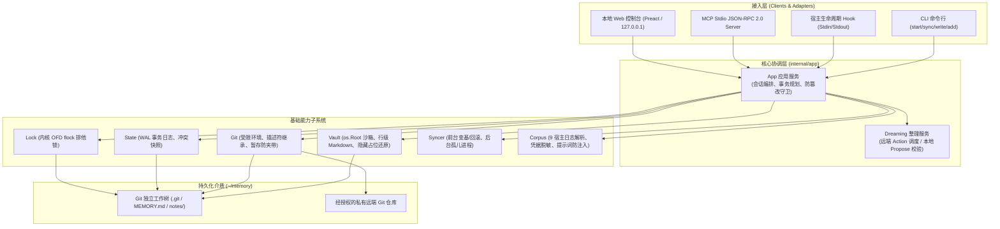
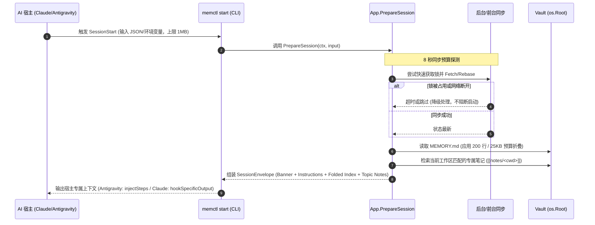
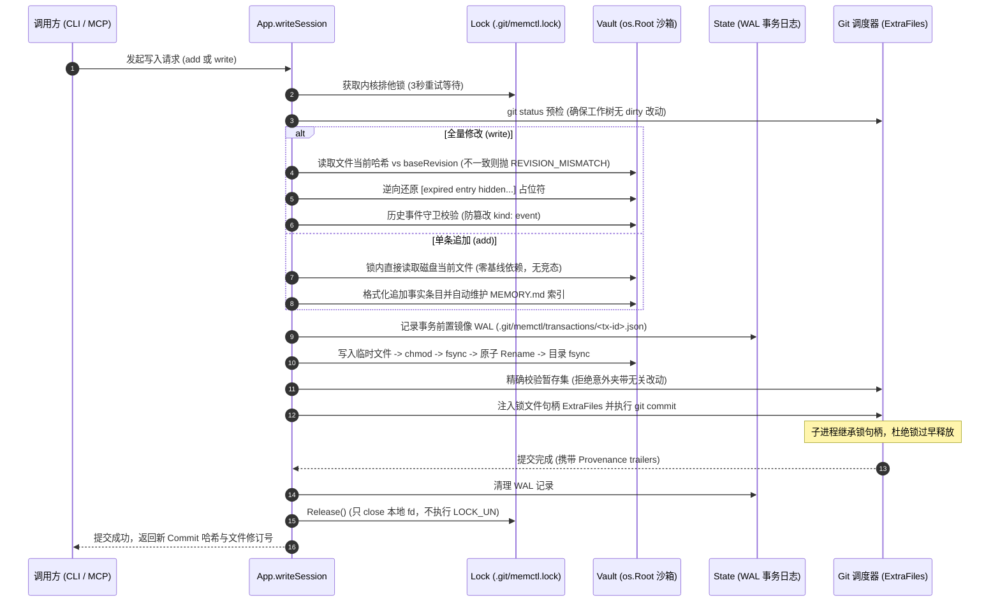
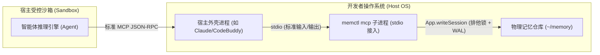
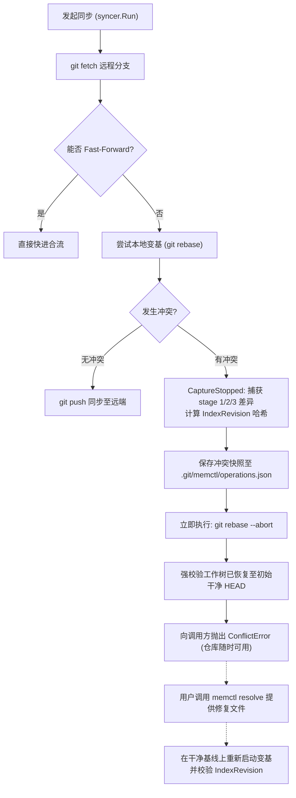
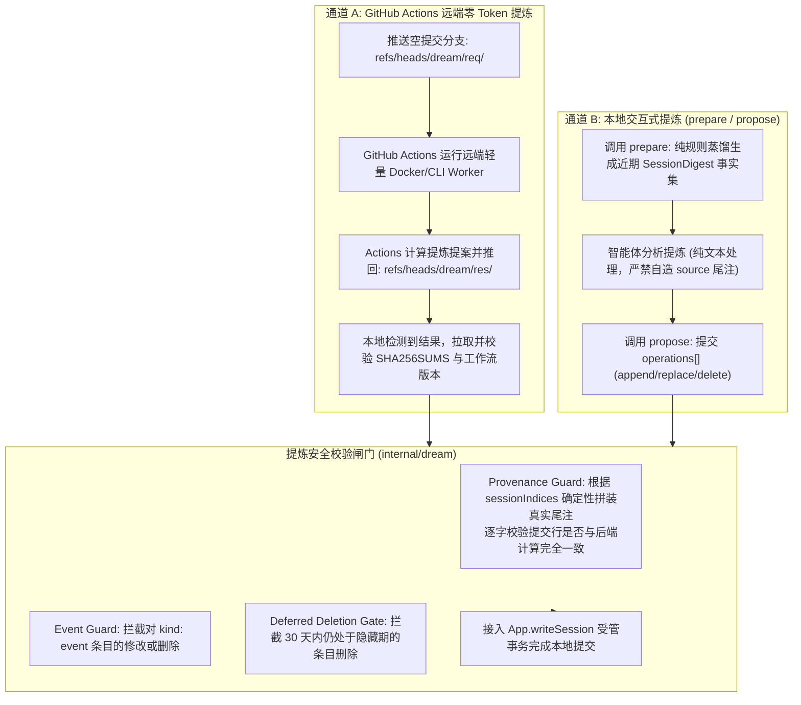
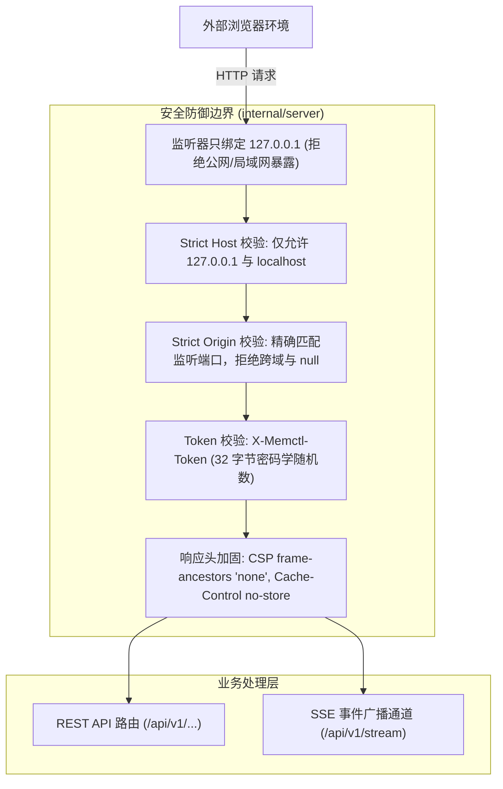

# memctl 系统架构与工作原理全景解析

> 导读：本文档系统阐述 `memctl` 的整体架构、核心概念、端到端运行时工作流与关键底层机制。权威契约与规范定义参见 [方案索引](README.md)。

## 1. 概述（Overview）

`memctl` 是专为现代 AI 编程智能体（Claude Code, Antigravity, Cursor, DSH, Pi, Codex, Delta 等）打造的**跨宿主、跨会话长期记忆中枢与本地运行时控制面**。它将记忆物理落盘于用户本地独立的 Git 仓库（默认位于 `~/memory`），向上暴露统一的 CLI 命令、生命周期 Hook 适配器、标准 MCP（Model Context Protocol）服务以及基于 Preact 的轻量内嵌 Web 控制台。其核心价值在于：打破不同 AI 宿主各自为政的专有上下文孤岛，解决记忆随工作区销毁、云端厂商锁定以及多智能体并发读写导致的数据覆盖与竞态冲突。

系统的工程哲学在于**「用操作系统与版本控制的底层确定性原语，约束 LLM 交互的不可靠性与并发冲突」**。`memctl` 并不依赖重型外部数据库或常驻后台守护服务，而是依托 Go 1.24 原生安全目录句柄（`os.Root`）防止路径穿越逃逸，借助内核 Open File Description（OFD）排他锁及描述符继承消除并发与进程崩溃竞态，通过 WAL（Write-Ahead Log）与内容哈希乐观并发控制构建 ACID 受管写入事务，辅以代码级只读历史事件保护（`kind: event`）、零模型消耗的多宿主会话蒸馏器以及具备立即可逆保证的三方变基冲突管理，为多智能体环境提供具备高确定性与可审计性的工程基石。

---

## 2. 核心概念（Key Concepts）

- **独立 Git 记忆仓库（Independent Git Memory Repository: `~/memory`）**  
  物理独立于各业务工程工作区的专用私有 Git 仓库。具备完整版本溯源、差异审计与双向网络同步能力，被辅助工程代码的分支切换、回滚或重置绝不污染持久化记忆。
- **受管写入事务与预写日志（Managed Write Transaction & WAL: [`writeSession`](../internal/app/mutation.go), [`Transaction`](../internal/state/state.go)）**  
  串行化受管写入事务。修改落盘前，在 `.git/memctl/transactions/<tx-id>.json` 记录所有受影响文件的前置镜像（WAL）；随后经历临时文件写入、权限校验、fsync、原子 rename，再由 Git 精确暂存提交。若中途崩溃，可在重启时执行确定性回滚或向前重放。
- **修订号与基线校验（Revision & Base Verification: `fileRevision`, `RepoRevision`, `REVISION_MISMATCH`）**  
  针对全量修改（`write`）的乐观并发版本校验机制。`fileRevision` 基于文件当前内容的 SHA-256 哈希派生；写入时必须携带读取时获取的基线修订号，若锁内检测到底层文件已变更，则立即抛出 `REVISION_MISMATCH`，强制调用方重新拉取合并。
- **行级无损 Markdown 解析器（Line-Level Markdown Parser: [`ParsedFile`](../internal/vault/parse.go), [`MemoryEntry`](../internal/vault/parse.go)）**  
  物理行级无损解析器。在严格保护原始文件换行符、空行、代码块边界与标题层级的前提下，结构化提取 `- ` 事实条目、多行缩进详情块（`DetailLines`）以及尾部元数据（`[source: ...; added: ...; until: ...; kind: ...; status: ...]`），并在同事务内保证 `MEMORY.md ## Index` 的 Wiki-Link 索引幂等一致。
- **内核文件描述锁与描述符继承（Kernel Open File Description Lock: [`Lock`](../internal/lock/lock.go) & Descriptor Inheritance）**  
  基于 `.git/memctl.lock` 的内核级仓库排他锁。在 Unix 下采用 `flock`、Windows 下采用 `LockFileEx` 绑定 open file description；利用 `cmd.ExtraFiles` 将文件描述符透传给 Git 子进程，父进程退出或崩溃时锁依然随子进程生存，避免提早释放引发仓库损坏。
- **溯源与事件守卫（Provenance & Event Guards: `agent://...`, `kind: event`, 30-day deferred deletion）**  
  不可伪造的事实证据链与代码级保护。所有事实条目绑定来源标记（`agent://<device>/<agent>/<sid>`）；标记为 `kind: event` 的历史决策受防篡改守卫（`EVENT_PROTECTED`）保护；过期条目（`until: YYYY-MM-DD`）在读取时转换为 `[expired entry hidden...]` 占位符并在 30 天宽限期内延迟物理删除（`DELETION_DEFERRED`）。
- **确定性会话蒸馏（Deterministic Corpus Distillation: [`Collector`](../internal/corpus/collect.go), `SessionDigest`）**  
  纯规则驱动、零模型调用的会话日志蒸馏引擎。原生适配 9 类宿主日志格式，自动滤除系统级注入指令、截断冗长代码与工具输出、掩码敏感凭据与 API Key，并在 4 秒预算内对 Delta 等流式日志做硬截断保护。
- **双通道记忆整理（Dual Dreaming Pipelines: [`Service`](../internal/dream/service.go)）**  
  记忆提炼与深度整理的双通道架构。包含**远端零 Token 通道**（通过专用 Git ref 协议 `refs/heads/dream/req/...` 与 GitHub Actions 驱动无状态 worker，本地无需常驻 LLM 资源）与**本地交互式通道**（提供 `prepare`/`propose` 标准接口，严密校验 Provenance 归属，支持安全原子操作集 `operations[]`）。

---

## 3. 工作流程与运行机制（How It Works）

### 3.1 整体分层架构与通道映射

`memctl` 采用清晰的分层解耦设计，所有访问通道（CLI、宿主 Hook、MCP 服务、Web UI）最终汇聚于单一的应用层核心 [`App`](../internal/app/app.go)，确保所有变更均受同一套互斥锁与事务机制管辖。

- **通道一致性**：无论 Agent 是在宿主沙箱内通过 MCP 工具（如 `memory_append`）写入，还是人类在终端通过 `memctl add` 写入，均调用 [`App.AppendEntry`](../internal/app/mutation.go) 逻辑，执行完全一致的校验与落盘步骤。
- **边界清晰**：解析器、Git 引擎和文件写入器不自行申请全局锁，锁的生命周期严格由 [`App`](../internal/app/app.go) 的会话层集中管控。

---

### 3.2 生命周期启动与上下文注入

当智能体启动会话时，宿主（如 Claude Code 或 Antigravity）通过配置好的 Hook 触发 `memctl start`。该流程在严苛的时间预算内完成同步探测与上下文组装。

1. **输入防御与解析**：[`hookio.ReadInput`](../internal/hookio/hookio.go) 从 `os.Stdin` 读取输入，实施硬性 1MB 截断防御，提取会话 ID、当前工作区 `cwd` 及设备标签。
2. **8 秒无阻塞同步探测**：启动流程绝不因为断网或锁等待而无限期卡死 Agent。`memctl` 分配 8 秒快速同步预算；若锁被占用或网络无响应，立即跳过网络同步，直接回退读取本地既有记忆。
3. **上下文动态折叠**：[`app.buildSessionBody`](../internal/app/session.go) 加载全局索引 `MEMORY.md`，执行 200 行 / 25KB 阈值折叠；提取匹配当前工作目录的专属笔记（如 `notes/<project>.md`），合并状态横幅与防御性 Instructions。
4. **宿主多态输出**：对 Antigravity 编码为 `injectSteps` 引导结构，对 Claude Code 编码为 `hookSpecificOutput` 结构，实现免感知的精准记忆注入。

---

### 3.3 受管写入事务与锁继承闭环

`memctl` 提供了两套写入原语：针对单条事实追加的**零基线新增**（`add` / `memory_append`）与针对文件内容重排的**基线校验修改**（`write` / `memory_write`）。

- **零基线并发设计**：`add` 无需调用方提供旧版本号，在排他锁保护下直接对最新物理文件追加，并同事务更新 `MEMORY.md` 索引，天然避免了多智能体并发添加事实时的合并冲突。
- **原子替换与文件系统硬化**：所有写入经由 Go 1.24 [`vault.Root`](../internal/vault/read.go) 安全沙箱，严格阻断相对路径中的 `.`、`..` 及符号链接逃逸；写入采用同一目录下的临时文件，配合文件与父目录的双重 `fsync`，保证断电不破坏磁盘原有文件。
- **锁描述符继承（Descriptor Inheritance）**：在调用 Git 提交前，通过 [`git.WithInheritedFile`](../internal/git/inherit.go) 将持有锁的 `*os.File` 句柄放入 Context，并在启动 Git 子进程时追加至 `cmd.ExtraFiles`。即便父进程在此刻被 SIGKILL 强杀，操作系统内核也会因子进程持有该 OFD 句柄而维系锁状态，直到 Git 子进程完全退场。

---

### 3.4 宿主集成与 MCP 沙箱穿越

许多现代 AI 宿主将 Agent 运行在严密的代码执行沙箱（Sandbox/Container）内，Agent 的 Shell 无法直接访问宿主操作系统的 `~/memory` 路径。`memctl` 通过 MCP 服务构建了安全的穿透通道。

- **stdio JSON-RPC 服务**：宿主以外部进程方式启动 `memctl mcp --agent <name>`，通过标准输入输出交互，提供 6 项标准工具：`memory_entries`、`memory_read`、`memory_append`、`memory_write`、`memory_dream_prepare`、`memory_dream_propose`。
- **免审提示注解（`readOnlyHint`）**：在 [`internal/mcp/tools.go`](../internal/mcp/tools.go) 中，只读工具显式声明 `readOnlyHint: &true`，引导宿主界面免去用户繁琐的手动弹窗确认；写操作工具则明确省略该提示，确保宿主的安全审查边界清晰。
- **AST 字符偏移无损配置合并**：在执行 `memctl install <host>` 时，[`adapters.mergeJSONContent`](../internal/adapters/mergejson.go) 使用自研词法分析器，按字符偏移范围进行外科手术式替换。与传统的 `json.Unmarshal/Marshal` 不同，该方式**百分之百保留宿主配置文件（如 `settings.json`、JSONC）中用户的原始注释、排版、未定义键与缩进风格**。

---

### 3.5 Git 同步与立即可逆冲突解决

`memctl` 的 Git 同步子系统不仅支持前台同步，还支持通过 Unix `Setsid: true` 或 Windows `DETACHED_PROCESS` 派生完全脱离父进程的后台非阻塞同步。其冲突处理策略坚持**「立即可逆（Immediate Abort）」**原则。

- **为什么绝不就地停顿在冲突状态**：如果在变基冲突时停留在 Git 中断状态（`.git/rebase-apply` 或 conflict markers），工作树就会变为脏状态，导致后续所有 Agent 无法执行只读查询、并发写入全部报错崩溃。
- **现场完整捕获与回滚**：`memctl` 在冲突发生瞬间，立即通过 Git 索引提取 base (stage 1)、ours (stage 2)、theirs (stage 3) 的文件快照，生成唯一 `IndexRevision`，随后**立即调用 `git rebase --abort` 恢复原始现场**。仓库得以时刻保持整洁和只读可用，待开发者或专属 Agent 执行 `memctl resolve` 时再进行可验证的恢复合流。
- **Git 环境变量沙箱**：[`git.SyncEnv`](../internal/git/env.go) 严格过滤执行环境变量，仅放行 `PATH`、`SSH_AUTH_SOCK` 等基础白名单项，彻底剥离可能泄漏给外部 Hook 的 LLM API Key、密码与危险 Git 配置。

---

### 3.6 两套记忆整理（Dreaming）与安全守卫

长期积累的碎片化记忆需要被抽象、去重并归档为专题笔记。`memctl` 提供了远端 Actions 与本地交互式两套提炼体系。

- **远端 Git Ref 协议**：开发者无需在本地承担提炼的高额上下文 Token 开销。`memctl dream --init-workflow` 生成 GitHub Actions 工作流，客户端只需通过 Git 推送专用请求引用即可触发云端处理，两端通信完全依赖 Git 协议，不暴露任何私有 HTTP 端口。
- **Provenance 强校验守卫**：在本地 `propose` 流程中，Agent 仅允许提交蒸馏后的事实文本与会话索引号（`sessionIndices`），**严禁自填 `[source: ...]` 尾注**。后端 Go 代码根据权威的真实会话摘要，确定性拼装时间戳与 `agent://` 标识，并要求组装后的完整行在 Agent 提交的文件内容中逐字存在。
- **30 天延迟删除闸门**：当某条记忆被标记为过期（`until`）时，系统并不立即将其从物理磁盘抹除，而是转换并在 30 天内拦截物理删除，防止 LLM 在幻觉状态下误删珍贵经验。

---

### 3.7 本地 Web 控制台与浏览器安全边界

当运行 `memctl ui` 时，系统在本地拉起 Preact Web 界面。由于该界面具有读写本地记忆仓库的高级权限，系统设计了严密的浏览器沙箱防御体系。

1. **会话令牌隔离（Session Token）**：服务启动时动态生成 32 字节高熵随机 Token，该 Token 绝不持久化到磁盘，仅通过 `index.html` 的 `<meta name="memctl-token">` 标签直接注入前端内存。所有后续 API 请求及 SSE 连接均需携带 `X-Memctl-Token` 请求头，URL 和日志中绝不暴露 Token。
2. **阻断恶意跨站请求（CSRF / DNS Rebinding）**：中间件强制校验 `Host` 头是否严格匹配实际监听的回环地址，杜绝利用本地 DNS 重绑定发起的攻击；强制比对 `Origin` 头，直接拒绝来自其他网页端口或 `null` 来源的请求。
3. **SSE 只做失效通知（Invalidation Broadcast）**：前端建立的 SSE 长连接仅用于接收仓库变更通知（如文件失效路径或全量重同步信号 `resync.required`），**绝不直接经由 SSE 推送事实数据**。前端收到广播后重新通过安全 API 拉取最新快照，彻底消除了连接闪断可能引发的状态不一致。

---

## 4. 目录与模块分布（Where Things Live）

| 模块 / 路径 | 核心类型与入口 | 架构职能与关键实现 |
| :--- | :--- | :--- |
| [`internal/app`](../internal/app/) | [`App`](../internal/app/app.go), [`writeSession`](../internal/app/mutation.go) | 应用层核心。主导会话编排、排他锁申请、WAL 事务生命周期、防篡改守卫比对与写入协调。 |
| [`internal/vault`](../internal/vault/) | [`Root`](../internal/vault/read.go), [`ParsedFile`](../internal/vault/parse.go) | 基于 Go 1.24 `os.Root` 的安全目录访问器。实现行级无损 Markdown 解析、`DetailLines` 提取与占位符还原。 |
| [`internal/lock`](../internal/lock/) | [`Lock`](../internal/lock/lock.go), `Acquire` | 仓库级互斥锁。跨平台封装内核 OFD `flock` / `LockFileEx`，支持重试轮询与文件句柄继承传递。 |
| [`internal/state`](../internal/state/) | [`Store`](../internal/state/state.go), [`Transaction`](../internal/state/state.go) | 运行时状态持久化。管理 `.git/memctl/` 下的 WAL 事务记录、冲突恢复快照（`Conflict`）及运行中操作。 |
| [`internal/git`](../internal/git/) | `Inspect`, `WithInheritedFile` | 受限 Git 调度执行器。强制 `GIT_LITERAL_PATHSPECS=1`，执行环境白名单过滤，实现子进程句柄继承。 |
| [`internal/syncer`](../internal/syncer/) | `Run`, `Spawn`, `CaptureStopped` | Git 同步引擎。前台变基/快进合流，跨平台非阻塞后台脱机孤儿进程派生，三方冲突捕获与立即可逆中止。 |
| [`internal/mcp`](../internal/mcp/) | [`Server`](../internal/mcp/server.go), `Serve` | 标准 Stdio JSON-RPC 2.0 服务端。向沙箱内 Agent 暴露 6 项核心记忆工具，处理免审提示注解。 |
| [`internal/hookio`](../internal/hookio/) | `ReadInput`, `ResolveSIDWithOrigin` | 宿主生命周期 Hook 编解码。执行 1MB 截断防爆，裁决会话标识来源（`host-flag` / `env` / `model`）。 |
| [`internal/adapters`](../internal/adapters/) | `Registry`, [`mergeJSONContent`](../internal/adapters/mergejson.go) | 宿主安装适配器。使用字符偏移词法分析器定点合并配置，完整保护用户原文件中的注释与格式。 |
| [`internal/corpus`](../internal/corpus/) | [`Collector`](../internal/corpus/collect.go), `CollectDelta` | 零模型会话提炼器。纯规则统一解析 9 类宿主日志，掩码凭据、消除系统注入、超时硬截断保护。 |
| [`internal/dream`](../internal/dream/) | [`Service`](../internal/dream/service.go), `Prepare`, `Propose` | 记忆整理核心。管控 GitHub Actions 远端 Git Ref 协议、本地 Propose 提案校验、来源绑定守卫与延迟删除闸门。 |
| [`internal/server`](../internal/server/) | [`Server`](../internal/server/server.go), `SetupRouter` | 本地 Web 控制台 HTTP 运行时。实现 127.0.0.1 绑定、随机 Token 注入与鉴权、Strict Host/Origin 防护与 SSE 广播。 |
| [`web`](../web/) | `DistFS` | 前端资产内嵌。基于 Go `embed` 打包预编译的 Preact、Tailwind 静态资产，实现单一二进制交付。 |

---

## 5. 设计细节与陷阱剖析（Gotchas）

1. **为什么用 `flock` 且 `Release()` 故意不调用 `unix.Flock(..., LOCK_UN)`？**  
   在 Unix 系统中，`flock` 创建的锁关联在内核的**打开文件描述（Open File Description, OFD）**上，而非单个进程的 `fd` 索引号。`memctl` 在执行 Git 提交时，将打开的锁文件句柄通过 `cmd.ExtraFiles` 传给 Git 子进程继承。若父进程在释放锁时显式发出 `LOCK_UN` 系统调用，将立刻使该 OFD 上的锁在内核中被解除，导致仍持有该描述符并在后台运行的 Git 子进程瞬间失去互斥保护！因此，[`Lock.Release`](../internal/lock/lock.go) 内部仅调用 `file.Close()` 关闭本进程持有的描述符引用；只要 Git 子进程仍在运行，内核 OFD 引用计数不为 0，锁就会一直有效，彻底杜绝了并发破坏。
2. **为什么变基冲突时立即 `git rebase --abort` 而不是停留在冲突状态？**  
   传统 Git 交互中冲突会停留在现场等待人工修改并 `git rebase --continue`。但在 AI 自动化场景中，这会导致仓库进入中断且脏污的中间状态，阻塞其他所有只读查询和 Hook 介入。`memctl` 采取「立即可逆」策略：利用 [`syncer.CaptureStopped`](../internal/syncer/conflict.go) 读取 stage 1/2/3 生成快照后，**立即执行 abort 将 HEAD 和工作树无条件恢复原状**。仓库得以时刻保持整洁可读，后续合流以干净快照在独立会话中安全重放。
3. **为什么 `memctl add` 是零基线无冲突的，而 `memctl write` 必须校验 revision？**  
   `write` 是全量文件替换逻辑，若没有基线保护，两个并发 Agent 分别修改前段与后段内容时，后提交者会盲目抹杀先提交者的修改，因此必须校验 `fileRevision`（发生偏差则报 `REVISION_MISMATCH`）。而 `add` 是语义上的单条事实追加，在排他锁内它直接读取磁盘当前文件最新状态完成行追加，并幂等更新索引，操作具备数学上的可交换性与增量原子性，因此不需要依赖读取基线。
4. **为什么严禁外部未提交变动（`EXTERNAL_CHANGES`）？**  
   受管写入要求每一次 Git Commit 必须能精准归因于特定的 Agent 会话与上下文 Provenance。如果工作树内残留用户手动未暂存、已暂存或未跟踪的代码，受管写入在提交时极易意外将这些文件夹带进提交，破坏审查审计链；且脏工作树会阻断后续的自动变基。因此，系统一旦检测到脏文件立即拒绝受管写入并提示用户通过 `memctl sync --capture` 显式归档。
5. **为什么本地 Dreaming 严禁 Agent 自己写 `source` 尾注？**  
   LLM 具有不可控的幻觉与投毒风险。如果允许 Agent 在提交提炼候选事实时自行拼接 `[source: agent://...]`，恶意或受提示词注入攻击的 Agent 便可伪造事实出自高信任级别的管理员或核心设备。为此，[`dream.Service`](../internal/dream/service.go) 设立了严格的 Provenance Guard：Agent 只能提供提炼纯文本与会话序号索引，权威尾注由 Go 原生代码从真实的密码学摘要中确定性组装，任何带自造尾注的提交均被代码级直接拒绝。
6. **为什么配置更新采用字符偏移量词法分析而不是 `json.Unmarshal`/`Marshal`？**  
   用户的宿主配置文件（如 `~/.claude/settings.json`、CodeBuddy 配置等）往往包含大量手写注释、特定缩进（2 空格或 4 空格）以及未在 Go 结构体中建模的私有字段。使用标准的 `Unmarshal`/`Marshal` 会导致**所有注释被清除、字段重新排序、缩进全部重置**，极易引发开发者反感甚至破坏其他插件配置。`memctl` 自研词法状态机按字符切片定点插入，做到真正的零副作用与无损更新。
7. **为什么 Delta 采集截断时直接丢弃整段而不部分缓存？**  
   Delta 宿主的会话流通过 `delta thread watch --json` 子进程流式消费。若由于进程超时或超出最大字节阈值被截断，未能读到 `live` 终点标记，若将前段内容持久化为缓存摘要，系统在下次提炼回填（Backfill）时就会误判该会话「已被完整采集」并永远跳过它，导致后半段的关键决策永久丢失。因此，未完整到达终点的流直接全额丢弃，确保下次触发时可以重新发起完整收集。
